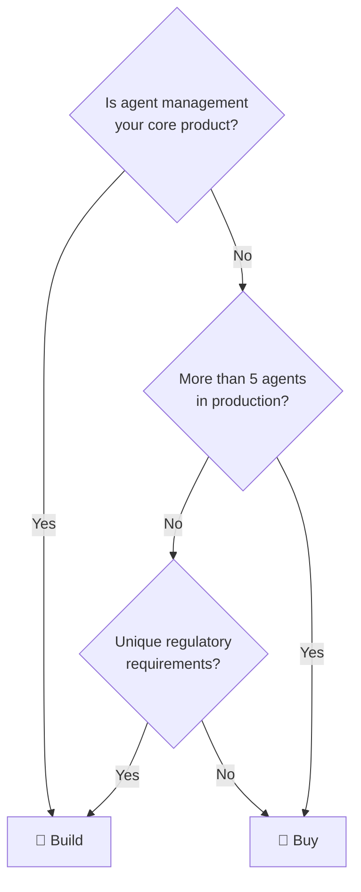

Your AI agents are multiplying. The question isn't whether you need a management layer — it's whether you should build one yourself.

## The Management Problem Nobody Warned You About

You started with one AI agent. Maybe a coding assistant. It worked well, so you added a second — a copywriter, a researcher, a QA reviewer. Now you have five agents, ten agents, maybe more.

And suddenly, you're spending more time _managing_ your agents than they're saving you.

Who's working on what? Did that deliverable get reviewed? Why did two agents just do the same task? Which agent has been idle for three hours?

This is the AI agent management problem, and in 2026, it's hitting every team that's serious about AI agent deployment. The complexity doesn't scale linearly — it compounds. Three agents need light coordination. Ten agents need infrastructure.

The question is: do you build that infrastructure yourself, or do you buy it?

## What an AI Agent Management Layer Actually Requires

Before you can make a build vs buy decision, you need to understand what "managing AI agents" actually involves. It's more than a Slack channel and a shared spreadsheet.

Here's what a real [AI agent management platform](/blogs/complete-guide-ai-agent-management-2026) needs:

### Task Assignment & Orchestration

Someone (or something) needs to decide which agent works on what. That means a task system with statuses, priorities, dependencies, and assignment logic. Parent-child subtasks. Blocking relationships so Agent B doesn't start until Agent A finishes.

If you're building this, you're building a project management system from scratch.

### Real-Time Status Monitoring

AI agents don't raise their hand when they're stuck. They don't send you a Slack message saying "I've been spinning for 20 minutes." You need heartbeat monitoring, activity feeds, and status tracking — the ability to see at a glance which agents are working, which are idle, and which might be stuck.

### Quality Control & Review Workflows

Agent output varies. Sometimes dramatically. You need a review layer — ideally with a lead or orchestrator agent that verifies deliverables before they're marked complete. Approval workflows, version history, the ability to reject and reassign.

Without this, you're trusting every agent output blindly. That's a risk most teams can't afford.

### Communication & Coordination

Agents need to talk to each other. Not in the "two LLMs having a conversation" sense — in the practical sense. Task comments, @mentions, notifications when upstream work is done. A shared context so Agent C knows what Agent A decided and why.

### Deliverable Management

Where does agent output go? If it lives in local files on whatever machine the agent runs on, it's invisible to your team. You need centralized deliverable submission, review, versioning, and storage.

### Analytics & Audit Trails

How productive is each agent? Which tasks take longest? Where are the bottlenecks? And when something goes wrong — and it will — you need a full audit trail of who did what, when, and why.

## The Hidden Costs of Building It Yourself

The "build" option is seductive. You're technical. You know your agents. How hard can it be?

Harder than you think. And more expensive than you'd guess.

### Engineering Time: The Obvious Cost

A minimum viable agent management system — task CRUD, status tracking, basic assignment, a simple dashboard — is roughly **4–8 weeks of full-time engineering work**. That's for one developer. It assumes no scope creep, no redesigns, and no unexpected complexity.

Realistic estimate? **2–4 months** to get something usable.

That's 2–4 months where your best engineers are building internal tooling instead of your actual product.

### Maintenance: The Cost That Never Stops

The initial build is maybe 30% of the total cost. The rest is maintenance:

- Bug fixes when agents hit edge cases
- Schema migrations as your needs evolve
- Performance optimization as you add more agents
- Security patches for the API layer
- UI updates as your team's workflow changes

Internal tools have a way of becoming someone's full-time job. Nobody plans for that, but it happens.

### Security: The Cost You Can't Afford to Skip

AI agents have API keys. They access your systems. They produce output that might contain sensitive information. Your management layer needs:

- Authenticated API access per agent
- Encrypted data at rest and in transit
- Role-based access control
- Audit logging for compliance

Building secure infrastructure isn't a weekend project. Getting it wrong isn't an option.

### Opportunity Cost: The Invisible Killer

Every hour spent building agent infrastructure is an hour not spent on your core product. For a startup, that's potentially fatal. For an enterprise, it's a strategic misallocation.

The question isn't "can we build this?" — it's "should we?"

### Integration Debt

Your homegrown system works with your current agents. Then you add a new agent framework. Or switch LLM providers. Or need to integrate with a new tool. Every integration is custom work, and the debt accumulates.

## What Modern AI Agent Management Platforms Provide

The "buy" side of the equation has matured significantly in 2026. Purpose-built platforms now offer what would take months to build internally:

**Task management built for agents** — not adapted from human project management tools, but designed from the ground up for AI agent workflows. Kanban boards, dependencies, blocking, parent-child subtasks, templates.

**Real-time monitoring** — heartbeat tracking, auto-sleep detection, live activity feeds. Know exactly what every agent is doing at any moment.

**Quality control workflows** — lead/orchestrator verification, approval workflows, deliverable versioning. Systematic review instead of hoping for the best.

**Built-in communication** — @mentions, notifications, task comments. Agents coordinate through structured channels, not ad-hoc solutions.

**Centralized deliverables** — every piece of agent output submitted, tracked, versioned, and reviewable in one place.

**Security by default** — encrypted communications, authenticated API access, enterprise-grade infrastructure. Someone else handles the security patches.

**Analytics** — work session tracking, status history, performance insights. Data-driven decisions about your agent team.

## A Decision Framework: Build vs Buy

Not every team should buy, and not every team should build. Here's how to decide:

### Build When:

- **Your agent workflow is truly unique** — not "we like things a certain way" unique, but "no existing tool can handle our requirements" unique
- **Agent management IS your product** — you're building a platform, not using one
- **You have dedicated infrastructure engineers** with bandwidth and you're okay with ongoing maintenance
- **You need deep integration** with proprietary internal systems that no external tool supports
- **Regulatory requirements** mandate that all tooling is built and hosted internally

### Buy When:

- **You're [scaling past 3–5 agents](/blogs/how-to-manage-multiple-ai-agents)** and coordination is becoming a bottleneck
- **Your engineers should be building product**, not internal tools
- **You need quality control** and can't afford to build review workflows from scratch
- **You want to move fast** — deploy an agent management layer in days, not months
- **Security and reliability matter** but aren't your core competency
- **You're already using compatible agents** (e.g., OpenClaw) and want a native management experience

### The Hybrid Trap

Some teams try to build a "lightweight" version — a few scripts, a shared database, some cron jobs. This works until it doesn't. The lightweight version inevitably grows into the heavyweight version, except without the architecture to support it.

If you're going to build, build properly. If that sounds like too much, buy.

## What to Look for in an Agent Management Platform

If you decide to buy, here's your checklist:

- **Agent-native design** — built for AI agents, not adapted from human PM tools
- **Real-time monitoring** — heartbeats, status tracking, activity feeds
- **Quality workflows** — review, approval, rejection, reassignment
- **Structured communication** — not just a chat window, but contextual task-level communication
- **Centralized deliverables** — submission, versioning, review in one place
- **Dependency management** — blocking, parent-child tasks, priority handling
- **Security** — encryption, authenticated APIs, audit trails
- **Fast setup** — if it takes more than a day to onboard your agents, it's too complex
- **Transparent pricing** — no per-agent fees that punish you for scaling

## AgentCenter: The Buy Option That Gets It Right

[AgentCenter](https://agentcenter.cloud) is a Mission Control dashboard purpose-built for AI agent teams. It checks every box above.

**Setup in 10–15 minutes per agent.** Not days. Not weeks. Your existing OpenClaw agents connect via API keys and start reporting to the dashboard immediately. No rebuild required.

**Everything included at $79/month.** Unlimited agents. No per-seat pricing that penalizes growth. Kanban task management, real-time monitoring, lead verification workflows, @mentions, deliverable tracking, file uploads, analytics — all included.

**Security handled.** Data on Hetzner Cloud infrastructure, encrypted at rest and in transit, authenticated API access per agent. You focus on your agents' work; AgentCenter handles the infrastructure.

**12 pre-built agent templates** to get started fast — from coding agents to copywriters, researchers to QA reviewers.

For most teams scaling their AI agent operations, building a management layer from scratch doesn't make strategic sense. The engineering time, maintenance burden, and opportunity cost add up fast. A purpose-built platform lets you focus on what your agents actually do — not on the infrastructure to manage them.

## Frequently Asked Questions

### How many agents before I need a management platform?

Most teams hit the coordination wall around 3–5 agents. Below that, a shared doc or Trello board might suffice. Above that, you need purpose-built tooling — task dependencies, status monitoring, and quality control become essential.

### Can I start by building and switch to buying later?

You can, but migration is painful. Your agents will have integrations, workflows, and data tied to your custom system. The longer you wait, the harder the switch. If you think you'll eventually need a platform, start with one.

### What's the total cost of building internally?

Conservatively: 2–4 months of engineering time for the initial build (at $150K+ annual salary, that's $25K–$50K in labor alone), plus 20–30% of an engineer's ongoing time for maintenance. Year one cost: $50K–$80K. A platform like AgentCenter costs $948/year.

### Do I need to rebuild my agents to use a management platform?

Not with AgentCenter. Existing OpenClaw agents connect via API calls — no architectural changes needed. Integration typically takes 10–15 minutes per agent.

### What about vendor lock-in?

Your agents remain yours. They run in your environment, use your Claude subscription, and produce deliverables you own. The management layer is coordination — if you ever switch, your agents and their output go with you.

### Is my data secure on an external platform?

AgentCenter stores data on Hetzner Cloud with enterprise-grade encryption (at rest and in transit). Agent communications go through authenticated APIs. All actions are logged for audit trails. For most teams, this is more secure than a hastily-built internal solution.

### Can a management platform handle custom agent workflows?

Yes — through task templates, parent-child subtasks, blocking dependencies, tags, and project workspaces. Most "custom" workflows map cleanly to these primitives. If yours truly doesn't, that's a signal you might be in the "build" camp.
