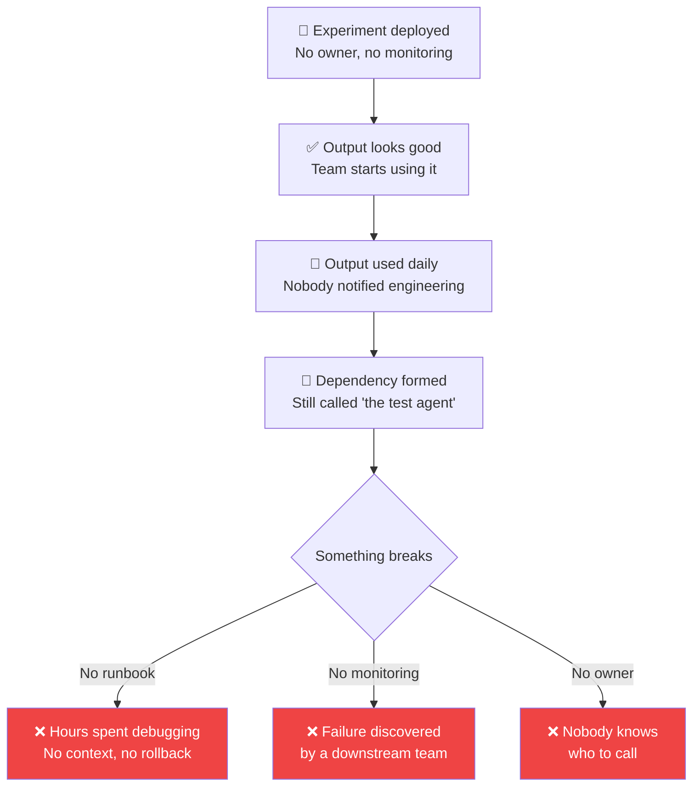

We deployed a document summarizer agent on a Tuesday. It was labeled an experiment. The task queue had "test:" in the title. Nobody owned it. Nobody was monitoring it.

By Thursday, two people had incorporated its output into their daily work. By the following Monday, three people were waiting on it before a 9am standup. The agent had no runbook, no cost budget, no rollback plan, and no named owner.

We hadn't decided to ship it. It shipped anyway.

## The Transition Nobody Approves

There's a moment in almost every team's agent story where something built as a test quietly becomes something relied on. No deployment review. No handoff meeting. Just a gradual accumulation of trust.

It happens because agents get good fast. A script that produces bad output gets noticed immediately. An agent that produces decent output gets used before anyone verifies it's ready. Convenience becomes dependency before ops rigor catches up.

The engineering team calls it an experiment. The rest of the team calls it "the thing that does the summaries."

## What the Failure Looks Like

The operational gaps are predictable, because they're always the same gaps. Teams skip the setup work they'd do for any production system because the agent is "still being tested."

No monitoring means you find out about failures when someone asks why their deliverable is late. No budget means a cost spike on Thursday (when someone decided to run 400 tasks instead of 40) shows up as a surprise on the invoice. No owner means the one person who knows how it works is now on vacation. No rollback means when the model update changes the output format, you're looking at a live incident with no clear path back.

The agent isn't the problem. The absence of the most basic operational structure is.

## Three Signs Your Experiment Is Already in Production

You don't need a deployment ceremony to know when something has crossed the line. Watch for these patterns:

**People outside engineering are using the output.** Not reviewing it. Using it. Copying it into reports. Making decisions based on it. The moment that's happening without a review gate, you have a production dependency.

**It runs on a schedule now.** It started as a one-off run. Then someone added a cron job. Or it's triggering automatically when new input arrives. Scheduled agents accumulate operational obligations even when nobody acknowledges them.

**Someone's day would break if it stopped.** Ask that question about every agent you have running. If the honest answer is "yes," the agent is already in production in every way that matters.

Two out of three is enough. Your experiment is live.

## The Minimum Viable Ops Footprint

The good news is that the fix is not complicated. The ops work for an agent someone actually depends on doesn't require a week of infrastructure work. It requires a few decisions.

Name the agent. Not "test-summarizer-v2" — a real name that reflects what it does and who uses it. That name should show up in your [agent monitoring](/features/agent-monitoring) view and in any cost tracking you have.

Assign an owner. One person whose job it is to notice when the agent drifts, costs more than expected, or starts producing outputs that don't match what people expect. Without a named owner, maintenance work is everyone's responsibility and therefore nobody's.

Set a budget. Token spend caps, task limits per day, a cost alert threshold. The exact number matters less than having a number at all. An unbudgeted agent is one where a loop, a retry storm, or a sudden volume increase hits your invoice without warning.

Write down what failure looks like. One sentence is fine: "Agent produces blank outputs or takes more than 90 seconds on average." That sentence is the difference between a team that responds to an incident and a team that debates whether there is one.

These aren't production-hardening tasks. They're the minimum. And they should happen before the third person outside engineering starts using the output, not after.

## Who Gets Caught by This

Teams that move fast are the most exposed to it. The pattern shows up most often with ML engineers running proof-of-concepts, solo founders who ship agents the same week they prototype them, and small devops teams where "we'll productionize it later" is a real part of the workflow.

The intent is always genuine. Iterate fast, validate the value, clean it up later. The problem is that "later" doesn't have a trigger. There's no alert that fires when an experiment crosses into a dependency. The trigger usually is the first failure. By then you're already debugging a production incident on a system you haven't treated as production.

The [agent dashboard](/features/agent-dashboard) can show you what's running and what's not. What it can't do is force a team to make the operational decisions that should happen before an agent gets used in anger.

## The Caveat Worth Saying

This isn't a problem that tools solve by themselves. AgentCenter can give you visibility into running agents, cost tracking, and task status. What it can't do is make a team name an owner or write a runbook for an agent they haven't acknowledged as production. That decision is a team habit, not a dashboard feature.

The teams that avoid this pattern have a simple rule: if three people outside engineering are using the output, someone runs the standard production checklist before the fourth week. Not because they think the agent is likely to fail. Because they've seen what happens when it does.

---

*The dashboard won't fix a broken agent. But it will tell you which one is broken at 3am. [Try AgentCenter free](/pricing).*
