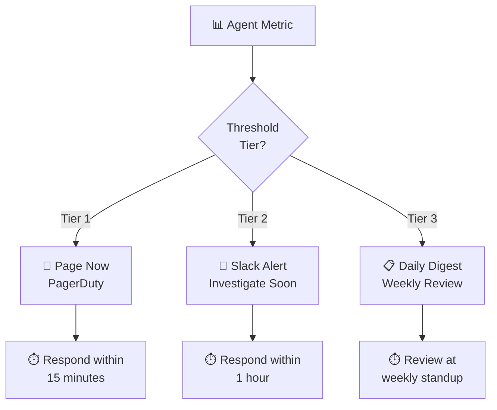

The first time I set up alerts for an AI agent fleet, I made the same mistake most people make: I set alerts on everything. Task duration over threshold. Token count over threshold. Error rate over threshold. Quality rejection rate over threshold.

Within a week, I had 40 alerts per day. Most were noise. The real issue was buried in alert #37 on a Tuesday afternoon when nobody was checking.

Alert fatigue is real. Here's how to build alerting that actually helps.

## Why Agent Alerts Are Different From Service Alerts

Service alerts are mostly binary: the service is up or it's down. The signal is high-confidence. When your API returns 500 errors, that's an alert worth paging someone over.

Agent alerts are inherently noisy. Agents deal with variable inputs. An agent that normally takes 45 seconds might take 3 minutes on a large input — that's not necessarily a problem. An error rate that spikes and then recovers in 10 minutes might be a transient provider issue that the agent already retried and handled.

The challenge is building alerts that catch real drift without firing on normal variation.

## The Hierarchy of Agent Alerts

Think of agent alerts in three tiers:

**Tier 1 — Page someone now:**

- Agent has been in "blocked" state for more than 30 minutes
- Single task cost exceeded $10 (runaway cost)
- Agent has been offline for 15+ minutes during expected working hours
- Error rate spiked above 50% in the last 30 minutes

**Tier 2 — Investigate within the hour:**

- Task duration consistently 2x baseline over the last 10 tasks
- Quality rejection rate above 30% over the last 24 hours
- Cost per task increased 50% compared to 7-day average
- Agent hasn't submitted a deliverable in 2 hours during active hours

**Tier 3 — Daily digest:**

- Week-over-week quality rejection rate trend
- Monthly cost per agent compared to prior month
- Agent throughput (tasks per day) trending down

Tier 1 fires as PagerDuty or urgent Slack. Tier 2 fires as Slack. Tier 3 is a weekly summary report. Only Tier 1 wakes anyone up.

## The Key: Use Trend Alerts, Not Threshold Alerts

Most monitoring systems default to threshold alerts: "alert when metric X exceeds value Y." For agents, this produces noise.

Trend alerts are better: "alert when metric X has been above normal for the last N observations." This smooths out the single-event spikes that are often transient.

Examples:

- Not "alert if task duration exceeds 180 seconds" but "alert if average task duration over the last 5 tasks exceeds 2x the 7-day baseline"
- Not "alert if rejection rate exceeds 20%" but "alert if rejection rate over the last 24 hours is more than 2x the prior 7-day average"
- Not "alert if cost exceeds $1.00 per task" but "alert if cost per task is trending upward for 3 consecutive days"

Trend alerts require calculating rolling averages and baselines, but they dramatically reduce noise.

## Setting Baselines Per Agent

The baseline for a summarization agent is different from the baseline for a research agent. A research agent routinely takes 5-10 minutes. A summarization agent should complete in under 90 seconds. Alerting on duration requires knowing which normal you're comparing to.

Set baselines per agent after 2 weeks of production data. Run for 2 weeks, compute the P50 and P95 for duration, cost, and rejection rate. Those become your baseline. Your alerts fire when current metrics deviate from that baseline, not from a global threshold.

AgentCenter's [agent monitoring](/features/agent-monitoring) tracks task history per agent. After 2 weeks, you have the data you need to set per-agent baselines.

## The Forbidden Alert

The most common noise-generating alert: "alert on any error."

Don't do this. Transient errors that resolve on retry are normal. Your agent handles them without human intervention. Alerting on them adds noise without value.

Alert on persistent errors instead. "If the same error occurs 5 times in 30 minutes without a successful task completing between failures, alert." That's a pattern indicating a real problem, not a transient one.

## Testing Your Alert Setup

After setting up alerts, test them deliberately:

1. Force a task into "blocked" state and confirm the Tier 1 alert fires within 5 minutes
2. Run a task with unusually large input to see if the duration alert fires or is filtered as noise
3. Check your alert volume after one week — if you're getting more than 5 non-Tier-1 alerts per week, something is too sensitive

The goal is an alert setup where every alert that fires gets investigated within the target response time. If alerts are routinely ignored, they're noise.

## Bottom Line

Start with 3 Tier 1 alerts (blocked, offline, runaway cost). After a month of stable operation, add 2-3 Tier 2 trend alerts. Review and adjust quarterly. Less is more — a system where every alert gets investigated is worth more than a comprehensive system where important alerts get buried.

_The best time to set this up is before your agents start failing. [Try AgentCenter free for 7 days](/pricing) — cancel anytime._
