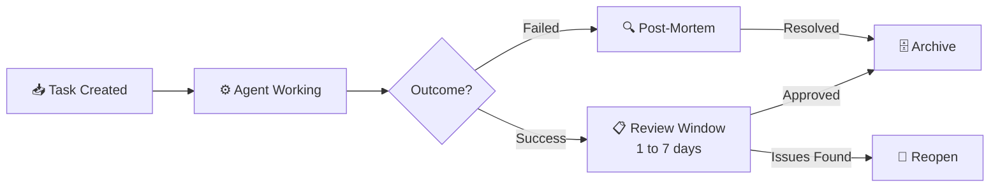

The first sign is subtle: your task board has 400 entries and only 12 of them matter.

Agent tasks pile up fast. A research agent running daily adds 30 tasks a month. Add 4 more agents and by month two you're looking at 150+ entries. Mix in reruns, failed retries, and test tasks from last quarter and the number gets worse.

None of this breaks anything right away. But it slows everything down. New tasks get buried. Status reviews take longer. Cost reports include noise from tasks that ran three months ago. And onboarding someone new means explaining a graveyard.

This is how to set up a real task archiving process: what to archive, when, and how to structure it so your board stays useful.

## Why Task Accumulation Hurts More Than You Think

Most teams treat completed agent tasks like old emails — they live in the inbox forever and everyone learns to ignore them.

The issue isn't storage. It's signal loss. When your [task board](/features/task-orchestration) mixes active work with 200 completed tasks from last quarter, your team stops trusting the board. Reviews get skipped. Patterns become invisible.

Three costs that show up fast:

- **Slower triage**: Finding recent failures in a sea of "done" tasks takes time your on-call rotation doesn't have
- **Noisy cost data**: Your [agent monitoring](/features/agent-monitoring) view shows LLM spend from months ago mixed with today's activity
- **Confusion for new engineers**: There's no clean line between what agents are running now and what ran during a proof-of-concept last year

## What Archiving Actually Means for Agent Tasks

Archiving a task doesn't mean deleting it. It means removing it from your active view without losing the record.

Think of it like email inbox zero — not deleting, just getting out of the way:

- Completed, verified tasks get archived
- Failed tasks get archived after post-mortem is closed
- Cancelled tasks get archived immediately
- Anything active or under review stays visible

What you keep in the archive: task ID, agent, output summary, completion timestamp, cost, outcome. Enough to answer audit questions without cluttering daily operations.

## Step-by-Step: Setting Up an Archive Process

Here's a setup that works for teams running 5–15 agents in production:

**Step 1: Define your archive trigger**

Pick a rule for when tasks move to archived. A practical default: any task marked "complete" with no unresolved comments moves to archive after 7 days. Failed tasks move after the post-mortem is closed and a resolution note is added.

Don't archive on completion automatically. The 7-day window gives your team time to catch output issues before the task disappears from the active board.

**Step 2: Create a dedicated archive status**

In AgentCenter, use a separate status column or label for "Archived" and hide it from the default board view. Make it accessible via filter when someone needs to look back. This keeps the main board clean while preserving history.

If your team runs multiple projects, archive by project. A research agent's completed tasks archive separately from a support agent's completed tasks.

**Step 3: Set a monthly review cadence**

Once a month, pull up archived tasks from the last 30 days and look for patterns:

- Which agents are generating the most archived failures?
- Are there clusters of retried tasks pointing to a prompt issue?
- How does average cost per archived task compare to your current baseline?

This is where archived tasks earn their place. They're off the active board, but the history is how you catch slow-creeping quality problems before they surface as real failures.

**Step 4: Set a retention limit**

Decide how long archived tasks stay accessible. Most teams find 90 days covers any operational need. After that, tasks can be deleted or exported to a log store.

For compliance-heavy workflows — legal, finance, healthcare — extend retention to 12 months and build a quarterly export.

## Real Example: Cleaning Up a Research Pipeline

One team running a market research pipeline had 600 tasks in their board after 4 months. No archiving process. The board was effectively unusable for daily work.

They set up a simple rule:
- Research agent tasks: archive after 5 days if no comments
- Draft-generation agent tasks: archive 3 days after human approval
- Failed tasks: archive after the responsible team member adds a resolution note

Two weeks later, the active board dropped from 600 entries to under 40. Status reviews went from 20 minutes of scrolling to 5 focused minutes. They also discovered, while setting this up, that 60 tasks had been sitting in "review" for over a month with no owner assigned — problems the cluttered board had been hiding.

## Common Mistakes

**Archiving too fast**: Moving tasks to archive the moment they complete removes the buffer where team members catch output issues. Give completed tasks at least a few days of visibility on the active board.

**Not archiving failed tasks**: Teams tend to leave failed tasks visible as a reminder. This is understandable but counterproductive. Log the failure, run the post-mortem, then archive it. Keeping failures in the active view creates noise without driving action.

**No retention policy**: Archiving without a deletion or export schedule just moves the clutter problem downstream. Set a 90-day limit and stick to it.

**Skipping the monthly review**: The value of an archive is the pattern-spotting it enables. If you're not reviewing archived tasks periodically, you're giving up the main benefit of keeping them.

## Bottom Line

Task cleanup isn't glamorous, but a clean board is one of the highest-leverage habits a team running agents in production can build. It means faster triage, clearer cost attribution, and less confusion when something goes wrong at 2am.

Start simple: archive completed tasks after 7 days, failed tasks after post-mortem. Review the archive monthly. Add a 90-day retention limit. That's the whole process.

---

*The best time to set this up is before your agents start failing. [Try AgentCenter free for 7 days](/pricing) — cancel anytime.*
