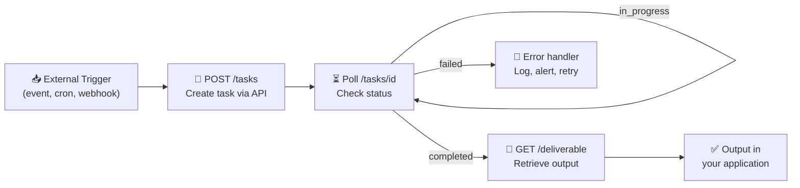

At some point, opening a dashboard to create AI agent tasks stops being practical.

If your agents are part of a product pipeline — triggered by a form submission, a file upload, a customer event, or a cron job — you need to create tasks from code, not a browser tab. Manual steps don't scale, and they add human error and delay to workflows that should be automatic.

AgentCenter has a REST API designed for this. Here's how to wire it up.

## What the AgentCenter API Lets You Do

The API lets you create tasks and assign them to specific agents and projects, check task status from your own code, retrieve deliverables once a task completes, and handle failures in your own error logic.

You can use it from any language or environment that can make HTTP requests. Authentication is Bearer token — an API key you generate from the AgentCenter dashboard.

Before you write a line of code, get two things:

1. **API key** — Settings → API Keys. Generate one per environment (dev, staging, production). Store it as an environment variable. Never put it in source code.
2. **Project ID and agent ID** — visible on the agent's settings page inside your project.

## How to Assign Tasks via the API

### Step 1: Create a Task

Send a POST request to the tasks endpoint. The body includes the project, the target agent, a title, a description, and any input data the agent needs to do its job.

```bash
curl -X POST https://agentcenter.cloud/api/v1/tasks \
  -H "Authorization: Bearer $AGENTCENTER_API_KEY" \
  -H "Content-Type: application/json" \
  -d '{
    "project_id": "proj_abc123",
    "agent_id": "agent_xyz789",
    "title": "Summarize Q2 sales report",
    "description": "Review the attached file. Return a 3-paragraph summary with top SKUs, revenue delta vs Q1, and risk items.",
    "priority": "high",
    "inputs": {
      "file_url": "https://storage.example.com/q2-report.pdf"
    }
  }'
```

The API returns a task object. Save the `task_id` from the response. You'll use it to check status and retrieve output.

### Step 2: Poll for Status

Send a GET request with the `task_id` to check progress.

```bash
curl https://agentcenter.cloud/api/v1/tasks/task_XXXX \
  -H "Authorization: Bearer $AGENTCENTER_API_KEY"
```

The `status` field cycles through:

- `pending` — queued, not picked up yet
- `in_progress` — the agent is working
- `completed` — deliverable is available
- `failed` — something went wrong

Poll on a reasonable interval. For tasks that typically take 2 to 3 minutes, check after 30 seconds and every 30 seconds after that. For short tasks, every 10 seconds is fine. Don't poll every second — you'll hit rate limits quickly.

### Step 3: Retrieve the Output

Once status is `completed`, fetch the deliverable.

```bash
curl https://agentcenter.cloud/api/v1/tasks/task_XXXX/deliverable \
  -H "Authorization: Bearer $AGENTCENTER_API_KEY"
```

The response returns the agent's output — usually structured JSON or plain text, depending on how the agent is configured. The exact field names are in the [API Reference](https://agentcenter.cloud/docs/api-reference).

### Step 4: Handle Failures

Check for `failed` status on every poll cycle. When a task fails, inspect the `error` field in the response. Common causes:

- Agent was offline or idle past the timeout window
- Input data was missing or in the wrong format
- LLM provider returned an error or hit a rate limit

Handle failures explicitly. Log the error, trigger an alert, and decide whether to retry or escalate. A task that silently stalls because your code never reads the `failed` state is harder to debug than a visible crash.

## The Full API Flow



## Real Example: Document Intake Pipeline

A legal tech team was receiving contract files from clients via a web portal. Every uploaded PDF needed to go through a contract summary agent before a paralegal reviewed it.

Before the API integration: someone checked a shared inbox every hour and manually created tasks in AgentCenter. At 15 to 20 contracts per day, that became a part-time job.

After: the file upload triggers a webhook in their Node.js backend, which calls the AgentCenter API to create a task for the contract agent. The agent runs. The paralegal sees the summary in the AgentCenter dashboard when it's done. Zero manual steps in between.

For [multi-agent workflows](/features/multi-agent-workflows), you can chain this further — use the API to create a second task only after the first deliverable passes a quality check. The task dependency model in AgentCenter handles the sequencing; your code just creates the tasks.

## Common Mistakes

**Using one API key for all environments.** When you're running load tests in dev and hitting the API hard, you don't want that traffic going through the same key as production. Generate one key per environment and rotate them on a schedule.

**Polling too aggressively.** One-second polling hits rate limits fast and creates unnecessary load. Space your intervals to match your typical task duration. If your agents usually take 90 seconds, polling every 5 seconds wastes 17 unnecessary calls per task.

**Not handling the `failed` state.** This is the most common mistake. A task that fails and never gets handled just disappears from your pipeline. Every polling loop needs an explicit path for `failed` status.

**Retrying without a cap.** If a task fails and your code retries it automatically, put a maximum retry count on it. Uncapped retry loops are expensive, noisy, and hard to debug.

**Putting the API key in code.** It happens. Use environment variables or a secrets manager. If a key gets exposed, rotate it immediately in Settings → API Keys. The [agent monitoring](/features/agent-monitoring) view shows recent API activity so you can spot unexpected usage.

**Ignoring input validation.** Don't assume the data you're passing to the agent is always clean. Add a validation step before the API call — check that required fields are present, URLs are accessible, and file formats are correct. Bad inputs are a top cause of `failed` tasks.

## Bottom Line

Manual task creation works for exploring what your agents can do. Once your agents are part of a real product flow — triggered by events, feeding downstream systems, running on a schedule — the API is the right way to drive them.

Set up task creation, status polling, and output retrieval. Handle the `failed` state explicitly. Keep API keys out of code. The rest is your application logic.

If you're on the Starter plan and hitting rate limits during parallel task creation, the [Pro plan](/pricing) supports more concurrent agents and higher request throughput.

---

*The best time to set this up is before your agents start failing. [Try AgentCenter free for 7 days](/pricing) — cancel anytime.*
