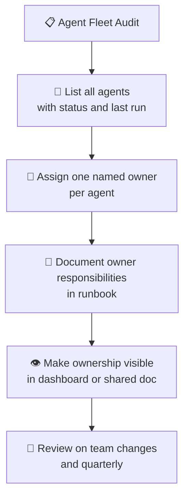

You have 14 agents running in production. One of them starts returning wrong output. Who gets paged? Who has the context to fix it quickly?

If the answer is "we'll figure it out in team chat," you don't have an ownership problem yet. You just haven't had a production incident at the wrong time.

Agent ownership is simple: every agent in your fleet has exactly one person responsible for it. That person knows what the agent does, what it costs per task, how common failures present, and what to do when it needs to be paused or rolled back.

Without that structure, agents become orphaned infrastructure. Everyone knows they exist. Nobody wants to touch them.

## What Agent Ownership Actually Means

Ownership is not blame. It is accountability for a set of specific things:

- The agent is running and doing what it should be doing
- Failures get looked at within a reasonable time
- The agent's cost stays within expected range
- The runbook exists and is current
- When the owner moves to another team, ownership transfers rather than disappearing

One person. Not "the platform team." Not "whoever built it." One named person.

## Step 1 — List Every Agent in Your Fleet

Before you can assign ownership, you need a full inventory. Pull every active agent from your agent management dashboard. Include agents that are paused or marked low-priority — quiet agents are often the ones that cause problems when they quietly restart.

In [AgentCenter's agent dashboard](/features/agent-dashboard), you can see all agents across your projects with current status in a single view. If you manage agents across multiple tools, export a flat list first.

For each agent, capture:
- What it does (one sentence)
- When it was last active
- Who built it
- What it depends on (APIs, databases, other agents)

## Step 2 — Assign One Owner Per Agent

Pick one person per agent. If you have 20 agents and 4 engineers, that is 5 agents per person on average — manageable.

The owner should be whoever:
- Built the agent, or
- Uses the agent's outputs most directly, or
- Has the most context on the domain the agent operates in

Do not default to "whoever is on-call." On-call handles incidents. Ownership is different: it is ongoing accountability, not just emergency coverage.

## Step 3 — Document What the Owner Is Responsible For

A name next to an agent means nothing without context. Write down what ownership covers — even two or three sentences is enough:

> Owner is responsible for: reviewing the agent's weekly error rate, triaging alerts, updating the prompt if output quality drifts, and handing off context before leaving the team.

Add this to your agent runbook. If you do not have a runbook yet, the ownership doc is a reasonable starting point for one.

## Step 4 — Make Ownership Visible to the Team

Ownership only works if everyone can see it. When an agent fails, people need to know who to contact without a round of Slack messages asking around.

[AgentCenter's monitoring view](/features/agent-monitoring) lets you assign each agent to a specific user, visible across the dashboard. Task threads support @mentions, so when output from a specific agent needs review, you can tag the owner directly in the thread. The owner gets the notification without anyone having to remember who that is.

If you are not yet using a centralized dashboard, a shared spreadsheet with agent name, owner, and contact handle gets you most of the way there. It is not sophisticated, but it works until you have a better system.

## Step 5 — Keep Ownership Current Through Team Changes

Ownership breaks down when people move teams, take extended leave, or leave the company. The fix is building a habit of updating it during transitions.

Add one question to your offboarding checklist: "Which agents do you own?" Then reassign before the person's last day. Five minutes during offboarding prevents a week of confusion six months later.

Same principle applies during onboarding. When someone joins, walk them through the fleet and assign ownership for anything in their domain.

For teams managing more than 20 agents, a quarterly review of the ownership list is worth the 30 minutes it takes. People change roles, agents get deprecated, new ones get added. The list drifts fast if nobody maintains it.

## Common Mistakes

**Assigning to a team instead of a person.** "The data team owns this agent" means nobody owns it. A team can be the escalation path. One person needs to be the first contact.

**Treating ownership as punishment.** If ownership only surfaces during post-mortems, engineers will avoid being assigned. Ownership should be a small ongoing responsibility, not a liability.

**Skipping quiet agents.** Agents that run infrequently are easy to forget. They also tend to have the most outdated configs when they finally do run. Every agent gets an owner, including the ones that trigger once a week.

**Not auditing after mergers or reorgs.** When teams restructure, agent ownership is usually the last thing updated. A half-hour audit after any major org change is a good habit.

## Bottom Line

Agent ownership is a one-time setup with lightweight ongoing maintenance. You spend an hour getting it right, then ten minutes reviewing it every quarter. When something breaks at the wrong time, someone is already prepared to respond.

You do not need a sophisticated system to start. A name attached to each agent in your [agent dashboard](/features/agent-dashboard) is enough.

---

*The best time to set this up is before your agents start failing. [Try AgentCenter free for 7 days](/pricing) — cancel anytime.*
