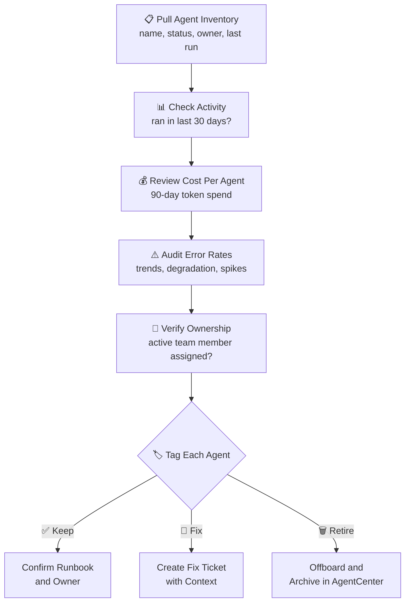

Teams accumulate agents the way they accumulate Slack channels. Fast, with good intentions, and no cleanup plan. Six months in, most teams have agents nobody remembers deploying, agents nobody owns, and agents burning real money producing outputs nobody reads.

A quarterly fleet audit fixes that. It takes two hours. Skipping it costs you twenty.

## What a Fleet Audit Is

A fleet audit is a structured review of every agent you're running — what it does, who owns it, whether it still produces value, what it costs, and whether it's performing the way you expected when you shipped it.

It's not the same as monitoring. Monitoring is real-time. An audit is periodic and deliberate. You're stepping back from the dashboard and asking "should this agent still exist?" rather than "is this agent working right now?"

Most teams don't do this. They only look at agents when something breaks. That's how you end up paying for three months of an agent that was silently producing wrong outputs before anyone noticed.

## Step-by-Step: How to Run the Audit

### 1. Pull Your Complete Agent Inventory

Start by listing every active agent. In the [AgentCenter agent dashboard](/features/agent-dashboard), you get all agents in one view: name, current status, last active date, and assigned owner.

For each agent, write down:
- What it does (in one sentence — if you can't, that's a finding)
- Status and last run date
- Owner (the person responsible for it)
- Which project or workflow it belongs to

This list is your starting point. Everything else in the audit flows from it.

### 2. Check Activity and Usage

Which agents ran in the last 30 days? Which ran but had no deliverable reviews?

Activity without review means you're paying for work nobody acted on. In AgentCenter, the activity feed shows task completions, deliverable submissions, and review timestamps per agent. Sort by last active. Anything that hasn't run in 45 or more days is a candidate for retirement unless there's a known seasonal reason.

Pay close attention to agents that ran often but had zero approved deliverables. High volume with zero approvals is a signal that someone stopped trusting the outputs months ago — but nobody retired the agent.

### 3. Review Cost Per Agent

Pull token spend per agent for the last 90 days. This is the part most teams skip and later regret.

AgentCenter's [monitoring dashboard](/features/agent-monitoring) tracks cost at both the task and agent level. Look for:

- Which 2 or 3 agents are consuming 40% or more of your total LLM budget?
- Are those agents producing outcomes that justify the spend?
- Any agents with a rising cost trend week over week?

A common finding: an agent configured to run on every incoming record when it only needed to run on a filtered subset. Three months of unnecessary token spend, invisible until you look at the 90-day view.

### 4. Audit Error Rates Over the Quarter

You probably glanced at error rates last week. A quarterly view shows different things — patterns that don't appear in daily monitoring.

Look for:
- Agents that launched at 95% success and now sit at 78%
- Error spikes tied to specific days, input types, or upstream data changes
- Agents whose error rates have crept up 1 to 2 percent per month for three months straight

Gradual degradation is easy to miss in real-time monitoring because each day looks acceptable. Quarterly is when you catch the trend.

### 5. Verify Ownership

Every agent needs a named owner — someone responsible for its outputs, its performance, and any changes to it.

If a team member left and their agents are still running, those are now orphaned. Nobody reviews the outputs. Nobody fixes failures. Nobody retires the agent because nobody knows who to ask. Check every agent against your current team roster.

Set a rule before closing the audit: every agent must have an active team member listed as owner. No exceptions.

### 6. Tag Each Agent: Keep, Fix, or Retire

This is the output of the audit. Every agent gets one of three labels.

**Keep** — Running well, producing value, has a named owner and a runbook.

**Fix** — Still needed but has a known problem. Error rate too high, cost rising, prompt drift suspected, or no owner assigned.

**Retire** — No longer producing value. Usage has dropped to near-zero, the workflow it supported no longer exists, or it's been superseded by a better approach.

Use the [AgentCenter task orchestration view](/features/task-orchestration) to trace each agent's recent work and verify whether the Fix or Retire call is right before you commit to it.

### 7. Act on the Findings Within Two Weeks

The audit is only useful if you follow through.

- **Keep** agents should have a confirmed runbook and owner before you close the audit session.
- **Fix** agents need a ticket in your backlog with enough context that anyone can pick it up without digging through months of logs.
- **Retire** agents should be offboarded cleanly: disable the agent, archive the task history, and notify any downstream processes that consumed its outputs.

Set a two-week deadline. An audit that produces a list nobody acts on just becomes another document in your drive.

## Common Mistakes

**Auditing only failing agents.** The expensive mistakes usually live in "healthy" agents — ones that run fine but produce outputs nobody checks. Cost creep and output drift happen silently in the green-status agents.

**Skipping ownership verification.** An agent without a named owner is a liability with no clear path to resolution. Ownership decays naturally as teams change. The quarterly audit is when you catch it.

**Auditing too frequently.** Quarterly is the right cadence for most teams running fewer than 30 agents. Weekly fleet reviews turn into noise and get abandoned. Keep the detailed audit quarterly and reserve incident reviews for when something actually breaks.

**No time limit on Fix status.** An agent tagged Fix and then left alone for 6 months is an agent you should have retired. If Fix agents don't have deadlines, they accumulate into technical debt with a monthly token bill attached.

## Bottom Line

Two hours every quarter. That's the investment. You get a clear picture of which agents are worth their cost, who owns what, and where your budget is actually going. Teams that skip quarterly audits typically discover the problems during an incident — which is the worst possible time to discover them.

---

*The best time to set this up is before your agents start failing. [Try AgentCenter free for 7 days](/pricing) — cancel anytime.*
