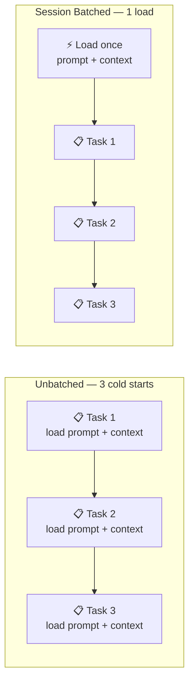
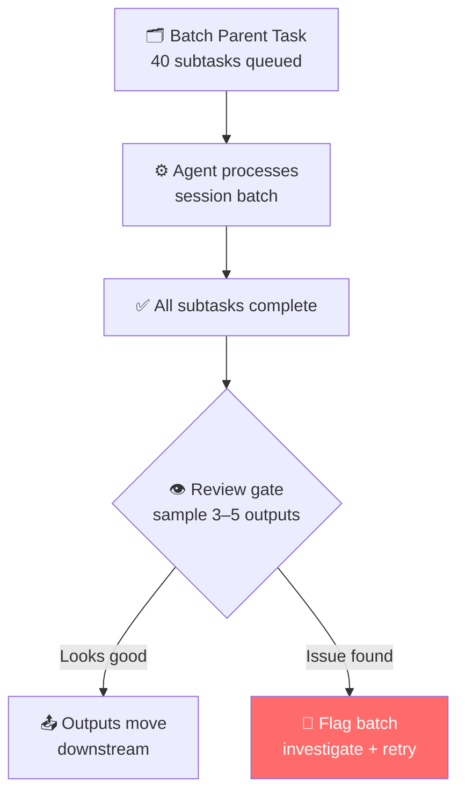

Your agents run one task at a time. Each run loads the system prompt, fires the API request, waits for a response, and closes the session. If you have 40 research tasks queued, that's 40 cold starts with nearly identical context. The result: more token spend than the work actually requires, lower throughput than your API limits would allow, and rate limits hit sooner than expected.

Task batching is how you fix this.

## What Task Batching Means for AI Agents

Batching means grouping similar tasks and processing them in a controlled sequence within a single agent session, instead of cold-starting for every task. The agent does the same work. The difference is that shared context — system prompt, tool configuration, background knowledge — loads once instead of once per task.

Two variants are worth knowing:

**Session batching** (most practical): The agent stays active and processes tasks sequentially in a single run, reusing loaded context. Good for structured tasks where each item is independent but uses the same agent setup.

**Context batching** (higher risk): Multiple inputs go into one LLM call, and outputs get parsed out separately. Works for simple classification or extraction tasks. Risky for anything longer, where outputs tend to bleed together.

For most production teams, session batching is the safer starting point.

## How to Set Up Agent Task Batching

### 1. Identify Batchable Task Types

Not every task is worth batching. Good candidates:

- Tasks with identical system prompts (same role, same tool config)
- Tasks processing the same input type (all PDFs, all URLs, all Slack messages)
- Tasks where each item is independent — output from item 2 doesn't depend on item 1
- High-frequency tasks that run many times per day

Tasks to leave unbatched:
- Tasks that depend on each other's outputs (sequential pipelines)
- Tasks with highly variable complexity where one long item would block shorter ones
- Tasks requiring human review between each run

### 2. Group Tasks in AgentCenter

In AgentCenter, create a parent task for the batch and add individual items as subtasks under it. This gives you a single place to track batch progress on the [Kanban board](/features/task-orchestration), per-item status without losing sight of the overall batch, and a clear handoff point when the batch completes.

Use a consistent naming convention. Something like: `[Batch] Weekly Competitor Scan — June 19` with subtasks named by item. When your team sees the parent task in review, they know immediately what kind of work is inside.

### 3. Set Concurrency and Batch Size Limits

Decide on batch size before you run. Two things to get right:

**Rate limits.** Most LLM providers rate-limit by tokens per minute. If each task uses 2,000 tokens and your limit is 60,000 tokens per minute, batches of more than 30 tasks will hit the ceiling mid-run. Set a hard ceiling below your rate limit headroom.

**Session timeouts.** A batch session timeout applies to the whole batch, not each task. If your per-task timeout is 3 minutes and you batch 20 tasks, your batch session timeout needs to be at least 60–90 minutes, not 3. Miss this and one slow task at item 5 stalls the entire session.

Use AgentCenter's concurrency controls in [agent monitoring](/features/agent-monitoring) to cap parallel batch runs when multiple agents are batching at the same time.

### 4. Track Cost Per Task Before and After

This is the step most teams skip, and it's the only way to know batching helped.

Before batching: run your standard single-task setup for one week and note the average token cost per task. AgentCenter shows per-task cost directly on each task card and in the monitoring view.

After batching: run for one week under the same workload and compare. You're looking for a drop in average token spend per task and faster total throughput — tasks completed per hour, not just tasks completed.

If cost per task goes up after batching, the tasks weren't similar enough to share context. Split them into separate batches by type and re-test.

### 5. Add a Batch-Level Review Gate

When a batch finishes, don't just mark it done and let outputs move downstream.

During single-task runs, a bad output affects one result. During a batch run, a systematic prompt issue can corrupt 30 items before anyone notices. Set up an approval step on the parent task in AgentCenter so a human spot-checks a sample of outputs before anything moves downstream. Even reviewing 3–5 items out of 40 will catch a systemic problem that 0-out-of-0 reviews would miss entirely.

## Common Mistakes

**Mixing task types in one batch.** Batching a competitor research task alongside a contract review task in the same agent session confuses the agent's context. Outputs get crossed. Keep batches homogeneous — one task type per batch.

**Starting too large.** A batch of 100 tasks sounds efficient. In practice, one slow task blocks the rest, rate limits hit mid-run, and debugging which item failed takes longer than running them individually. Start at 10–20 tasks per batch and scale up once you've seen it work.

**Skipping the baseline measurement.** Batching is supposed to reduce cost per task. If you don't measure before and after, you don't know if it did. Two weeks of data — one before, one after — is enough to validate.

**Assuming batching works for every agent.** Agents doing open-ended reasoning or creative work often produce better output when they start fresh. Long sessions accumulate context that can bias later outputs. Test before assuming batching helps.

## Bottom Line

Batching is not a trick. It's a straightforward way to reduce per-task token overhead on structured, high-volume workloads. Most teams running more than 20 similar tasks per day have room to apply it. The setup takes an afternoon. Start with one task type, track cost per task before and after, and expand from there once you have numbers that confirm it works.

---

*The best time to set this up is before your agents start failing. [Try AgentCenter free for 7 days](/pricing) — cancel anytime.*
