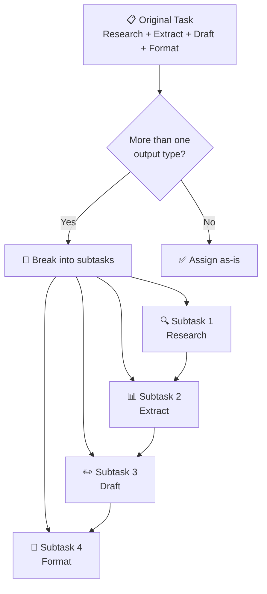

You give an agent a task. The description is three paragraphs long, covers five requirements, and asks for two different types of output. The agent returns something, but it missed two of the requirements and the output is 2,400 words you have to read in full to find out.

The problem is not the agent. The task was too large. Breaking it into subtasks would have caught the problem three steps earlier.

## Why Large Tasks Break AI Agents

When a task asks too much at once, three things go wrong.

**Context overload.** Agents have a finite attention window. When a task has eight requirements spread over a long description, the ones near the top get deprioritized as the agent works through the rest. Requirements don't disappear — they just get treated as less important than they are.

**Blurred acceptance criteria.** A task with five requirements is five tasks with no checkpoints. You can't tell which requirement failed without reading every line of the output.

**Review bottleneck.** Large outputs require full-document review before you can catch anything. Smaller outputs can be spot-checked in under a minute. That time difference compounds across dozens of tasks per week.

## Signs a Task Is Too Big

Any of these means you should break it down:

- The agent keeps timing out on it
- Outputs are inconsistent from one run to the next
- Your reviewers spend more than 5 minutes per output
- You cannot write a one-sentence acceptance criterion for it
- The task description uses more than two "and" connectors

The two-and-connectors rule is a fast heuristic. "Find competitor pricing pages, extract their tier structure, and write a comparison summary" has three natural split points. That is three tasks, not one.

## How to Break a Task into Subtasks

**Step 1: Find the natural splits.**

Read the task and mark every point where one type of work ends and another begins. Research is one type of work. Extraction is another. Writing is another. Formatting is another. Each transition is a split point.

**Step 2: Define one output per subtask.**

Each subtask should produce exactly one thing: a list, a structured JSON block, a paragraph, a table. If you cannot describe the output in a single sentence, the subtask is still too broad.

**Step 3: Write explicit handoff specs.**

The output format of subtask 1 becomes the input format of subtask 2. Write both down before you create the tasks. If subtask 1 produces a markdown table with columns for competitor, plan name, and monthly price, say that. The agent running subtask 2 needs to know what it is working with.

**Step 4: Create parent-child tasks in AgentCenter.**

In AgentCenter, create a parent task that represents the full workflow. Attach each subtask as a child under it. This keeps all related context visible in one place without mixing all the work into one thread.

Use [task orchestration](/features/task-orchestration) to set dependencies: subtask 2 cannot start until subtask 1 is marked complete. This prevents agents from running ahead of data they do not have yet.

**Step 5: Assign the right agent to each subtask.**

A research agent that is good at web lookup is not necessarily good at synthesis. Once you have split the work, assign based on what each agent is actually designed to do. The split is also what makes this possible: a monolithic task forces you to pick one agent for everything.

## A Real Example

Say you need a competitive analysis for a pricing refresh. The instinct is to create one task: "Research competitor pricing, extract key features, build a comparison table, and draft a pricing recommendation."

Here is what the split looks like:

| Subtask | Agent | Output | Depends On |
|---|---|---|---|
| Find 5 competitor pricing pages | Research Agent | URL list with notes | None |
| Extract tier structure per competitor | Extraction Agent | JSON: plan names, prices, features | Subtask 1 |
| Build comparison table | Formatting Agent | Markdown table | Subtask 2 |
| Draft pricing recommendation | Writer Agent | 300-word summary | Subtask 3 |

Each subtask can be reviewed independently. A reviewer who catches a problem in the extraction step can fix it before the comparison table agent runs. No wasted downstream work, no re-running the whole pipeline.

You can monitor each subtask's status in real time using [agent monitoring](/features/agent-monitoring) in AgentCenter. When something breaks, you see exactly where.

## Common Mistakes

**Breaking too fine.** Splitting a 200-word task into 12 subtasks creates coordination overhead that slows everything down. Target subtasks that take 1 to 5 minutes each, not 30 seconds.

**Skipping the handoff spec.** The most common failure point in multi-step agent pipelines is the handoff. Agent 2 gets output in a format it was not expecting. Write the expected input format for downstream subtasks before you run anything.

**Not setting dependencies.** Without task dependencies, agents can start working before upstream data is ready. In AgentCenter, always link child tasks to their upstream dependency before activating the pipeline.

**Confusing splitting tasks with splitting agents.** Breaking a task into subtasks is about making each piece independently reviewable. If you cannot review subtask 3 without reading subtasks 1 and 2, it is not really a separate task yet.

## Bottom Line

If your agents produce inconsistent outputs on complex work, the task is probably the problem. Split it into pieces where each piece has one output, one acceptance criterion, and a clear handoff to the next stage. Review gets faster, failure modes get clearer, and when something goes wrong, you fix the one broken subtask instead of rerunning everything.

---

*The best time to set this up is before your agents start failing. [Try AgentCenter free for 7 days](/pricing) — cancel anytime.*
