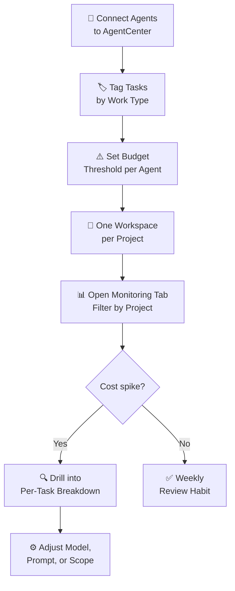

You've got agents running. You get the invoice at the end of the month. You have no idea which agent ran up the bill.

That's the common setup. And "check the invoice" doesn't actually tell you which task cost $14 or which agent is burning 70% of your LLM budget.

A cost dashboard fixes that. Here's how to build one.

## What a Cost Dashboard Actually Shows

A basic cost dashboard tracks three things:

- **Spend per agent** — which agents cost the most
- **Spend per task type** — which kinds of work cost the most
- **Spend over time** — are costs trending up?

Without per-task data, you can't trace a spike. Without per-agent data, you don't know where to cut. Without a time trend, you don't see the slow creep before it becomes a problem.

The goal isn't pretty graphs. It's answering: "Why did we spend more this week, and which agent caused it?"

## Step 1: Connect Your Agents to AgentCenter

Before you can see costs, your agents need to report them. Every OpenClaw agent connected to AgentCenter sends per-task data back to the dashboard, including token counts, model used, and task duration.

If your agents aren't connected yet, that's where to start. Set up the [agent monitoring integration](/features/agent-monitoring) before building any cost views on top of it. Without the data source, there's nothing to display.

## Step 2: Tag Tasks by Type

Raw cost numbers grouped by agent name don't tell you much. What helps is cost by category, so you can see whether your research agents cost more than your writing agents, or whether a specific workflow is consuming more than expected.

In AgentCenter, you do this with task tags on your Kanban board. When you create tasks, add a tag that identifies the work type: `research`, `summarize`, `review`, `generate`, or whatever fits your workflow.

Your cost view then groups by tag automatically. You can filter to a single tag and see exactly what that category costs per week.

## Step 3: Set a Budget Threshold per Agent

A real dashboard has alerts, not just numbers. Once you can see per-agent costs, set a weekly budget ceiling for each agent. In AgentCenter's [monitoring panel](/features/agent-monitoring), you can configure a cost threshold and get notified when an agent crosses it.

This is the difference between a cost log and a cost dashboard. The log tells you what happened. The threshold tells you when something is going wrong before you find out from the billing statement.

Starting values: $10/week for a lightweight research agent, $30–50/week for an agent doing heavy generation work. Adjust based on your first two weeks of real data.

## Step 4: Group Costs by Project

If you're running agents across multiple projects or clients, per-agent costs mix everything together. You need a project split.

AgentCenter's workspace structure maps to projects. Each workspace gets its own agent pool, task board, and cost view. That means you can see what each project costs in isolation — useful if you're billing clients or allocating team budgets.

One workspace per project is all you need. That single structural decision gives you clean cost separation without any extra configuration.

## Step 5: Build the View in AgentCenter

Here's the actual setup sequence:

1. Open the **Monitoring** tab in AgentCenter
2. Select your time range — last 7 days is a good default to start
3. Filter by workspace or project
4. Sort agents by cost, high to low
5. Click into any agent to see its per-task cost breakdown

The monitoring view is built into AgentCenter because cost data is inseparable from operational data. An agent that's expensive to run is also one that might be running too many retries, taking too long per task, or using the wrong model for the work.

## Common Mistakes

**Watching total spend instead of per-task cost.** The total tells you nothing about what's driving it. An agent that costs $40/week running 200 tasks is cheaper per-task than one that costs $15/week but runs only 10 tasks.

**Setting one budget ceiling for all agents.** Different agent types have very different cost profiles. A document summarizer costs a fraction of what a full-document generator costs. One threshold creates false alarms on cheap agents and misses real issues on expensive ones.

**Checking costs after the billing cycle.** Weekly reviews catch problems before they compound. Monthly reviews find them after three weeks of overspend are already done.

**Ignoring retry costs.** An agent that retries 5 times per task is paying for 5 LLM calls, not 1. High retry counts show up in the per-task breakdown. If you're not watching that line, you're missing a significant source of unexpected spend.

**Skipping the project split.** If you're running any kind of multi-client or multi-team setup and all your agents are in one workspace, you can't separate costs cleanly. You'll spend time doing manual math that the workspace structure handles for you.

## Bottom Line

A cost dashboard isn't a finance tool. It's an ops tool. When an agent goes over budget, something is usually wrong: the prompt is too long, the model is over-specified for the task, or retries are stacking up. The cost spike is the signal.

You don't need a separate analytics platform to see this. AgentCenter's monitoring view gives you per-agent, per-task cost data out of the box. The steps above are just how you structure your workspace to make that data actionable.

Start with one project. Look at the cost view at the end of the week. The expensive agent is almost always obvious once you can see it.

---

*The best time to set this up is before your agents start failing. [Try AgentCenter free for 7 days](/pricing) — cancel anytime.*
