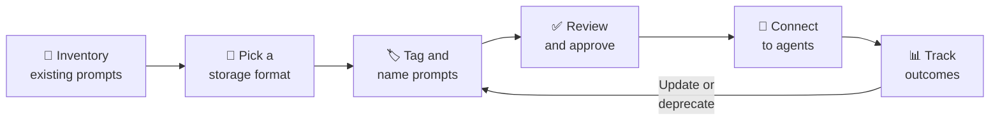

Most teams don't have a prompt library. They have a prompt graveyard: strings buried in agent configs, half-finished Notion pages, and "the good version" someone emailed around three months ago. Nobody knows which is current. Agents doing similar work run on five different prompts because each one was written by a different person at a different time.

When one agent starts producing bad output and someone fixes its prompt, the fix stays local. Three other agents doing similar work keep running the broken version because nobody connected them to the fix.

A prompt library changes this. It's a shared, organized store of tested prompts your team can find, reuse, and update in one place. Not a folder of text files. Not a graveyard. A living reference.

## What a Prompt Library Is (and Isn't)

A prompt library is not a documentation dump. It's a structured catalog where each entry is a named, tagged, tested prompt that agents can reference directly.

Think of it like a snippet library for code. You don't rewrite the same database query from scratch every time. You pull it from a shared location, modify what you need, and move on. The same logic applies to prompts.

Each prompt in the library should have:
- A clear name describing what it does
- A tag indicating which agent type or task category it belongs to
- A tested status (draft, approved, deprecated)
- A short note on what output it produces and where it's used

## How to Build Your Prompt Library

Here's how to go from scattered strings to a working library in six steps.

### 1. Inventory What You Have

Before building anything, collect every prompt your agents currently use. Pull them from agent configs, task descriptions, and shared docs. You'll probably find duplicates, near-duplicates, and a few prompts no one can explain.

Don't clean them yet. Just gather them in one place so you can see the full picture.

### 2. Pick a Storage Format

You have three practical options:

- **A git repository**: Prompts as `.txt` or `.md` files, versioned with commit history. Best for teams already comfortable with git.
- **A shared doc or Notion database**: Lower friction, easier for non-engineering stakeholders to contribute. Harder to version properly.
- **A dedicated tool or config layer**: Some agent platforms let you define prompt templates at the platform level. AgentCenter's [task templates](/features/task-orchestration) work this way, letting you create reusable task structures that agents pull from directly.

For most teams, start with git or a structured doc. You can migrate later once the habit forms.

### 3. Name and Tag Prompts Consistently

Naming matters more than you'd expect. A prompt called `summarize-v3-FINAL` tells nobody anything. A prompt called `contract-review/extract-obligations` tells you exactly what it does and where it lives.

Use a naming pattern like `[category]/[action]` or `[agent-type]/[task]`. Then add tags for:
- Output type (list, JSON, prose)
- Agent category (research, writing, review, extraction)
- Status (draft, approved, deprecated)

This makes prompts findable. When someone needs an extraction prompt for a new research agent, they search "extraction" and find three options instead of writing from scratch.

### 4. Review Before Approving

Don't add a prompt to the "approved" pool until at least one other person has tested it on real inputs. One person's test case is rarely representative.

Set a lightweight review process: prompt author creates a draft, a second person runs it against 5 real examples, both agree on whether it should be approved. That's it. You don't need a committee.

This also catches prompts that work in isolation but break in production because they make assumptions about input format the author didn't notice.

### 5. Connect Your Agents to the Library

The library only matters if agents actually use it. This means agents should reference prompts by name rather than embedding literal strings in their config.

In AgentCenter, you can set up [task templates](/features/task-orchestration) that include the prompt structure for common agent tasks. When you update the template, every agent using it benefits immediately. No need to edit 12 separate agent configs.

For teams using a git-based library, point agents to a shared config file and build a process so prompt updates trigger an agent restart or review cycle.

### 6. Track Which Prompts Are Working

A prompt library without outcome data becomes stale fast. Log which prompts each task used, and track output quality over time through AgentCenter's [agent monitoring](/features/agent-monitoring) features.

When you notice an agent's output quality dropping, you can check whether the prompt changed recently or whether the inputs shifted. That's much easier when the prompt is named and tracked rather than buried in the agent config.

## Common Mistakes

**Skipping tags.** The library becomes useful only if people can find things. Without tags, you end up with 40 approved prompts and no way to know which ones apply to your problem.

**Not deprecating old prompts.** Every library needs a way to retire prompts that no longer work. Mark them deprecated with a note pointing to the replacement. If you don't, agents will keep finding and using them.

**Letting one person own everything.** If only one engineer knows the prompt library exists or can add to it, the library stalls the moment that person is busy. Set clear guidelines and let multiple people contribute through the same review process.

**Treating system prompts and task prompts as the same.** They're not. System prompts define agent behavior. Task prompts define what to do for a specific job. Keep them in separate categories in the library, or you'll end up with confusion about what's safe to change.

## Bottom Line

A prompt library is one of the cheapest process improvements a team managing multiple agents can make. You're not building new software. You're just organizing what you already have in a way that everyone can find, reuse, and improve. Start small: pick one agent category, collect its prompts, and get them named and tagged. The habit spreads from there.

---

*The best time to set this up is before your agents start failing. [Try AgentCenter free for 7 days](/pricing) — cancel anytime.*
