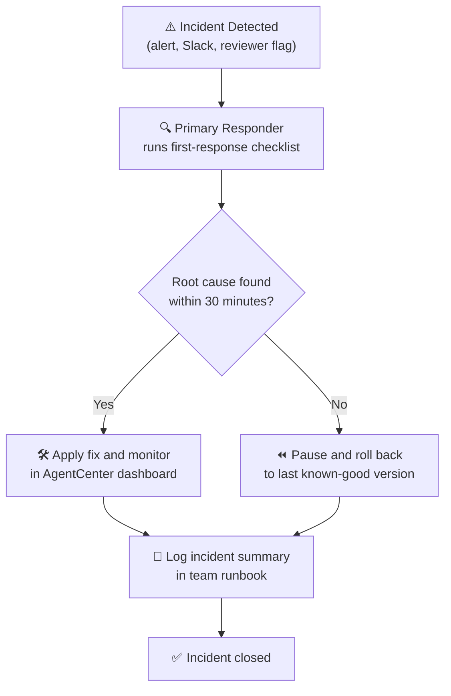

An agent goes silent at 11pm. You get a Slack ping at midnight. No one knows if it was the prompt, the API, the data, or something upstream.

Without an incident response playbook, everyone improvises. Someone restarts the agent without checking logs. Someone else opens a PR to change the prompt. A third person emails the API vendor. An hour later, you still don't know what happened.

An incident response playbook for AI agents is a short, opinionated document that tells your team exactly what to do — step by step — when something breaks. Not a general runbook. A specific response protocol for when something is actively failing in production.

## What Goes Wrong Without One

Most agent teams handle failures reactively. The first person who notices fires off a message in Slack. Then it becomes a group debugging session with no structure. People check different things, propose fixes at the same time, and someone ends up making a change that hides the root cause.

The cost isn't just time. It's that you don't learn from it. Without a documented process, the same failure pattern shows up again two months later, and you improvise again.

## What an Agent Incident Response Playbook Covers

A playbook doesn't need to be long. Two pages is enough. It needs to answer five questions:

1. How do you know there's an incident?
2. Who handles it?
3. What do you check first?
4. When do you escalate or roll back?
5. What do you document afterward?

That's it. The goal is to stop improvisation and make the first 10 minutes structured.

## How to Build Your Playbook

### Step 1: Define What Counts as an Incident

Not every agent error is an incident. An agent that fails one task is probably a retry. An agent that fails 15% of tasks over 30 minutes is an incident.

Set thresholds before you need them. Examples:

- Error rate above 10% for more than 15 minutes
- Agent status stuck on "working" for more than twice the normal task duration
- Deliverable quality flag raised by a reviewer
- No task completions in a window where there should be active throughput

Write these down. Concrete thresholds stop people from ignoring real problems and prevent alert fatigue from false ones.

### Step 2: Name a Primary Responder Per Agent

For each agent or group of related agents, name one person who owns the first response. This isn't about blame — it's about who knows the agent best and who checks first when something fires.

In AgentCenter, you can assign task ownership and see which team member is watching which agent from the [agent dashboard](/features/agent-dashboard). Use that visibility to assign primary responders by agent group and keep the mapping current.

### Step 3: Build the First-Response Checklist

When an incident is declared, the primary responder runs through a fixed checklist before making any changes. The discipline here is important: no fixes until you've run the checklist.

1. **Check agent status** in AgentCenter — is it stuck, blocked, or throwing errors?
2. **Pull the last 10 task logs** — is the failure consistent or sporadic?
3. **Check upstream dependencies** — is the API or service the agent calls returning errors?
4. **Check recent changes** — did a prompt update go out in the last few hours?
5. **Check cost and token metrics** — unusual spikes can indicate prompt expansion or an agent in a loop

This checklist takes about 5 minutes. Running it consistently means you always have baseline information before you touch anything.

### Step 4: Set Rollback Criteria in Advance

One of the hardest parts of agent incidents is deciding when to stop diagnosing and just roll back. Define that threshold before any incident happens.

Examples:
- If root cause isn't identified within 30 minutes, roll back to the last known-good prompt
- If error rate exceeds 25%, pause the agent immediately
- If degraded deliverables are reaching end users, halt first, investigate second

Pre-defined criteria take the debate out of the decision. You don't want to negotiate under pressure at 2am.

AgentCenter makes rollback straightforward. You can pause an agent, revert to a previous prompt version, and restart from the [task orchestration view](/features/task-orchestration) without deploying code.

### Step 5: Log and Close

After every incident, write a one-paragraph summary: what happened, what you checked, what you changed, and what you'd watch next time. Don't make this a full post-mortem template. Just a log entry.

Keep it in your team runbook or a shared doc. After three incidents, patterns show up. You'll notice the same external API goes down on weekends, or that prompt changes without staging tests cause most of your failures.

## What This Looks Like in Practice

When the flag fires in AgentCenter, the primary responder opens the dashboard, checks the agent's recent task history, runs through the checklist, and decides whether to fix or roll back. The whole flow stays in one place — no jumping between five tools.

## Common Mistakes

**Writing a playbook no one can find.** A document buried in Confluence is not a playbook. Link to it in your Slack channel description, in each agent's runbook, and in your team onboarding docs.

**Making it too long.** If it takes 20 minutes to read, no one will use it during an incident. Keep the first-response checklist to a single page.

**Skipping rollback thresholds.** Teams without pre-defined rollback criteria end up debating when to pull the trigger while the error rate climbs. Set the threshold in writing before you need it.

**Leaving the primary responder blank.** "Everyone" is responsible means no one responds first. Name one person per agent group. Rotate quarterly if that helps with load.

**Not updating it after incidents.** The playbook gets better through use. After each incident, spend five minutes updating the checklist based on what you actually needed to check. Version it so the team can see what changed.

## Bottom Line

A good incident response playbook doesn't prevent failures. It shortens the gap between "something is wrong" and "we know what to do." For AI agents, where failures can be subtle, expensive, and slow to surface, having a structured first response is worth the hour it takes to write.

---

*The best time to set this up is before your agents start failing. [Try AgentCenter free for 7 days](/pricing) — cancel anytime.*
