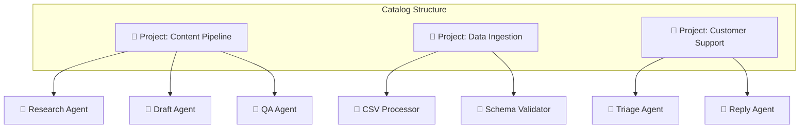

At ten agents, you can hold the whole fleet in your head. At fifteen, you start forgetting what two of them do. At twenty-five, someone new joins and asks "what's the CSV processor supposed to output?" and nobody can say for certain.

An AI agent catalog solves this. It's a single document (or structured view) that records what every agent in your fleet does, who owns it, what it costs to run, and what it depends on. Build one early and it saves you hours of archaeology later. Build one after things break, and at least you'll know which agent was responsible.

Here's how to build an AI agent catalog your team will actually keep current.

## What Your AI Agent Catalog Needs to Cover

A catalog that requires 30 fields per agent won't get filled in. The fields that actually matter in production:

| Field | What to record |
|-------|---------------|
| Name | A short, descriptive name (not "agent-v3-final") |
| Owner | One person, not a team |
| What it does | One sentence max |
| Input | What it receives to start a task |
| Output | What it produces when done |
| LLM used | Which model and tier |
| Cost per run | Approximate token cost or monthly spend |
| SLA | How long it should take; what "stuck" looks like |
| Dependencies | Other agents, APIs, or data sources it calls |
| AgentCenter project | Which project it lives under |

Ten fields. Fill in what you know today. Leave blanks rather than guessing — a blank is honest, a wrong number is misleading.

## Step 1: List Every Agent You're Running

Start with a complete inventory. Pull from three sources:

1. **Your [AgentCenter monitoring dashboard](/features/agent-monitoring)** — everything visible there is running in production right now
2. **Your code repository** — check for agent definitions, OpenClaw configs, or deployment files
3. **Your team** — ask each person which agents they've shipped or maintain

Don't rely on memory. The monitoring dashboard is the ground truth. If an agent isn't running anywhere, don't include it. Drafts and experiments from last quarter don't belong in a catalog of production agents.

## Step 2: Organize by Project, Not by Team

Teams reorganize. Projects don't. Group your catalog entries by the project they belong to rather than by who currently owns them.

In AgentCenter, each agent runs under a [project with its own task board and monitoring view](/features/task-orchestration). Your catalog should mirror that structure. When someone opens the catalog and then opens AgentCenter, the two should match.

If an agent doesn't map to any project, that's a problem to fix in AgentCenter first, not in the catalog.

## Step 3: Assign One Owner Per Agent

A catalog without owners becomes a document nobody trusts. When the research agent starts returning garbage, "who fixes this?" needs an instant answer.

One owner per agent. Not "the ML team." One person who:

- Gets notified in AgentCenter when it fails
- Approves any prompt or config changes
- Updates the catalog entry when something changes

If that person leaves, the catalog is how you know which agents became orphaned. Update ownership immediately when someone changes role or leaves the team.

## Step 4: Document Dependencies Before You Need To

Dependencies are the part teams skip, and also the part that hurts most when something breaks.

For each agent, record every external service or data source it calls: other agents, APIs, databases, file paths. When the data ingestion agent goes down at 2am, you need to know within two minutes which other agents depended on it.

A quick way to start: trace one recent agent failure backward. What did it try to call before it failed? That's your dependency list for that agent. Do the same for every agent and you're done.

## Step 5: Schedule a Monthly Catalog Review

The catalog drifts the moment you stop updating it. Put 30 minutes on the calendar for the first Monday of each month:

- Check every entry against AgentCenter's live agent list
- Update costs based on actual spend from the past month
- Remove agents that haven't run in 30 days
- Update owner fields for anyone who's changed role or left

The goal isn't a perfect catalog. It's catching agents nobody owns anymore and agents you're paying for that nobody uses.

## Common Mistakes

**Making it too detailed.** If filling in a new entry takes more than ten minutes, nobody will do it. The ten fields above are enough. Add more only if your team proves they'll actually maintain them.

**Putting it somewhere nobody opens.** A catalog buried in a Notion page nobody links to is dead on arrival. Keep it where your team already looks: pinned in your engineering Slack channel, linked from your AgentCenter project descriptions, or in your team wiki's top-level nav.

**Treating it as a one-time project.** The catalog is a living document. Schedule the monthly review before you close the tab, or it won't happen.

**Listing what agents were supposed to do, not what they actually do.** Check AgentCenter's activity feed when filling in the "what it does" field. What tasks has it actually completed in the past 30 days? That's more accurate than the spec from six months ago.

## Connect It to Live Monitoring

The catalog tells you what each agent is supposed to do. AgentCenter's monitoring dashboard tells you what they're actually doing right now. You need both.

When an agent runs slow, you check AgentCenter first. When you need to know who to contact or what the expected output should look like, you check the catalog. They answer different questions and work better together.

## Bottom Line

An AI agent catalog is ten fields per agent. It takes a few hours to build, an hour a month to maintain, and saves real time when something breaks or someone new joins the team. Start with the agents you're running today, fill in what you know, and put the monthly review on the calendar before you do anything else.

---

*The best time to set this up is before your agents start failing. [Try AgentCenter free for 7 days](/pricing) — cancel anytime.*
