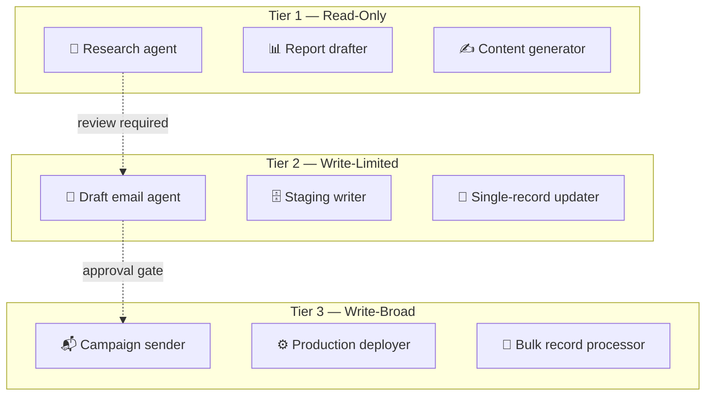

When you have 3 agents, you can treat them all the same. When you have 30, that approach breaks fast.

Some agents read data and return a summary. Others write to your database, send emails to customers, or call external APIs with real side effects. Those two categories need completely different levels of oversight, but most teams don't make the distinction until something goes wrong.

Categorizing agents by risk level is how you fix that. You group agents by what failure actually looks like, then apply the right guardrails to each tier without adding unnecessary friction everywhere else.

## Why Risk Tiers Matter

The common mistake is treating all agents equally because they're all "just agents." A report-drafting agent and a bulk customer record updater look the same in your codebase. They behave very differently when something goes wrong.

Treating them identically means one of two things: you over-monitor low-risk agents and waste your team's time, or you under-monitor high-risk agents and find out about the problem after the damage is done.

Risk tiers let you spend oversight where it counts.

## Step 1: Define Three Tiers

Most teams need exactly three categories. Adding more creates confusion; fewer leaves too much ambiguity.

**Tier 1 — Read-Only (Low Risk)**

The agent reads data and produces output that a human reviews before anything acts on it. Even a bad output gets caught before downstream harm. Examples: research agents, report drafters, content generators, data summarizers.

**Tier 2 — Write-Limited (Medium Risk)**

The agent can write or send output, but the scope is bounded. A bad output causes some damage, but it's contained and usually reversible. Examples: agents that update a single record type, draft emails that get reviewed before sending, agents that write to a staging environment.

**Tier 3 — Write-Broad (High Risk)**

The agent can trigger broad or irreversible changes: bulk data updates, production deployments, direct customer communications, calls to external APIs with persistent effects. A bad output here causes real damage that's hard to undo. Examples: agents that process customer records at scale, send marketing campaigns, or push configuration changes to production.

## Step 2: Audit Your Existing Agents

Go through every agent you're running and ask three questions:

1. What's the worst-case output this agent could produce?
2. If that happened, would a human catch it before any downstream damage?
3. Can the effect be fully reversed?

If you answer yes to all three: Tier 1 or Tier 2. If the answer to any question is no: Tier 3, no exceptions.

A common error here is classifying agents by how often they fail rather than by what failure looks like. An agent with a perfect track record can still be Tier 3 if its failure mode is irreversible.

## Step 3: Assign Oversight to Each Tier

The goal is right-sized oversight, not uniform oversight.

**Tier 1 agents** don't need pre-flight approval. Let them run on a schedule and review outputs asynchronously. Spot-check a sample weekly. If the output is wrong, correct it and move on.

**Tier 2 agents** need output review before downstream systems consume the result. In [AgentCenter's task orchestration](/features/task-orchestration), set up a review step after the agent completes. The next step in the pipeline only runs once a team member confirms the output looks right.

**Tier 3 agents** need an explicit approval gate before the action executes, not after. The agent prepares a plan or a batch, a human reviews it in AgentCenter, and only then does the action run. No automated trigger should skip this step.

## Step 4: Set Monitoring Per Tier

Match your alerting to the tier, not to a one-size rule.

**Tier 1:** Alert on agent failure only. If the agent stops running, you want to know. Output quality issues are low-stakes enough that async review handles them.

**Tier 2:** Alert on failure and output anomalies. Track error rates and flag unusual output sizes or patterns. Something outside the normal range is worth a look before the next pipeline step runs.

**Tier 3:** Alert on everything. Track cost, latency, error rate, and output characteristics in [AgentCenter's agent monitoring](/features/agent-monitoring). Set budget alerts tight. Any anomaly gets reviewed immediately — don't wait for a downstream complaint.

## A Real Example

Say you're running a content pipeline with three agents: one drafts posts, one formats and uploads to staging, one publishes to your site.

- **Agent 1 (drafter):** Tier 1. Output is text. Humans review drafts before anything else runs.
- **Agent 2 (formatter/uploader):** Tier 2. Writes to a staging bucket. A team member confirms the output before Agent 3 gets triggered.
- **Agent 3 (publisher):** Tier 3. Fires a webhook that publishes to production. In AgentCenter, this task stays in pending-approval status until a reviewer signs off.

The pipeline runs mostly hands-off. Tier 3 is the one spot where a human stays in the loop, and that's intentional.

## Common Mistakes

**Classifying by past behavior, not failure mode.** An agent that has never failed is still Tier 3 if its failure would cause bulk changes to customer data. Risk tier is about blast radius, not track record.

**Not updating tier when agents gain new capabilities.** An agent that starts as a drafter and later gets access to send emails directly jumped from Tier 1 to Tier 3. Reassess tier every time an agent's permissions or output scope changes.

**Applying Tier 3 oversight to everything "just to be safe."** This buries your team in approval requests and trains them to approve without reading. Right-sized oversight per tier means Tier 1 agents can actually run without constant supervision.

## Bottom Line

Three tiers handles most cases. Classify by what failure looks like, not by how often things go wrong. Apply heavy oversight where it actually matters, leave the rest alone, and revisit tier assignments whenever an agent's capabilities change.

---

*The best time to set this up is before your agents start failing. [Try AgentCenter free for 7 days](/pricing) — cancel anytime.*
