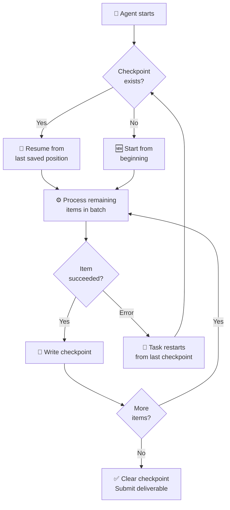

Your agent was 40 minutes into a batch job when the API timed out. Now you're starting from scratch.

That's the checkpointing problem. Most agents have no memory of where they stopped. A network hiccup, a rate limit, a model error — any of it resets progress to zero. For an agent processing 200 documents or running an overnight research pipeline, that means hours of wasted compute and real cost.

Checkpointing fixes this. It's the practice of saving agent state at defined intervals so a restart picks up close to where the failure happened, not at the beginning.

## What a checkpoint captures

For AI agents, a checkpoint is a record of what the agent has already done and what's left.

A useful checkpoint stores three things:

1. **Progress position**: which item in the batch the agent last completed successfully
2. **Partial outputs**: anything the agent produced so far that shouldn't be re-run
3. **Runtime context**: task ID, agent ID, iteration count, any accumulated state needed to continue

Without these, every restart is a full restart. With them, you restart at item 47 of 200, not item 1.

## Step 1 — Identify checkpoint boundaries

Not every action needs a checkpoint. You want them at natural unit boundaries — points where completing one unit of work is meaningful and distinct.

For a document processing agent:
- After each document is processed: checkpoint here
- After each paragraph inside a document: usually not worth it

For a multi-step research pipeline:
- After web research completes: checkpoint here
- After each individual search result is parsed: maybe, if parsing is slow

A working rule: if resuming from this point saves more than 5 minutes of compute, it's worth checkpointing. Apply the same thinking to cost — if skipping a checkpoint means re-spending $2 on LLM tokens, the checkpoint is worth the overhead.

## Step 2 — Store checkpoint state outside the agent process

The agent's in-memory state doesn't survive a crash. Checkpoint data has to live somewhere the agent can read on startup.

Three common approaches:

| Storage option | Good for | Avoid when |
|---|---|---|
| Task metadata field | Quick setup, no extra infra | Payloads over a few KB |
| Shared database (Postgres, Redis) | High-volume batch agents | Teams without DB access |
| Object storage (S3, GCS) | Large output accumulation | Very frequent checkpoint writes |

For most teams, writing progress to a task metadata field is the fastest path. In [AgentCenter](/features/agent-monitoring), every task has a metadata area — agents can write their current position there and read it back at startup without any extra infrastructure.

## Step 3 — Add checkpoint writes after each successful unit

Write the checkpoint *after* a unit of work completes successfully, not before. Writing before means you could checkpoint a step that then fails.

The basic pattern:

```
on task start:
  read checkpoint state if it exists
  set start_position = checkpoint.last_completed + 1 (or 0 if no checkpoint)

for each item from start_position to end:
  process item
  if success:
    write checkpoint: last_completed = current item index

on task complete:
  clear checkpoint state
  submit deliverable
```

The loop reads once at startup and writes incrementally. Clearing the checkpoint at completion prevents the next clean run from skipping the beginning.

## Step 4 — Build restart logic to check for existing checkpoints

The checkpoint write is half the system. The resume logic is the other half.

When the agent starts, the first thing it should do is check whether a checkpoint exists for the current task. If state exists, skip ahead to the next unprocessed item. If not, start fresh.



In AgentCenter, you can look up checkpoint state by task ID. This makes restarts invisible from the outside — the reviewer sees continuous progress, not a repeated start.

## Step 5 — Test failure recovery before going live

The checkpoint system only proves its value when it actually recovers from a failure. Test it explicitly in a staging environment before you rely on it in production.

A basic test:
1. Start a long-running agent with 50 items in the batch.
2. Kill the agent process after item 20 completes.
3. Restart the agent against the same task.
4. Confirm it starts at item 21, not item 1.

Run this using a cloned project in AgentCenter's [staging setup](/features/agent-dashboard) so you don't touch live tasks. You want to verify the resume path works before a real failure at 3am teaches you it doesn't.

## Common mistakes

**Checkpointing too often** — Writing state after every function call adds overhead and can slow the agent significantly. Checkpoint at meaningful unit boundaries, not on every micro-step.

**Not clearing state on success** — If a checkpoint remains after a successful run, the next clean run skips the beginning of the batch. Always clear checkpoint state when the task completes cleanly.

**Storing checkpoint state in memory only** — If the agent process dies, in-memory state dies with it. External storage is the only reliable option.

**Ignoring idempotency** — If restarting from a checkpoint re-processes items already finished, you get duplicate outputs. Either skip by index or make each processing step idempotent.

## Bottom line

Checkpointing isn't a complex feature. It's a small amount of state management that turns restarts from "start over" into "pick up where we stopped." For any agent doing meaningful batch work — document pipelines, overnight research jobs, multi-step data processing — adding checkpoints before the first production run is worth the hour it takes to implement.

---

*The best time to set this up is before your agents start failing. [Try AgentCenter free for 7 days](/pricing) — cancel anytime.*
