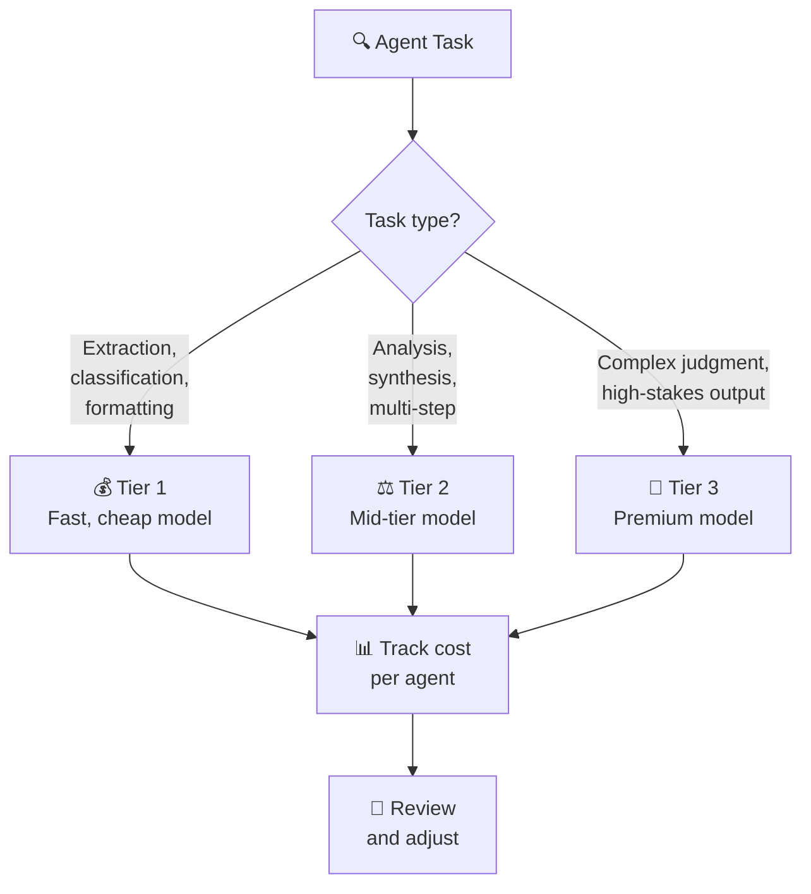

You have eight agents running in production. One scrapes competitor pricing. One writes weekly reports. One classifies customer tickets. Another summarizes legal documents.

Are they all running on the same model?

If yes, you're probably over-spending on simple tasks and under-spending on complex ones. Choosing the right LLM for each agent in your fleet is one of the most direct ways to cut costs without affecting output quality.

## Why Model Choice Matters Per Agent

Three things determine whether you picked the right model for an agent task: cost, latency, and quality.

Cost is obvious. A model that charges $15 per million output tokens versus one at $0.15 per million can produce similar results on classification tasks. Running a simple extraction agent on the expensive model for a month costs 100x what it should.

Latency matters for interactive agents. An agent that answers customer questions needs a response in under 2 seconds. An agent running a nightly data analysis job can wait 30 seconds. These are different requirements.

Quality is where teams over-index. Premium models are better at nuanced reasoning, but most agent tasks aren't nuanced. They're repetitive, structured, and deterministic. A cheaper model handles them just as well.

## Categorize Your Agent Tasks First

Before picking a model, understand what your agent actually does.

**Tier 1 — Simple and deterministic:** extraction, classification, formatting, short summarization. These tasks have clear inputs, clear outputs, and little ambiguity. Fast, cheap models perform as well as premium ones here.

**Tier 2 — Analytical:** synthesis, comparison, multi-step reasoning, longer summarization. These need more than pattern matching. Mid-tier models work well, with occasional spot-checks against premium outputs.

**Tier 3 — Judgment required:** nuanced writing, legal or compliance review, tasks where being wrong has real consequences. Premium models earn their cost here.

Most agents fall into Tier 1 or Tier 2. Very few genuinely need Tier 3 on every single run.

## How to Choose the Right LLM for Each Agent

Here's a practical process for assigning models across your fleet.

**1. Get a per-agent cost breakdown.**

You need to know which agents cost the most. AgentCenter's [agent monitoring dashboard](/features/agent-monitoring) shows cost per agent over time. Without this data, you're guessing. Start here before doing anything else.

**2. Rank agents by cost-to-value ratio.**

Your most expensive agents should be doing your most valuable work. If a simple ticket-classification agent is your second-highest cost item, that's a mismatch. Flag it for review.

**3. Audit what each expensive agent actually does.**

Read a sample of recent task logs. Ask: is this task genuinely requiring complex reasoning, or is it doing something a simpler model could handle? Most teams find 2 or 3 agents that are over-modeled.

**4. Run a side-by-side test on a cheaper model.**

Take 20 recent inputs. Run them through the current model and the candidate replacement. Compare outputs. Focus on error cases, not average cases. If the cheaper model makes the same mistakes on the same inputs, the premium model wasn't helping.

**5. Reassign and monitor.**

Switch the agent to the cheaper model. Watch cost per task and output quality for one week. If quality holds, you're done. If it degrades on specific task types, you now have data on exactly which subtasks need the premium model.

## A Real Example

One team had a report-writing agent running on a premium model. It was their second most expensive agent.

Looking at the task logs, the agent did two things: first it summarized raw data tables, then it wrote narrative insights from those summaries.

They split the process into two steps. The summarization step moved to a Tier 1 model. The insights-writing step stayed on the premium model. Cost for that agent dropped 60%. Output quality was unchanged across 300 test cases.

You don't always need to restructure the agent. Sometimes a single change to how the prompt separates structured from open-ended work is enough to route tasks more efficiently.

## Common Mistakes

**Using one model across your entire fleet.** It's the default. It's rarely right.

**Never reviewing per-agent cost.** If you don't have visibility into what each agent spends, you have no baseline for improvement. This is a gap, not a feature.

**Assuming premium models always produce better outputs.** On structured, deterministic tasks, they often don't. "Better at nuanced reasoning" does not mean "better at all tasks."

**Switching models without testing first.** The side-by-side comparison step isn't optional. Some agents have edge cases that only surface when you move to a cheaper model. Test before you commit.

**Treating model selection as a one-time decision.** Models change. Prices change. Your agent's task load changes. Set a calendar reminder to review your model assignments every quarter. What made sense six months ago may not hold now.

## Bottom Line

You don't need to run every agent on the best model. You need to run each agent on the right model for its task. A ticket classifier and a legal review agent have completely different requirements. Treating them the same is expensive.

The process is straightforward: know what your agents cost, understand what they do, test cheaper alternatives where the task doesn't require premium reasoning, and reassign where it makes sense. Most teams that go through this exercise find at least one agent where they cut costs by 50% or more with no quality loss.

---

*The best time to review your agent model assignments is before your costs compound. [Try AgentCenter free for 7 days](/pricing) — cancel anytime.*
