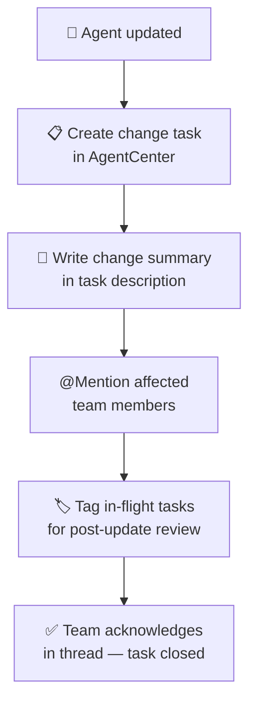

You updated the agent's prompt last Thursday. You fixed a formatting issue and swapped in a better data source. Solid improvement.

Then your teammate submitted 12 tasks using the old format. Three failed. Four produced outputs that nobody recognized. The rest got flagged in review because they looked wrong, even though they were correct.

That's the agent change problem. You shipped the fix. You forgot to ship the announcement.

## Why This Happens More Than It Should

Software changes have visible side effects. A UI update is obvious. A new API version breaks something. Developers notice.

Agent changes are invisible. The agent runs. It produces output. Whether your team understands that output depends entirely on whether they knew what changed. A single prompt update can flip an agent from returning markdown to returning JSON. A new tool can change the data source the agent pulls from. Nobody knows until something breaks in review.

And because agents run continuously, the confusion compounds quickly. One unannounced change can leave your team second-guessing outputs for days.

## What a Good Agent Change Announcement Covers

Before getting into the process, here's what the announcement itself needs to include:

**What changed.** Prompt update, tool swap, new capability, removed behavior. Be specific. "The output format changed from plain text to JSON" is useful. "Updated the agent" is not.

**Why it changed.** The problem you were solving: a hallucination issue, a cost spike, a quality drop in review. This helps your team understand whether the change is relevant to their workflows.

**What looks different.** How outputs or task inputs will behave differently starting now. If reviewers need to evaluate outputs differently, say so here.

**What to do.** Any updated task format, reviewer instructions, or steps for in-flight tasks that were submitted before the change.

## How to Do This in AgentCenter

Here's a repeatable process using [AgentCenter's task and coordination features](/features/task-orchestration):

**Step 1: Create a task for the update.**

Open the relevant project in AgentCenter and create a task titled something like: `Agent Update: [Agent Name] — [Date]`. This becomes the central record for the change. Keep the task open until your team has acknowledged.

**Step 2: Write the change summary in the task description.**

Keep it short and plain. Example: "Prompt updated to return structured JSON instead of markdown. Data source switched from internal DB to live API. Outputs will look different starting Aug 8."

Three to five sentences is enough. If it takes longer to explain, the change probably needs a separate review before shipping.

**Step 3: @mention the people it affects.**

Tag everyone who writes tasks for this agent, reviews its outputs, or has a downstream process that depends on it. AgentCenter pushes @mentions directly to their notification feed. It won't get buried in a Slack thread.

This is the step teams skip most often. They announce to the person who requested the change, not to everyone who touches the outputs. Announce broadly. Let people opt out.

**Step 4: Tag in-flight tasks for post-update review.**

Any task submitted before the update may have been written with old assumptions. Use a label like `post-update-review` to flag them. This makes it easy to filter and check them before closing.

**Step 5: Close the task once the team confirms.**

Have teammates reply in the thread once they've read the update. When everyone relevant has confirmed, close the task. You now have a permanent record: what changed, when it shipped, and who was notified.

## A Real Example

We had a summarization agent that ran across about 40 tasks per week. In April we updated the prompt to return structured output instead of free-form text. The new format had three separate fields: a short summary, a list of key points, and a recommended next step.

Before the update, we created a task in AgentCenter called "Agent Update: Summarizer — Apr 14". We wrote a four-sentence description, @mentioned seven teammates, and tagged 18 open tasks with `post-update-review`.

Two teammates flagged in the thread that their review checklist assumed the old format. We updated the checklist and linked the revised version in the same task. By the time the updated agent went live, every reviewer had read the change and updated their workflow.

No confused outputs. No debugging sessions. The whole coordination process took about 20 minutes.

## Common Mistakes

**Using Slack instead of a task.** Slack threads disappear. Someone who joins the project next month won't find them. A task in AgentCenter becomes part of the agent's history and stays searchable.

**Announcing only to the person who requested the change.** The requester isn't always the one reviewing outputs or writing task descriptions. Map out who actually touches this agent's outputs and notify all of them.

**Skipping the announcement for small changes.** A one-line prompt edit can change agent behavior in ways that confuse reviewers. If the agent's behavior changes, announce it — no matter how minor the change feels.

**Not tagging in-flight tasks.** Tasks submitted before the update were written with old expectations. Tagging them for review is the only reliable way to catch issues without manually auditing everything.

## Keeping a Change History

Over time, your agent change tasks become a useful audit trail. If a team member asks "why does this agent return X now?" the answer is one search away in your AgentCenter project.

You can also link related changes. If a prompt update in March was followed by a tool swap in May, connecting those tasks gives you a full picture of why the agent behaves the way it does today. That context is especially useful when you're [monitoring for performance regressions](/features/agent-monitoring) or trying to pinpoint when a quality issue started.

## Bottom Line

Your team works off what they know. When you update an agent without communicating it, you create a gap between what the agent does and what your team expects. That gap shows up as confused reviewers, failed tasks, and hours of unnecessary debugging.

A five-minute task in AgentCenter closes that gap before it opens.

---

*The best time to build this habit is before your first confused reviewer pings you asking why the outputs look wrong. [Try AgentCenter free for 7 days](/pricing) — cancel anytime.*
