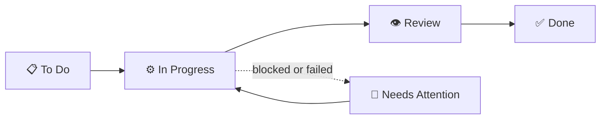

Your PM asks "How are the agents doing?" You have two choices: send them a link to a dashboard they can't interpret, or say "fine" with no data to back it up. Neither is useful.

This is one of the more overlooked problems in AI ops. The tooling is built for engineers who run agents, not for the people who depend on their output. Closing that gap doesn't require new software. It requires deciding what different roles actually need to know, then building a simple system around those answers.

## Why Generic Status Updates Don't Work

Engineers want to know what broke and why. Product managers want to know if the work is on track. Executives want to know if the money is being spent wisely.

These are three different questions. Answering all three with the same dashboard pleases no one.

| Audience | Their core question | What they need |
|---|---|---|
| Engineer | Why did this fail? | Logs, error traces, task states |
| Product Manager | Is the work progressing? | Task completion, blockers, ETA |
| Executive / Founder | Is this worth running? | Cost per output, volume, failure rate |

Most agent monitoring tools only answer the first row well. If agents affect product decisions or business outcomes, you need to handle all three.

## Step 1: Define What "Healthy" Means for Each Audience

Write it down before you need it. A healthy agent means something different depending on who's asking.

For a PM: 40 tasks completed per day, no task blocked for more than 4 hours.

For an exec: less than $0.10 per output, 95% of tasks reaching done state.

For yourself: error rate below 5%, p95 response time under 30 seconds.

Once you have these numbers, building a status summary is easy. Green means all thresholds met. Yellow means one is slipping. Red means something needs human attention right now.

## Step 2: Use the Task Board as a Shared View

The [Kanban board in AgentCenter](/features/task-orchestration) is the most practical way to give non-engineers visibility into agent progress without pulling them into engineering tooling.

Set up columns that map to states your PM actually understands: **To Do**, **In Progress**, **Review**, **Done**. Agents move tasks through these columns automatically. A PM can look at it for 10 seconds and know whether work is flowing or backing up.

Keep internal agent states off the shared board. "Retrying after 429" or "awaiting tool response" are engineering details. The PM-facing board should only show business-level states.

When a task lands in "Needs Attention," that's when a human gets pulled in. Everything else flows without interruption.

## Step 3: Use @Mentions for Selective Escalation

In AgentCenter, you can @mention teammates inside task threads. Use this deliberately.

The rule is simple: don't @mention a PM or exec unless it affects a decision they need to make. Mention them when:

- A task that was due yesterday is now blocked and will miss a deadline
- A batch completed and the output is ready for their review
- Something failed in a way that changes scope or timeline

For everything else, the board and a weekly summary are sufficient. Over-mentioning people trains them to ignore you. Reserve it for moments that actually need a response.

## Step 4: Send a Short Weekly Summary

One paragraph per audience. This takes five minutes if you have [agent monitoring](/features/agent-monitoring) already running.

Example for a PM:
> "Agents completed 312 tasks this week, up from 280 last week. Four tasks were manually re-routed due to ambiguous input. Nothing is currently blocked."

Example for an exec:
> "Total agent spend this week: $47. Average cost per completed task: $0.15. On track with the monthly budget."

That's all it needs to be. No charts, no logs, no jargon. Short, specific, actionable only when something is off.

## Step 5: Define Escalation Thresholds Before You Need Them

The worst time to decide when to alert a stakeholder is during an incident. Set thresholds in advance and write them somewhere your team can find them.

Example thresholds:

- Cost per task exceeds 2x the baseline for more than 1 hour: notify the team lead
- Error rate above 10% for more than 30 minutes: notify the PM
- Agent offline during business hours for more than 15 minutes: notify the exec

With thresholds written down, there's no judgment call in the moment. You either hit the line or you don't. This also makes your updates more credible because stakeholders learn they only hear from you when something is genuinely wrong.

## Common Mistakes

**Sending raw dashboards.** A 20-panel monitoring view is not a status update for a PM. It's a scavenger hunt. If you're sharing this, you haven't done the translation work yet.

**Using engineering terms without definition.** "The agent hit a rate limit" is fine. "The agent received a 429 on the third tool call and the retry budget was exhausted after 5 attempts" is not a PM update. Translate before you send.

**Only updating when things break.** If stakeholders only hear from you when something fails, they'll start assuming failure is the default state. Short, positive updates build trust over time.

**Conflating agent health with task health.** An agent can be online and running fine while a specific task is failing. Be specific about which you're reporting so stakeholders don't draw the wrong conclusions.

## Bottom Line

The frustration around AI agent communication almost always comes from not deciding in advance what each audience needs to see. Separate the questions: engineers get traces, PMs get the task board, executives get a weekly number. Set escalation thresholds before the first incident. Keep the shared view clean.

You can do all of this with a Kanban board, a few @mention conventions, and a short weekly message. No new tooling required.

---

*The best time to set this up is before your agents start failing. [Try AgentCenter free for 7 days](/pricing) — cancel anytime.*
