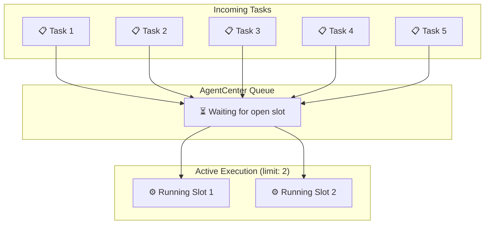

You have 8 agents. Each one runs 5 tasks at a time. That's 40 parallel API calls to a provider that allows 10 requests per minute. Everything queues up, timeouts stack, and you're looking at a wall of failures that looks random but isn't.

The fix isn't smarter retry logic. It's setting concurrency limits before things break.

## What Concurrency Limits Actually Do

A concurrency limit caps how many tasks an agent can run in parallel at any given moment. It's separate from rate limits — rate limits control calls per time window, concurrency limits control how many run simultaneously right now.

Think of a checkout line. Rate limits say "no more than 10 people per minute." Concurrency limits say "only 3 people in the checkout area at once." Both matter. Neither solves the other.

Without concurrency controls:
- 4 agents each running 10 tasks = 40 simultaneous LLM calls
- Your API provider returns 429 errors
- Tasks retry and pile up
- Your cost bill for a 20-minute incident looks like a 3-hour run

With sensible limits, API calls become predictable and costs stay flat.

## When You Actually Need This

Most teams hit the concurrency problem after their first scale-up. You go from 2 agents to 8. Nothing breaks immediately. Then a large batch job kicks off, all 8 agents activate at the same time, and you have 50 parallel tasks hitting a provider with a 10 RPM ceiling.

You need concurrency limits if any of these are true:
- You run more than 3 agents at the same time
- You have batch jobs that trigger many tasks at once
- You share an API key across multiple agents
- Your monthly bill spikes unexpectedly after certain runs

## How to Configure Concurrency Limits in AgentCenter

The diagram below shows how task queuing works once you have limits in place:

**Step 1: Audit your current parallel load**

Before setting anything, get a baseline. In AgentCenter, open the [agent monitoring dashboard](/features/agent-monitoring) and filter by the past 7 days. Look at peak concurrent task counts per agent. If any agent regularly runs more than 5 tasks simultaneously, that agent is a candidate for limits.

Also note which agents share a downstream API. If 4 agents all call the same OpenAI endpoint, their concurrency adds up even if each agent looks light on its own.

**Step 2: Set per-agent concurrency**

In AgentCenter, go to each agent's settings page. Under **Task Execution**, set the **Max Concurrent Tasks** value. A reasonable starting point:

- Content or research agents: 3 to 5 concurrent tasks
- External API integration agents: 2 to 3 (conservative until you know the downstream limits)
- Internal data processing agents: up to 10 if no external API is the bottleneck

Save the change. AgentCenter will queue new tasks if the agent is already at its ceiling.

**Step 3: Set a project-level ceiling**

Individual agent limits help, but if 6 agents in the same project all share one API key, you still need a project-level cap. Go to **Project Settings** → **Concurrency** in AgentCenter. Set a maximum total concurrent tasks across all agents in the project.

This number matters more than per-agent limits when shared keys are involved. The provider doesn't know you have 6 agents — it just sees 6 callers burning through one key's rate limit.

**Step 4: Watch queue depth, not just errors**

Once limits are active, open the [task orchestration view](/features/task-orchestration) and watch tasks move from "queued" to "running" as slots open. If your queue depth stays consistently above 20 tasks, your limits are too conservative. If you're still seeing 429 errors, the limits are too loose.

The target: a queue that clears within the same time window the tasks arrived. Not a growing backlog, not an empty queue with idle agents.

**Step 5: Tune over 48 hours**

After running with the new limits for 2 days, check the error log in AgentCenter for any remaining 429 responses. If they're still showing up, drop the project ceiling by 20% and re-test. If the queue barely fills and costs are higher than expected, nudge concurrency up by 1 or 2.

This tuning cycle usually takes 3 to 4 rounds before you land on stable settings.

## A Real Example

One research pipeline had 6 agents, each configured to run 8 tasks at once. Peak load was 48 simultaneous calls to a single API source. The provider's rate limit was 10 RPM.

After setting per-agent limits to 2 and a project ceiling of 8, the 429 errors stopped. The pipeline ran a bit slower on large batches. But it actually finished — instead of failing halfway and requiring manual reruns. Net time to completion went down because retries stopped eating into the window.

## Common Mistakes

**Setting per-agent limits without a project ceiling.** Five agents each limited to 10 concurrent tasks still means 50 calls to one API key. The project-level ceiling is what protects shared resources.

**Ignoring batch jobs.** A nightly batch that launches 200 tasks at midnight can overwhelm even well-configured agents. Make sure your batch trigger sends tasks in chunks with spacing between groups, not all at once.

**Watching error rate instead of queue depth.** Limits that are too tight don't cause failures — they cause tasks to pile up silently. Monitor queue depth alongside errors, or you'll think everything is fine when tasks are just waiting.

**Assuming separate agents mean separate rate limit buckets.** If 3 agents share one API key, the provider counts all their calls together. Separate agents don't get separate quotas.

## Bottom Line

Concurrency limits are one of the lowest-effort controls you can put on a running agent fleet. You configure them once. They run silently. They prevent an entire class of failures that are expensive to debug after the fact.

Start conservative, watch the queue depth, and tune up from there.

---

*The best time to set this up is before your agents start failing. [Try AgentCenter free for 7 days](/pricing) — cancel anytime.*
