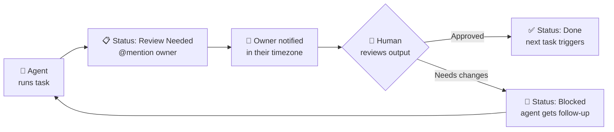

Your agent finishes a research task at 3am. The output lands in your system. Nobody reviews it until the morning standup — 7 hours later. By then, the downstream agent that was waiting on that output has either stalled or run ahead on stale data. The handoff didn't fail noisily. It just drifted.

This is the async coordination problem. It gets worse the more agents you run across a distributed team.

## Why Async Agent Work Is Different

When humans work async, the expectations are clear: leave a comment, update the doc, someone picks it up tomorrow. The work sits still.

Agents don't sit still. A task assigned to an agent at midnight can produce output by 12:05am, trigger three downstream tasks, run into a dependency that needs human input, and silently stall — all before anyone on your team is awake.

The problem isn't the agent. The problem is that your coordination layer wasn't built for this.

[AgentCenter's task orchestration features](/features/task-orchestration) let you set up async workflows that stay visible without requiring anyone to babysit them in real time. Here's how to do it.

## How to Set It Up

### Step 1: Assign Every Task a Clear Owner

In AgentCenter, every task has an owner field. Don't leave it blank. Even for fully automated tasks, assign a human who is responsible for reviewing the output.

If your team spans time zones, match the owner to someone in the time zone where the task is likely to complete. If your research agent runs at 3am IST, the owner should be the team member starting their day around that time — not the one who originally set up the task.

No owner means no one is watching. On a distributed team, tasks without owners age out.

### Step 2: Use Task Statuses to Signal Handoff State

AgentCenter task statuses are your async communication layer. Use them on purpose:

- **In Progress** — agent is actively working
- **Review Needed** — agent finished, a human needs to check the output before the next step runs
- **Blocked** — agent is waiting for input or a dependency hasn't resolved
- **Done** — reviewed and approved

When agents complete a task, set the status to "Review Needed" via your OpenClaw agent's task update call. This tells the next reviewer exactly what to do when they open AgentCenter — without a standup, without a Slack ping.

### Step 3: Use @Mentions for Async Handoffs

When an agent needs human input to continue, it should @mention the task owner in the task thread. This creates a notification that reaches the reviewer in their own working hours.

The @mention in AgentCenter shows up in the reviewer's notification feed with full task context — output, agent status, what decision is needed. The reviewer doesn't need to reconstruct context from scratch. It's all threaded to the task.

This is the difference between a handoff that works and one that disappears into someone's inbox at 3am.

### Step 4: Write Task Descriptions That Travel

This sounds basic. It usually gets skipped.

When you create a task in AgentCenter, write the description so someone can pick it up cold at any hour without asking questions. Include what the agent is supposed to produce, what success looks like (specific, not vague), what the reviewer should check, and what happens after approval.

If a reviewer needs to Slack someone to understand what a task is asking for, the description isn't done.

### Step 5: Schedule Recurring Tasks Around Your Review Windows

For always-on workflows, use recurring tasks with timing that accounts for when your reviewer is actually awake. If you have a daily report-generation agent, schedule it to complete 2 hours before the reviewer's working day starts. The agent finishes, the task flips to "Review Needed," and a fresh output is waiting when they open their laptop.

AgentCenter's recurring task scheduler lets you set the cadence once and trust it. The agent runs, updates status, and the review is queued without anyone having to remember.

---

Here's what a clean async coordination flow looks like end to end:

## Common Mistakes

**Treating agents like humans in a standup.** Humans know when they're blocked and can say so. Agents don't. You have to build block detection in — through status updates, timeout alerts, or explicit output checks. If you're relying on someone noticing an agent went quiet, you're relying on luck.

**Assuming the reviewer will find the output.** [Agent monitoring in AgentCenter](/features/agent-monitoring) shows you what's waiting for review. But reviewers still need a trigger. A task that completes at midnight and shows "Done" instead of "Review Needed" doesn't tell anyone to look at it. Status discipline matters.

**Letting the review queue pile up.** If you have 20 tasks in "Review Needed" state on a Tuesday morning, something is wrong with the process. Either the review step is too manual, or your team needs designated review windows each day. The backlog is the signal — don't ignore it.

**Creating tasks with no written context.** The agent knows what it did. The reviewer at 8am in a different time zone does not. Every task description should be enough for a cold start. If it isn't, plan on losing time to back-and-forth that async coordination is supposed to eliminate.

## Bottom Line

Async agent work fails at the handoff. The agent finishes. The output sits. Nobody knows it's waiting. Something downstream stalls, or worse, runs on stale data.

The fix isn't faster agents. It's a coordination layer that makes handoff state visible across time zones, notifies the right person at the right time, and gives reviewers enough context to act without a catch-up call.

AgentCenter's task status, @mentions, and recurring task scheduling give you those tools. The setup takes an hour. The payoff is agent workflows that don't need someone awake at 3am to hold them together.

---

*The best time to set this up is before your agents start failing. [Try AgentCenter free for 7 days](/pricing) — cancel anytime.*
