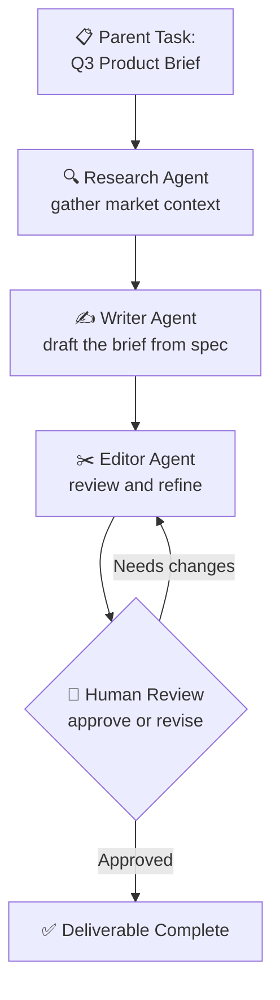

You have three agents working on a product brief. A research agent gathers market data. A writer agent drafts the sections. An editor agent tightens the prose. Sounds like a clean pipeline.

Here's what actually happens without a coordination plan: the research agent produces a 2,000-word dump with no structure. The writer agent doesn't know which parts matter, so it writes around the noise. The editor agent receives a draft with gaps where the research didn't fit. Nobody flagged the conflict. The final output is weak, and you won't find out until a human reads it.

Three agents on one deliverable is not three times the output. It's three times the coordination surface.

## What a Shared Deliverable Actually Is

A shared deliverable is any output that more than one agent touches before it reaches a human reviewer. That includes:

- Multi-section documents — research feeds a draft, the draft gets edited
- Data reports — a gathering agent, then an analysis agent, then a formatting agent
- Code reviews — a static scan agent, a security agent, then a summary agent

The challenge isn't routing data between agents. Most teams figure that out. The challenge is format drift, lost context, and conflicting assumptions about what "done" means at each stage.

## How to Set It Up

Here's a working approach for multi-agent collaboration on a single deliverable.

### Step 1: Write the Deliverable Spec Before Anyone Starts

Before any agent runs, define the final output in writing:

- What format does the deliverable use?
- What sections or fields must be present?
- What does a complete, acceptable output look like?

This spec is the source of truth for every agent in the chain. Without it, each agent optimizes for its own interpretation of "done."

In AgentCenter, attach this spec to the parent task. Every child task references it, so agents always know the target structure — not just their own piece.

### Step 2: Give Each Agent One Role

Assign each agent a single, clearly scoped job:

- **Research agent:** gather market context and competitor data, return as a structured JSON with defined fields
- **Writer agent:** take research JSON as input, produce a formatted brief matching the deliverable spec
- **Editor agent:** review the draft against the spec, flag deviations, return a clean version

No agent should have two jobs on the same deliverable. When an agent gathers data and writes the draft, quality at each stage is harder to evaluate independently. Separation of roles means failures are easier to isolate.

### Step 3: Sequence the Tasks — Not Parallel

Every agent in a shared deliverable pipeline runs in sequence, not at the same time. Set up task dependencies so:

- The writer agent can't start until the research agent's task is marked complete
- The editor agent can't start until the writer agent's task is marked complete

AgentCenter's [task orchestration](/features/task-orchestration) enforces this directly. Set dependencies on child tasks under the parent task. If research fails, the writer task stays blocked and doesn't run on incomplete input.

Running agents in parallel on a shared document creates race conditions you won't see coming until the outputs don't fit together.

### Step 4: Write a Handoff Spec for Each Stage

A handoff spec is a short note (3–5 lines) attached to each task that tells the next agent what it's receiving and what it should produce:

> **Editor task handoff note:** Input is a Markdown product brief from the writer agent. Should have 5 sections matching the spec. If any section is missing or under 50 words, flag it in a "REVIEW NEEDED" block rather than filling it in. Output: edited brief in the same Markdown format.

This isn't a full prompt — it's a task note in AgentCenter. It takes 2 minutes to write and removes the ambiguity that causes the editor agent to guess what the writer intended.

### Step 5: Add a Human Review Gate at the End

Don't let a shared deliverable leave the pipeline without a human seeing it. Use AgentCenter's [approval workflows](/features/agent-monitoring) to put the final output into a pending review state before it goes anywhere downstream.

This matters especially in multi-agent pipelines because errors compound. Bad research produces a bad draft, which produces a bad edit. The review gate is your last chance to catch compound errors before they reach a user, a client, or another system.

## A Real Example: Product Brief Pipeline

Here's how this looks in AgentCenter:

The parent task holds the deliverable spec. Each child task runs in sequence with explicit dependencies. When the research task completes, AgentCenter unblocks the writer task automatically. The editor runs after the writer finishes. A human review gate sits at the end.

If the research agent fails, the writer task stays blocked. You see that in AgentCenter's [agent monitoring](/features/agent-monitoring) view rather than discovering it when the editor produces something garbled.

## Common Mistakes

**Running all agents at once on the same output.** It sounds faster. It isn't. You spend more time reconciling two versions than you save in parallelism. Always sequence agents on shared deliverables.

**No deliverable spec on the parent task.** Each agent guesses the structure independently. By the time the editor touches the document, the format doesn't match what was requested and someone rewrites sections manually.

**One flat task, three agents.** Some teams assign a single task and swap the assigned agent at each stage. This works until a stage fails and you need to rerun from that point — or until you're auditing who produced which version. Parent-child task structure gives you both.

**Skipping the final review gate.** Multi-agent pipelines give you more automation, not more confidence. A review gate is cheap compared to a bad deliverable reaching a stakeholder.

**No handoff spec between stages.** When the editor doesn't know what the writer was told, it either over-edits or under-edits. A 3-line handoff note fixes this.

## Bottom Line

Multiple agents on one deliverable only saves time when coordination is explicit. A deliverable spec, sequential dependencies, per-stage handoff notes, and a final review gate — that's the complete setup. Skip any one of those and you end up debugging compound failures instead of reviewing clean output.

---

*The best time to set this up is before your agents start failing. [Try AgentCenter free for 7 days](/pricing) — cancel anytime.*
