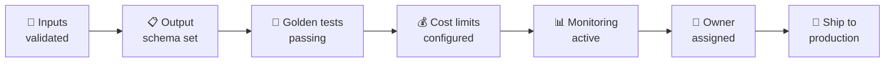
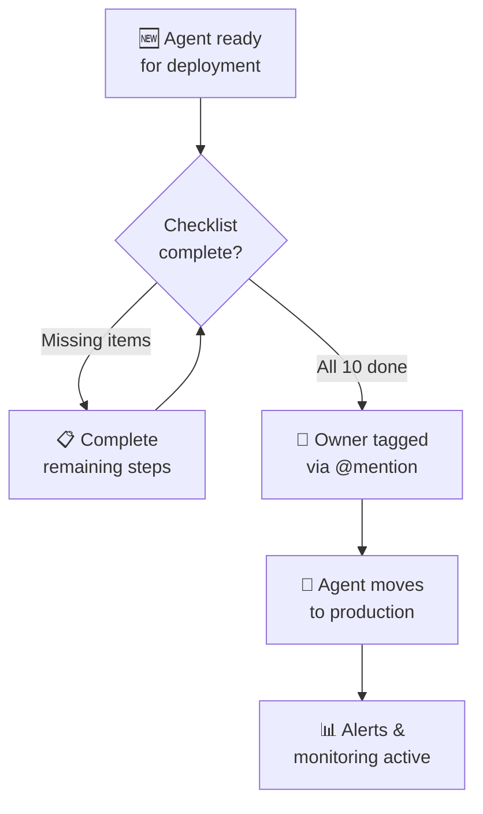

Most agent failures have nothing to do with the model. They happen because someone skipped the pre-deployment checklist for AI agents — or didn't have one to begin with. No output validation, no cost ceiling, no designated owner, no rollback plan. The agent ships, something breaks, and the team spends three hours figuring out what "working" was supposed to look like.

This post gives you the 10-point checklist I use before every agent goes to production.

## What This Checklist Is For

It's not a code review. It's a go/no-go check: does this agent have guardrails, monitoring, a single owner, and a path back if things break?

You're not asking whether the agent is good. You're asking whether it's safe to run unsupervised.

None of these steps takes more than 15 minutes to set up. All of them matter.

## The 10-Point Checklist

**1. Define and validate inputs**

Know exactly what your agent expects: required fields, data types, freshness constraints. Set up input validation before the task reaches the agent. If a malformed input can break the run, catch it before it enters the queue. See the [AgentCenter agent monitoring guide](/features/agent-monitoring) for where to wire this in.

**2. Enforce an output schema**

Define what a valid output looks like — required fields, format, value ranges. If your agent returns JSON, specify the schema and reject anything that doesn't match. Agents that return "something" fail silently in pipelines. A schema makes failure loud and catchable.

**3. Run your golden test suite**

Before shipping, run every case in your golden set. If you don't have one yet, build 5 to 10 representative inputs with expected outputs. A passing golden suite is your green light. Failing any case is a hard stop.

**4. Confirm error handling and fallback behavior**

What happens when the agent times out? When the LLM returns an error? When the output schema fails validation? Map every failure path to a specific action: retry once, return a partial result, escalate to a human, or stop cleanly. Agents that fail without logging anything are harder to debug than agents that throw a clear error.

**5. Set a cost limit and alert**

Every production agent needs a per-task cost estimate and a monthly ceiling. In [AgentCenter](/features/agent-monitoring), you configure cost thresholds per agent and get notified before spend hits the limit. Do this before the first task runs, not after the first unexpectedly large bill lands.

**6. Configure health checks**

Set up a check that tells you the agent is alive and responding. A periodic lightweight task that verifies the agent returns a valid response is enough. Without this, you won't know an agent has gone dark until tasks start backing up in the queue.

**7. Set task timeouts**

Every agent task needs a timeout. Decide in advance: how long is too long for this task type? Set an alert at 80% of expected duration and a hard cut-off with a defined recovery action. An agent stuck waiting for an LLM response will hold a queue slot indefinitely without a timeout.

**8. Assign a single owner**

Not a team. One person. They get paged when the agent fails, run the post-mortem, and decide when to roll back. The [AgentCenter task board](/features/task-orchestration) lets you assign agents to specific team members so ownership is visible at a glance. "Shared ownership" means nobody picks up the pager.

**9. Write down the rollback plan**

Before you ship, put the rollback steps somewhere everyone can find them. Which version do you revert to? How long does rollback take? Is there a manual fallback process? Teams that answer these questions before shipping execute rollbacks in minutes. Teams that figure it out during an incident take hours.

**10. Do a final staging run**

Run the agent on real (or realistic) data in your staging environment with production-equivalent configuration. Check that cost estimates match, outputs pass schema validation, and the task completes within the expected time window. If staging passes, you ship.

## Running the Checklist in AgentCenter

The easiest way to make this checklist stick across your team is to turn it into a task template. Create a deployment task in [AgentCenter](/features/task-orchestration) with the 10 checklist items as subtasks. Nobody moves an agent to production until all 10 are checked off.

Here's what the deployment gate looks like in practice:

When a new agent is ready, the team lead creates a deployment task. The 10 checklist items are subtasks. The owner gets tagged via @mention when the agent flips to production status. Nobody ships without the full checklist.

The process doesn't add much time. It adds accountability — which is what prevents the 3am incident.

## Common Mistakes

**Skipping the checklist for "simple" agents.** Simple agents get prompt changes, tool calls, and retry logic added over time. The checklist habit is easier to build before the agent gets complicated.

**No output schema for agents that feed other agents.** If agent A's output breaks and agent B is consuming it, the failure shows up in agent B's logs. Schema validation at every interface prevents that confusion.

**Rollback plan in someone's head.** The person who knows the rollback steps will be unavailable when you need them. Write it down, link it from the AgentCenter task.

**"The team" owns this agent.** Nobody owns it. One person, always.

## Bottom Line

The checklist is 90 minutes of setup that prevents a six-hour incident. Run through it once per agent, make it a task template, and ship knowing the basics are covered.

---

*The best time to set this up is before your agents start failing. [Try AgentCenter free for 7 days](/pricing) — cancel anytime.*
