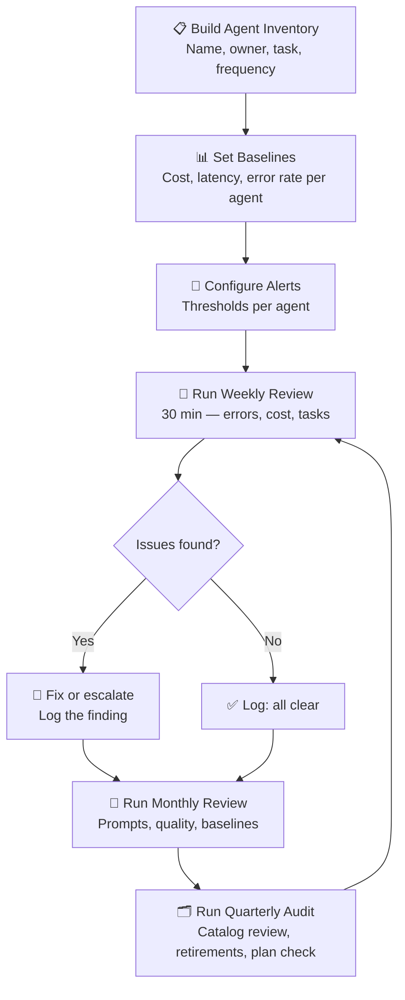

Most teams treat agent maintenance as something that happens after something breaks. A prompt goes stale. A cost spike shows up. An agent starts producing worse outputs and nobody knows when it changed.

The fix isn't a better debugging process. It's a maintenance schedule — a recurring calendar that keeps your agent fleet healthy before failures accumulate.

Here's how to build one.

## What an Agent Maintenance Schedule Actually Is

A maintenance schedule for AI agents is a calendar of regular, planned actions — not in response to incidents, but as preventative checks. The same way a database team runs weekly vacuums and monthly index reviews, your agent team should run regular health audits, prompt reviews, and cost reconciliations.

Without a schedule, maintenance only happens reactively. You fix the agent that's loudly broken while the agents slowly degrading stay invisible. Most quality problems in production agent fleets are gradual, not sudden.

## What Goes on the Schedule

Not all maintenance is the same frequency. Some checks run daily, some weekly, some monthly.

**Daily (automated where possible):**
- Agent health checks — is each agent responding and completing tasks within expected latency?
- Error rate checks — did any agent spike in failures overnight?
- Cost tracking — is any agent spending significantly more than its 7-day baseline?

**Weekly (manual review, 30 minutes):**
- Review the previous week's error logs for patterns across agents
- Check for any agent that completed fewer tasks than expected
- Verify that recurring scheduled tasks ran on time
- Note any task that required human approval or escalation and why

**Monthly (deeper review, 1-2 hours):**
- Re-read and test each agent's core prompts against real outputs
- Compare current output quality to your baselines from 30 days prior
- Review cost per task versus the prior month — look for creep
- Update agents that depend on external context that may have changed

**Quarterly:**
- Full audit of your agent catalog — which agents are still earning their seat?
- Identify agents that have become redundant or rarely used
- Reassign or retire agents that no longer carry their weight
- Check whether your current plan limits still match team size and workload

## How to Build the Schedule Step by Step

Here is a practical process to go from zero to a running maintenance cadence.

1. **List every agent you're running.** Include name, owner, primary task type, and run frequency. If you don't have this list, start there. A maintenance schedule is impossible without an accurate inventory. AgentCenter's [agent dashboard](/features/agent-dashboard) gives you this view out of the box.

2. **Define a baseline for each agent.** Before you can catch drift, you need to know what normal looks like. Record average task completion time, average cost per task, and typical error rate. AgentCenter's [agent monitoring](/features/agent-monitoring) shows these metrics per agent across any time window.

3. **Set alert thresholds.** Don't wait to spot problems manually. Configure alerts for when an agent's error rate, cost, or task duration crosses the threshold you defined in step 2. Alerts catch overnight spikes you'd otherwise miss until the weekly review.

4. **Create a recurring calendar event for weekly and monthly reviews.** Assign an owner. If nobody owns the maintenance calendar, it won't happen. A 30-minute Friday slot works for most teams.

5. **Build a short checklist for each cadence.** Three to five questions per review is enough. "Did any agent cost more than 15% above baseline?" is a better checklist item than "review costs." Specific, answerable, quick.

6. **Log what you find after every review.** A shared doc or pinned comment in your project is enough. The log lets you spot trends across reviews and gives new team members history when they join. "Looks fine" said at standup doesn't exist in 6 weeks.

## A Real Example: Weekly Review in AgentCenter

Here's what a weekly review looks like in practice.

You open AgentCenter on Friday afternoon. Five agents are green, two are showing elevated cost. One of the yellow agents ran 18% more tasks than last week and cost per task went up 40 cents — not alarming, but you log it. If it's still yellow next week, you dig in.

The other agent had three failed tasks on Tuesday. You click into the task history, see they all timed out around the same window, and check the logs. The external API it was calling had a 6-hour outage. Nothing to fix on your side. You log it so next month's review doesn't flag it as a growing trend.

You confirm that the recurring summary agent ran on schedule every day. Two tasks pending human approval came back within 24 hours. Review done in 20 minutes.

That's the point. A maintenance review doesn't need to be a long project when agents are healthy. The value is catching drift early — before a 40-cent cost increase becomes $200 in unexpected spend, or before one timed-out task becomes a pattern of failing deliverables.

## Common Mistakes

**Skipping reviews because nothing is visibly broken.** Agents degrade gradually. Prompts become outdated. Context shifts. Output quality drops a few percent per month until someone notices a deliverable that's noticeably worse than it was six months ago. Regular reviews catch this before it compounds.

**Making the review too long.** A 2-hour monthly review is reasonable. A 4-hour weekly review won't survive contact with a real team. Keep the weekly check short and focused on the signals that actually move.

**Not logging what you find.** Logging takes two minutes and builds a history that makes quarterly audits much faster. Teams that don't log spend the first half of every quarterly review trying to reconstruct what happened.

**Treating all agents the same cadence.** A high-frequency, customer-facing agent deserves more attention than a low-stakes internal summarizer. Calibrate your review frequency to risk and business impact.

## Bottom Line

Agent maintenance isn't glamorous, but it's how you keep a fleet running reliably past the first month. Pick a cadence, assign an owner, write a short checklist, and log what you find. The teams that build this habit catch problems when they're cheap to fix — not after a stakeholder asks why outputs have been off for two weeks.

---

*The best time to set this up is before your agents start failing. [Try AgentCenter free for 7 days](/pricing) — cancel anytime.*
