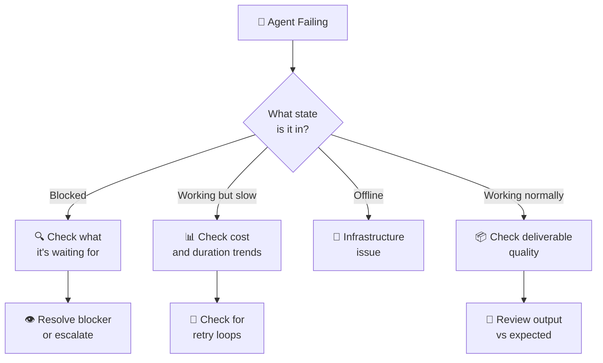

Your agent is failing. Something broke. You're not sure if it's the prompt, the model, the data, the tools it's calling, or something in the infrastructure. You need to figure it out without spinning the whole thing down.

This is what a debugging session actually looks like when it goes well.

## Start With the Symptom, Not the Cause

Most people start debugging by looking at code or prompts. Don't. Start by precisely defining what "failing" means.

Ask yourself:

- Is the agent not running at all?
- Is it running but producing wrong outputs?
- Is it running, producing outputs, but slower or more expensive than expected?
- Is it stuck in a specific state?

These are different problems with different causes. "My agent is broken" is not a debugging statement. "My agent is submitting deliverables that fail the review gate at a rate of 60%, up from 10% last week" is.

## The 5-Step Debug Sequence

### 1. Check Status First

Is the agent actually running? An agent that appears active might be stuck in a retry loop, waiting for an external service, or consuming resources without making progress.

In AgentCenter, the [agent dashboard](/features/agent-dashboard) shows you real-time status: online, working, idle, or blocked. If it shows "blocked," the agent has flagged it's waiting for something. Start there before digging into logs.

### 2. Narrow the Time Window

When did this start? If you can pinpoint the time, you can correlate it with:

- Model updates from your provider
- Prompt or configuration changes
- Upstream data changes (did the input schema change?)
- Infrastructure events

Pull the task history for the failing agent. Most agents have a pattern of successful completions before the failure point. The timestamp of the first failure is your biggest clue.

### 3. Check the Inputs

Agents fail differently based on input. The same prompt with different input data can produce wildly different results. Before assuming the prompt or model is wrong, verify:

- Is the input data what you expect?
- Did the input format change? (Different field names, missing fields, encoding changes)
- Is the input dramatically larger or smaller than what the agent was tested on?

One team I worked with spent two days thinking their summarization agent had broken. It had. But only on inputs over 80,000 tokens. Everything shorter worked fine. The agent wasn't broken — it was hitting a context limit nobody had tested.

### 4. Isolate to One Variable

Once you have a hypothesis, test one thing at a time. This is basic debugging discipline but it's easy to skip when you're under pressure.

Don't simultaneously update the prompt, swap the model, and change the input data to see if something fixes it. You'll never know what actually worked.

Change the prompt and test. Change the model and test. Change the input handling and test. One at a time.

### 5. Check What Changed Recently

If nothing obvious is broken — the agent is running, the inputs look fine, but the quality has degraded — something external probably changed.

The most common culprits:

- **Model version update:** Your provider may have silently updated the model. Behavior can shift.
- **Tool endpoint changes:** If the agent calls external APIs, check if those changed their response format.
- **Prompt injection from upstream:** If an earlier agent's output feeds into this agent's prompt, a change in the upstream agent can corrupt this one's context.

## What Good Debugging Looks Like

Here's a real example. An agent processing customer emails started flagging 3x more messages as "high priority" than normal. No error. No crash. Just wrong categorization.

Debug sequence:

1. Status: working normally
2. Time window: started Monday at 2pm
3. Inputs: email volume and format unchanged
4. One variable: swapped model from GPT-4-turbo to GPT-4-turbo-2024-11-20 (provider updated the default)
5. That model version has different calibration on sentiment — same prompt, different thresholds

Fix: pin the model version in the agent config. Done.

## Common Mistakes

**Assuming it's the prompt.** Prompts are the most visible thing, so they get blamed first. But model changes, input changes, and tool failures cause most production failures.

**Not keeping a change log.** If you can't answer "what changed in the last 48 hours," you're debugging blind. Keep a log. Even a sticky note is better than nothing.

**Fixing without verifying.** You made a change. Does it actually fix the failure? Run the failing cases through the fixed agent and confirm before closing the incident.

## Bottom Line

Structured debugging beats intuition every time. Define the symptom precisely, narrow the time window, check inputs, isolate variables, and look for external changes. The cause is almost always one of those.

The teams that debug fastest aren't the ones who know AI best. They're the ones with the best visibility into what their agents are actually doing.

_The best time to set this up is before your agents start failing. [Try AgentCenter free for 7 days](/pricing) — cancel anytime._
