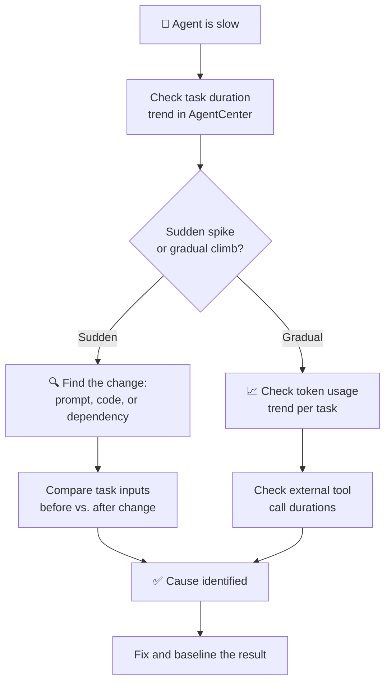

Your summarizer agent ran in 6 to 8 seconds last week. Now it takes 40 to 50. No errors, no crashes. Just slow. Debugging slow AI agents is harder than debugging failing ones because the usual signals are not there. Failures show up in logs. Slowness just silently costs you time and money.

This guide walks through how to find the bottleneck systematically, using what you can see in [AgentCenter's monitoring](/features/agent-monitoring) and your task history.

## Why Agents Get Slow

Before looking at code, narrow down the category:

- **More tokens being processed**: the prompt grew, retrieved context is larger, or examples were added
- **Model-side latency**: the LLM provider is slower than usual, or rate limits are queuing your requests
- **External tool calls**: a database or API your agent depends on got slower
- **Agent logic changes**: a code update or dependency change added extra steps

Most slowness falls into one of these. Your job is to figure out which one.

## How to Debug Slow AI Agents Step by Step

Start cheap and get specific. Don't change anything until you know what's wrong.

### 1. Check When It Started

Open [AgentCenter's agent monitoring](/features/agent-monitoring) and look at the task duration trend for the slow agent. A sudden spike on a specific day points to a change that happened then. A gradual climb over weeks points to data growth or prompt drift.

If the spike is sudden: pull up the task history and find the first slow task. Cross-reference the timestamp with your deployment log or prompt change history. Something changed around that time.

If the climb is gradual: the agent is probably processing more data per task than it was three months ago. The input is bigger, not the code.

### 2. Check Token Usage Per Task

If you have token tracking in your OpenClaw config, compare a slow recent task to a fast one from last week. If the token count jumped by 30 to 40 percent, that is almost certainly your answer.

Now ask why. Is the retrieved context larger? Did someone add more examples to the prompt? Did a list the agent depends on grow over time? Token usage does not lie. If the model is doing more work, the task takes longer.

### 3. Rule Out Model-Side Latency

LLM providers have variable latency. If your provider is under load or you are hitting rate limits, your agent waits. This shows up as tasks that are slow across all agents, not just one.

Check: are multiple agents running slower at the same time? If yes, the problem is likely external. You can verify by looking at variance in task durations. Rate limit delays cause inconsistent timing. A consistent slowness on one agent is almost never a provider issue.

### 4. Check External Tool Call Durations

If your agent calls external APIs, database queries, or internal services, those calls add up. A database call that used to take 300 milliseconds and now takes 3 seconds will make the whole task look slow even though your agent code is fine.

In AgentCenter's activity feed, look at the timing pattern. If slow tasks all use a specific tool or service and fast tasks do not, that tool is the bottleneck. This is worth checking before you touch any prompts or agent logic.

### 5. Isolate the Slow Segment

Once you have a hypothesis, test it with a minimal input. Take a recent slow task and run it with a shorter input or a trimmed prompt. If it runs fast, your real-world input is the problem. If it is still slow, the bottleneck is elsewhere.

For multi-agent pipelines, use the [task board](/features/task-orchestration) to check timestamps at each stage. Often one agent in the chain is fast and one is slow, and you are watching the slow one back up the whole pipeline. The bottleneck is usually at a handoff.

## Common Mistakes When Debugging Agent Slowness

**Blaming the model first.** The model is rarely the problem. Slow models show up as inconsistent latency across all your agents, not just one. Check token growth and external tool calls before assuming the LLM is the issue.

**Looking at averages.** Average task duration hides outliers. One run that took 3 minutes pulls the average way up even if 90 percent of runs were normal. Use p90 or p99 if you have them. If not, look at individual task durations, not summaries.

**Fixing before confirming.** Developers often trim the prompt first because it is the easiest lever. But if the real bottleneck is a slow downstream API, shortening the prompt does nothing. Identify the cause first.

**Not recording a baseline before you fix it.** Before changing anything, note the current average task duration and token count. If you fix it, you need to confirm the fix actually worked. Without a baseline, you are guessing.

## A Real Example

A categorization agent we ran labeled incoming support tickets. At launch it averaged 7 seconds per task. After four months it averaged 38 seconds. No code changes.

The prompt included a full list of categories so the agent could pick the right one. That list had grown from 22 categories at launch to 94. Token count had nearly quadrupled. The model was not slow. The input was just much bigger.

Fix: retrieve only the 10 most relevant categories at runtime instead of all 94. Task duration dropped to 9 seconds. That is it.

## Bottom Line

Slow agents almost always have a traceable cause. Task duration trends, token counts, and external tool timings point to it if you look in the right order.

Measure first. Isolate the segment. Then fix it. Skip any of those steps and you risk changing the wrong thing.

---

*The best time to set this up is before you are already debugging something slow. [Try AgentCenter free for 7 days](/pricing) — cancel anytime.*
