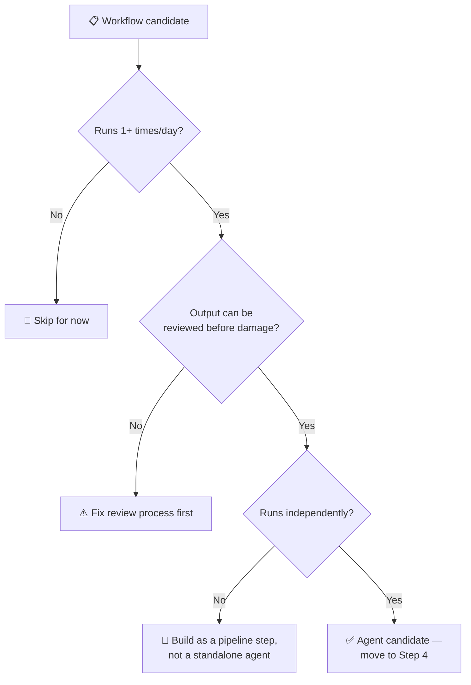

There's a question every team hits after their first few agents ship: how many AI agents do we actually need? Most ask it too late — after they've already overbuilt, or after one overloaded agent is doing the work of five and breaking constantly.

Neither extreme works. This is a step-by-step process for getting the number right before you build.

## What Determines the Right Number of Agents?

The right number is never a fixed target. It's a function of three things: how many distinct repeating workflows you have, how fast your team can review agent outputs, and how stable your current agents are.

Teams that skip this math either end up with 2 agents trying to do everything, or 20 agents they can't keep track of. Both are problems you can avoid.

## Step 1 — List Every Workflow That Could Benefit From an Agent

Start on paper. Write down every repeating task your team does that fits this profile:
- Template-driven or rule-based (not requiring judgment every time)
- High enough volume that doing it manually is a real time cost
- Low enough stakes that occasional errors won't cause serious damage

Don't filter yet. Just list them. Most teams end up with 8 to 20 candidates.

## Step 2 — Group by Input Type, Not Output Topic

This is where teams over-split. They create one agent per output type — one for summarizing contracts, one for summarizing emails, one for summarizing reports — when one agent handles all three fine.

A better frame: agents handle one category of input well. Group your workflow list by what goes in, not what comes out. "Text summarization" is one group. "Structured data extraction" is another. You'll find your 20 candidates collapse to 5 or 6 groups.

## Step 3 — Apply Three Filters to Each Group

For each workflow group, answer three questions:

**Does it happen at least once a day?** Twice a month doesn't justify a dedicated agent. Once a day or more does.

**Can a human review the output before it causes damage?** Agents make mistakes. If an error in this workflow could go undetected and cause real harm, the process isn't ready for an agent yet. Fix the review process first — the [deliverable review and approval features in AgentCenter](/features/task-orchestration) can help, but someone still needs to check.

**Does it run independently, or wait for other outputs?** If this workflow needs three other steps to complete before it starts, it's a pipeline step, not a standalone agent. Build it as part of a chain, not as a separate agent.

What passes all three filters is your real agent list. For most teams, it's 3 to 8 agents — not 20.

## Step 4 — Count Your Review Capacity

Every agent needs a human backstop. Build too many agents and your team spends its day doing reviews instead of real work.

A practical baseline: one person can comfortably review outputs from 3 to 5 active agents without it becoming their full-time job. That assumes reviews are quick — under 2 minutes per output — and errors are rare.

If you have 4 people on the team, you're probably looking at 12 to 15 agents max before reviews start backing up.

In AgentCenter, your [agent monitoring dashboard](/features/agent-monitoring) shows deliverable queue depth per agent. If any agent has a consistently backed-up review queue, you don't need more agents — you need to fix the one that's producing work faster than your team can check it.

## Step 5 — Start With Two or Three, Then Measure

Don't try to deploy your full fleet at once. Start with the 2 or 3 workflows that would save the most time. Get them stable. Measure:

- Tasks completed per day
- Average review time per output
- Cost per task (AgentCenter tracks this per agent under [agent monitoring](/features/agent-monitoring))
- Error rate — how often does an output need to be redone?

Once you have a baseline, adding the next agent is easy. You know what normal looks like. You can spot when a new agent is underperforming immediately instead of three weeks later.

Teams that skip this end up with 15 agents after two months and no idea which ones are worth running.

## Common Mistakes

**Adding agents to fix a broken process.** An agent running a flawed workflow just makes the flaws faster and harder to catch. Fix the workflow first.

**Building one agent that does everything.** A single agent that researches, writes, formats, and posts is hard to debug and fails in confusing ways. Each major step should be a separate agent or a clearly defined pipeline step.

**Not accounting for maintenance.** Every agent needs prompt updates, error investigation, and occasional tuning as your workflows change. If you're stretched too thin to maintain an agent, don't build it yet.

**Copying another team's headcount.** Reading that a team runs 25 agents means nothing if their workflows, review capacity, and error tolerance are different from yours.

## Bottom Line

There is no universal right number. A solo developer might run 5 agents and have complete visibility into all of them. A team of 10 might run 30 and feel overwhelmed. The number that works is the one you can staff, monitor, and actually improve over time.

Map what you do. Filter against the three questions. Match your agent count to your review capacity. Measure before you expand. If you want to see your current agents' cost, task volume, and error rate in one place, the [AgentCenter dashboard](/features/agent-dashboard) shows all of it by agent.

---

*The best time to set this up is before your agents start failing. [Try AgentCenter free for 7 days](/pricing) — cancel anytime.*
