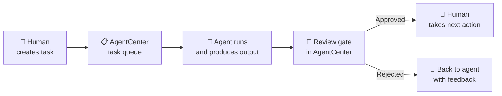

When you add AI agents to a workflow, two decisions matter more than which model you use or how you write the prompt. The first: exactly where does the human stop and the agent start? The second: exactly where does the agent stop and the human take over again?

Get those two boundaries wrong and you end up with agents running tasks they shouldn't, humans reviewing outputs they don't understand, and no one sure who owns what when something breaks.

Here's how to define them properly.

## What a Handoff Point Is

A handoff point is the moment in a workflow where responsibility transfers. Either a human passes a task to an agent, or an agent passes a result back to a human.

Every agent workflow has at least two handoff points: the trigger that starts the agent and the gate that holds the output for review. Complex pipelines have more, especially when multiple agents pass work to each other.

The problem isn't that teams skip handoffs. It's that they define them too loosely. "The agent handles the research" sounds clear until you realize no one specified what inputs it needs, what format the output should be in, or who reviews it before it goes anywhere.

## How to Map Your Handoff Points

Start by drawing your workflow as a sequence of steps, then mark every place where a human passes work to an agent or an agent returns something to a human.

For each handoff point, define four things before you ship:

**1. Input specification:** What exactly goes into the agent? File format, field names, character limits, required context. If the input is ambiguous, the agent's output will be too.

**2. Trigger condition:** What causes the handoff? A button click, a form submission, a time schedule, a status change in a project management tool? Undefined triggers lead to agents that run at the wrong time or get kicked off with incomplete data.

**3. Output contract:** What does the agent produce? A JSON object, a written summary, a filled template, a list with a specific structure? Document this before the agent runs a single task in production.

**4. Return condition:** When does the agent's work go back to a human? Always, or only on certain outcomes? What does "done" look like?

## Setting Up Handoff Gates in AgentCenter

In AgentCenter, every agent task has a deliverable review step you can configure as a gate. When the agent marks a task complete, the output goes into a review queue before anything downstream happens.

You set this up under [task orchestration](/features/task-orchestration). For each task type, you configure:

- Who reviews the output (named reviewer or role)
- What the acceptance criteria are (these go into the task description so the agent knows what it's aiming for)
- What happens on rejection (send feedback, retry, escalate)

This is the simplest form of a return handoff gate. The agent runs, produces output, and nothing moves forward until a human approves.

For input handoffs, use task templates. Build a template that specifies required fields, and the task doesn't get assigned to an agent until those fields are populated. This prevents the most common input problem: agents getting kicked off with missing or malformed data.

## Common Mistakes

**Handing off too early.** The agent gets the task before all inputs are ready. This happens when triggers are based on time or status rather than data completeness. Fix: add a readiness check to your trigger condition.

**Handing back too late.** The agent produces output, but no one reviews it before it flows into the next step. This is how wrong outputs compound into larger problems. Fix: require explicit approval before any downstream task can start.

**No rejection path.** Teams set up approval flows but forget to define what happens when output is rejected. The reviewer clicks "reject" and nothing happens. Fix: define a feedback route — either a retry with a comment, or a manual escalation — for every review gate you create.

**Vague return criteria.** "The agent is done when it finishes" is not a return condition. Define what done means: a specific file, a filled template, a specific set of fields with values. Agents that don't know what done looks like tend to produce inconsistent outputs.

**Skipping handoffs for trusted agents.** A common mistake after an agent runs well for a few weeks: teams remove the review gate to save time. Then the agent changes behavior (due to context drift or a provider update) and no one catches it for days. Keep gates on agents that touch anything important.

## Documenting Handoff Points for Your Team

Once you've defined the handoff points, write them down in the agent's runbook. Three short sections cover what you need:

- **Input:** What the agent needs, in what format, and who provides it
- **Output:** What the agent returns and what "acceptable" looks like
- **Review:** Who reviews it, how fast, and what happens on rejection

This documentation lives with the agent configuration, not in a separate wiki page. If it's in a separate place, it will drift out of sync with how the agent actually behaves.

You can track this in [AgentCenter's agent dashboard](/features/agent-dashboard) by adding the handoff spec to the agent description field. Every team member sees it in the same place they see task status.

## What Good Handoffs Look Like in Practice

A content team with 6 agents running draft generation, fact-checking, and SEO review. Each agent has a defined input template (content brief with word count, target audience, and keyword). Each agent has a review gate before the next agent picks up the work. The SEO review agent doesn't start until the fact-check is approved.

When one agent produces output that fails review, the reviewer adds a comment, clicks reject, and the task goes back to the agent queue with the comment attached. No hunting through Slack threads. No guessing what feedback was given.

That's what clean handoffs enable: a paper trail, a clear path for bad output, and no confusion about who owns the task at any moment.

## Bottom Line

Define what goes in, what comes back, and who reviews it. Do that for every agent in your workflow before you ship. Use AgentCenter's task templates for input handoffs and deliverable review for output gates. Without those two boundaries, you're not running an agent workflow. You're running a guess.

---

*The best time to set this up is before your agents start failing. [Try AgentCenter free for 7 days](/pricing) — cancel anytime.*
