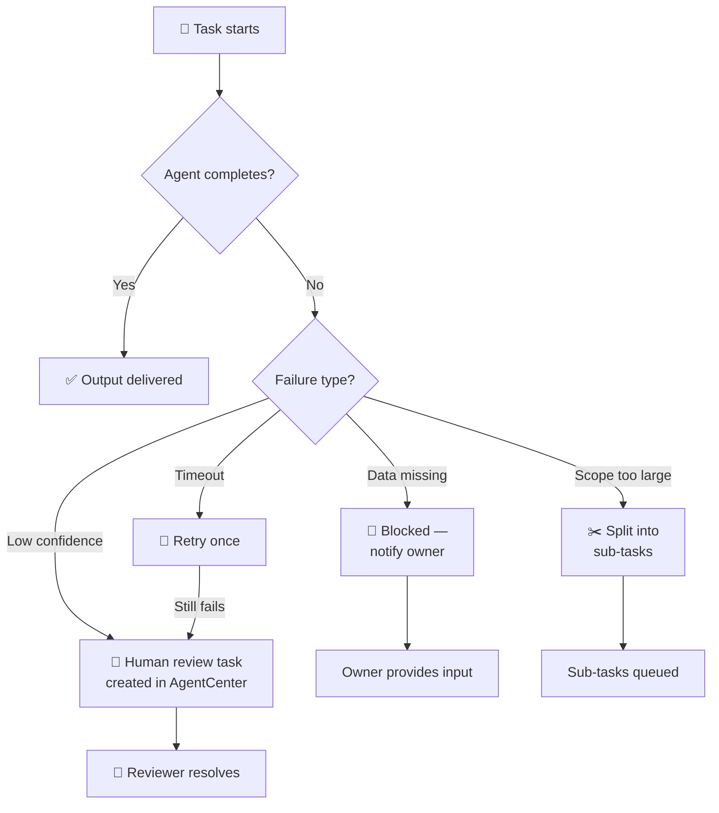

One of our agents processes vendor contracts. Each night it scans incoming PDFs, extracts key terms, and routes them to the right team. It has been running for six months.

For the first three months, when it couldn't parse a PDF, it logged an error and stopped. The task stayed "in progress" until someone noticed — usually a day later. By then, the contract was late.

The fix wasn't a better model. It was a fallback behavior: when confidence drops below 80%, route the task to a human reviewer instead of hanging. That change cut our late contract rate from 12% to 2%.

Fallback behaviors are the difference between agents that fail loudly and ones that fail silently. Here's how to design them.

## What a Fallback Behavior Is

A fallback behavior is what your agent does when it can't complete its primary task — by design, before a problem compounds into a bigger one.

There are four types worth knowing:

- **Partial result**: the agent returns what it finished so far and flags the task as incomplete
- **Human handoff**: the agent creates a review task for a person to finish or approve
- **Retry with variation**: the agent tries again with different parameters (shorter prompt, different model, smaller scope)
- **Graceful stop**: the agent marks the task as blocked and stops, triggering an alert

Most agents without a designed fallback default to a fifth option: silently hang or produce wrong output without flagging it. That's the one you want to avoid.

## How to Design Fallback Behaviors

### Step 1 — Map your agent's failure modes

Before writing any fallback logic, list every realistic way your agent can fail. Common categories:

- **Confidence failure**: the model signals low confidence in its output
- **Data failure**: the input is missing, malformed, or incomplete
- **Timeout**: the agent takes too long to respond
- **Tool failure**: an external API or database the agent calls returns an error
- **Scope failure**: the task is too large or ambiguous for the agent to handle

Do this before deployment. After a production incident is the wrong time to discover your agent's failure modes for the first time.

### Step 2 — Define a fallback for each failure type

Not every failure needs the same response. Timeouts might need a retry. Confidence failures might need human review. Tool failures might need a graceful stop with alerting.

Map it explicitly:

| Failure Type | Fallback Action |
|---|---|
| Confidence below 80% | Route to human reviewer |
| Input data missing | Mark task blocked, notify owner |
| API timeout | Retry once, then partial result |
| Task scope too large | Split and queue sub-tasks |

This table becomes your fallback spec. Write it before you build the agent, not after something breaks.

### Step 3 — Set the trigger condition

A fallback without a trigger is documentation, not behavior. Define the exact condition that fires each fallback:

- Confidence threshold: if `confidence_score < 0.80`
- Timeout: if no response within 45 seconds
- Data check: if required fields are null or empty

These conditions should live in your agent logic, not in someone's memory.

### Step 4 — Configure task hand-off in AgentCenter

For human handoffs, the task needs to show up somewhere a person can act on it. When an agent triggers a fallback in AgentCenter, it should:

1. Update the task status to "needs review"
2. Attach what the agent completed before stopping
3. @mention the right reviewer or team

You can set this up through [AgentCenter's task orchestration](/features/task-orchestration). The blocked task appears in the reviewer's Kanban column with full context already attached. No log-diving required.

### Step 5 — Test the fallback path explicitly

Most teams build a fallback and never trigger it on purpose. Then the first real test happens in production.

Trigger your fallback conditions deliberately — inject bad input, block the external API, set the confidence threshold artificially high. Watch the whole path: does the task route correctly, does the reviewer get notified, does the agent stop cleanly?

[AgentCenter's agent monitoring](/features/agent-monitoring) shows you whether the fallback triggered, how long the review task sat before someone resolved it, and whether the agent's partial output was actually usable.

### Step 6 — Track fallback activation rate

A fallback that fires once a week is probably fine. One that fires for 30% of tasks means something upstream is broken.

Track fallback rate as a first-class metric alongside task completion rate. If it starts climbing, that's a signal to investigate — not something to ignore or silence.

A sudden spike in fallback activations often means:
- Input quality dropped (a data source changed format)
- The agent's scope expanded past what it handles well
- An upstream API is degraded

None of these are visible from task completion rate alone. The fallback rate tells you what completion rate doesn't.

## Common Mistakes

**Treating fallbacks as an afterthought.** Fallbacks added after the first incident are usually incomplete and reactive. Design them upfront as part of the agent spec, alongside the happy path.

**Never testing the fallback path.** If you can't trigger a fallback on purpose, you don't know if it works. Make fallback testing part of your pre-ship checklist, not something you discover is missing at 11pm.

**Too many fallback layers.** Fallback to fallback to fallback creates a system nobody understands when something breaks. One primary fallback per failure type is enough. If that doesn't work, notify a human and stop.

**Ignoring the fallback rate.** A fallback isn't a success state. If your agent hits its fallback 20% of the time, something is wrong with the task design, the input quality, or the agent itself. Use the rate to find the real problem.

## Bottom Line

Every agent fails sometimes. The question is whether those failures are visible, handled, and recoverable. Designing fallback behaviors up front gives you agents that fail gracefully instead of silently — and a team that hears about problems before users do.

---

*The best time to set this up is before your agents start failing. [Try AgentCenter free for 7 days](/pricing) — cancel anytime.*
