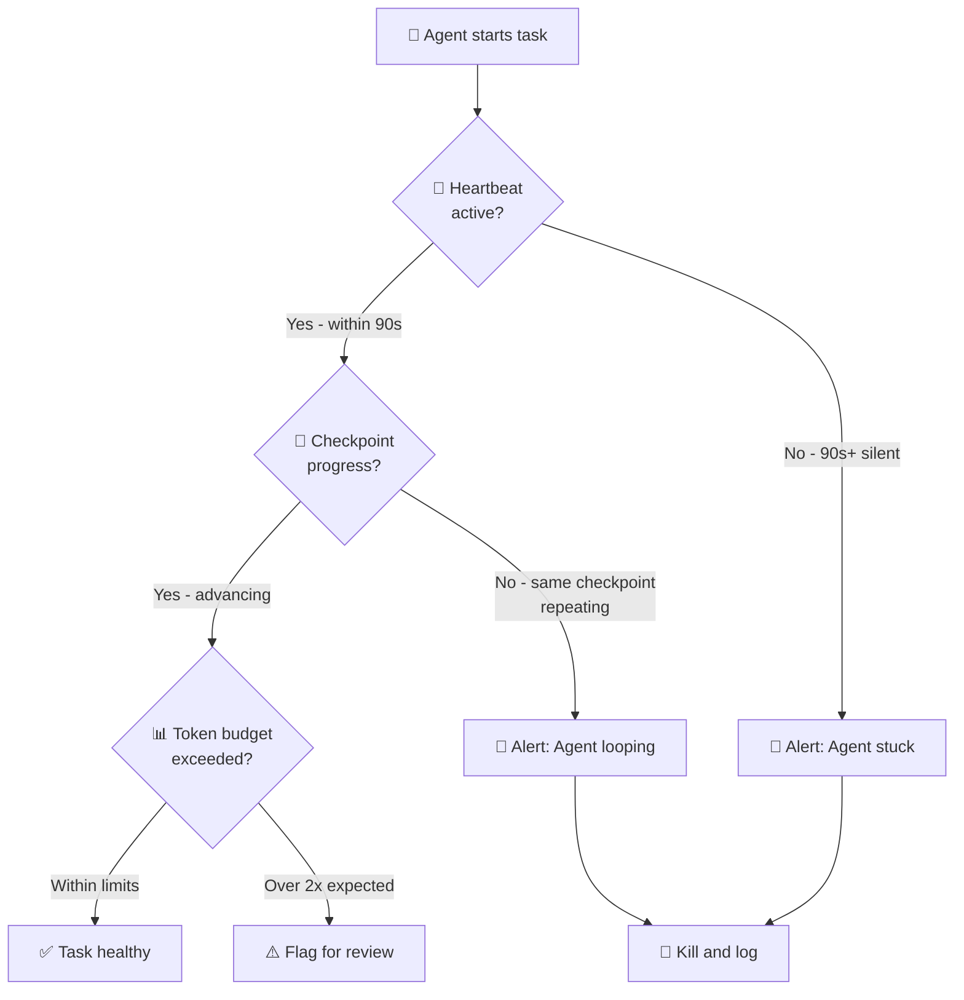

You deployed an agent an hour ago. No output yet. The status says "working." Is it making progress, or has it been spinning on the same API call for the last 50 minutes?

This is the stuck agent problem. Unlike a crash, where you get an error and know something went wrong, a stuck or looping agent fails silently. It consumes tokens, ties up your pipeline, and looks perfectly healthy from the outside.

Here's how to detect when an AI agent is stuck or looping, before it becomes a real incident.

## What "Stuck" and "Looping" Actually Mean

They're different failure modes.

**Stuck** means the agent is blocked. It's waiting on an external API that stopped responding, or it hit a tool call that never returned, or it queued behind something it can't get past. It's not making progress, and it's not retrying either.

**Looping** means the agent is actively retrying. Calling the same tool repeatedly, generating the same output and discarding it, cycling through a decision branch that never resolves. It looks busy. It's not getting anywhere.

Both burn tokens and time. The difference matters for how you fix them.

## Five Ways to Detect a Stuck or Looping Agent

### 1. Set a Task-Level Timeout

The most basic detection mechanism: if a task hasn't completed within a set time window, treat it as failed.

Don't rely on agent framework defaults. They're often set to forever, or close to it. Set your own limits based on what the task actually does:

- Short tasks (search, classify, extract): 2 to 5 minutes
- Medium tasks (draft, summarize, compare): 10 to 15 minutes
- Long tasks (research, multi-step workflows): 30 to 60 minutes

If a task exceeds the limit, kill it and log the reason. You'll know something went wrong instead of finding out at the end of the billing cycle.

### 2. Track Progress Markers, Not Just Status

"Running" isn't enough. You need to know if the agent is making progress within that running state.

Instrument your agent to emit checkpoints. Even simple ones: "Fetched data," "Generated draft," "Reviewing output." If you're not getting checkpoint updates after N minutes, the agent is likely stuck on a step.

This also catches looping: if you see the same checkpoint emitted five times in a row, the agent isn't progressing. It's retrying the same thing.

### 3. Watch the Retry Count

Most agent runtimes implement automatic retries on tool call failures. That's reasonable in theory. In practice, uncapped retries are how you end up with an agent that burns $30 before you notice.

Cap retries at 2 or 3 per tool call, then surface the error. A retry count above your expected maximum signals something is broken: the tool is down, the prompt is generating malformed requests, or the agent is stuck in a loop.

### 4. Monitor Token Usage Per Task

Token usage is a proxy for agent behavior. A task that should use 2,000 tokens but is at 15,000 and still running has something wrong.

Set soft limits per task type. If a task exceeds twice its expected token budget, flag it. Don't always kill it, since some tasks run long legitimately. But flag it for review.

This is especially useful for looping agents. Every loop iteration consumes tokens. The usage graph looks like a staircase instead of a hill: flat, flat, flat, jump, flat, flat, flat, jump.

### 5. Add a Heartbeat Check

A heartbeat is a periodic signal your agent sends to confirm it's alive and making progress. If the heartbeat stops, the agent is stuck.

Implement this as a simple timestamp update at regular intervals. Every 30 seconds works well for most tasks. If the last heartbeat is more than 60 to 90 seconds old, trigger an alert.

This catches a specific failure mode that timeouts miss: the agent that's "working" but frozen mid-execution because an API call hangs indefinitely without ever erroring out.

## Catching This in AgentCenter

AgentCenter shows real-time agent status across your task board. When an agent moves to "working," a timer starts. If it stays in "working" beyond the expected window for that task type, the status flips to "blocked" automatically. You see it on the board without waiting for a log or a page.

The [agent monitoring dashboard](/features/agent-monitoring) surfaces token usage per task in real time. You can spot a staircase usage pattern without querying logs or parsing JSON.

For teams running recurring tasks or long-running workflows, the activity feed shows the most recent checkpoint per agent. If an agent's last activity was 40 minutes ago on step 2 of 8, you know it's stuck at step 2. Not just "working."

Set up alerts for any task that exceeds your defined timeout. AgentCenter fires those to Slack or email, so you find out about a stuck agent before your users do.

Plans start at $14/month on the [Starter plan](/pricing), which covers up to 5 agents and includes real-time monitoring. If you're running 10 or more agents, the Pro plan at $29/month gives you 15 agents and full activity tracking.

## Common Mistakes

**Treating "no error" as "working fine."** A stuck agent doesn't throw an error. You have to actively check. Passive monitoring won't catch it.

**Setting one timeout for everything.** A 30-minute timeout on a short classification task means waiting 30 minutes to discover it failed in the first 2. Match timeouts to task types.

**Ignoring token usage until the bill arrives.** Real-time token tracking per task is your early warning system for loops and runaway retries. Set it up from the start.

**Not distinguishing stuck from slow.** Some tasks are just slow. An agent querying a heavy external API might take 8 minutes legitimately. Heartbeats tell you the agent is alive and working. Timeouts tell you if the overall task has gone too long. Use both together.

## Bottom Line

Stuck and looping agents are one of the most common silent failure modes in production. The detection isn't complicated: task timeouts, checkpoint tracking, retry caps, token budgets, and heartbeats. But none of it happens automatically. You have to set it up.

Get these checks in place before you scale. Catching a stuck agent at agent 3 is annoying. Catching it at agent 30, when it's blocking a downstream pipeline and burning your token budget, is a real incident.

---

*The best time to set this up is before your agents start failing. [Try AgentCenter free for 7 days](/pricing) — cancel anytime.*
