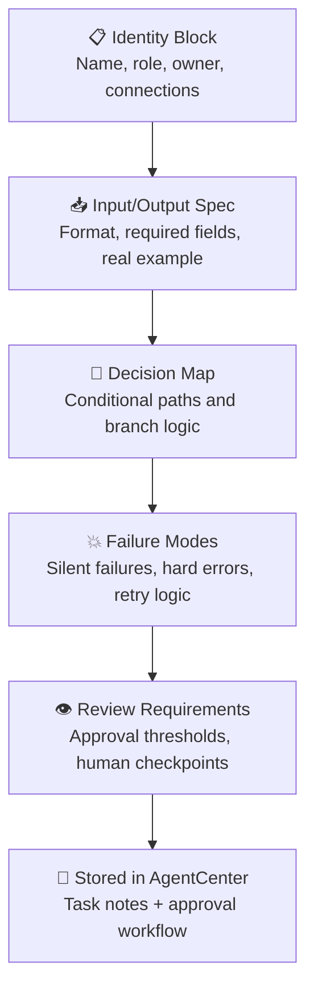

The engineer who built your lead-enrichment agent is gone. You have no idea what it does when it hits a rate limit. You don't know if it retries. You don't know what it outputs when the data is incomplete. And the person who does know is on a flight.

That's not an edge case. That's Tuesday for any team with more than three agents and normal employee churn.

Documenting agent behavior isn't busywork. It's what makes an agent handable to another person without a three-day debugging session.

## What Agent Behavior Documentation Actually Means

It's not a README. A README tells you what an agent is supposed to do. Agent behavior documentation tells you what the agent *actually* does — including the edge cases, the failure modes, and the decisions baked into the prompt.

Think of it as the difference between a job description and a performance review. One is aspirational; the other is what's actually happening.

Good documentation answers these questions for anyone who hasn't worked with the agent before:

- What triggers this agent, and what does it need as input?
- What does a good output look like? What does a bad one look like?
- What happens when the agent hits an error or a rate limit?
- Which parts of the output are reliable and which are fuzzy?
- Where does a human reviewer get involved, if at all?

## The 5-Part Agent Behavior Profile

Here's a practical structure you can fill in for any agent in about 20 minutes.

**1. Identity Block**

Name, role (one sentence), what it's connected to (data source, model, external API), and who owns it. This alone eliminates half the "wait, what does this thing do?" confusion.

**2. Input/Output Spec**

What it expects as input — format, required fields, optional fields. What it returns — field names, data types, known variability. Include a real example of a good output, not a made-up one. Real examples reveal assumptions that specs miss.

**3. Decision Map**

This is the part most documentation skips. For any branch in the agent's behavior, write down the condition and what happens:

- "If the company field is missing, the agent returns a partial record and flags the task as incomplete"
- "If the API times out, it retries twice then marks the task failed"

You don't need to cover every path. Cover the ones that will confuse someone at 2am.

**4. Failure Modes**

List the known ways it breaks:

- What causes silent failures (returns something that looks correct but isn't)
- What causes hard failures (errors, task crashes)
- What the retry logic is, if any

**5. Review Requirements**

Does any output require human review before being used downstream? What's the acceptance threshold? ("Flag the task for review if confidence score is below 0.7" is specific enough to act on.)

## Using AgentCenter to Back This Up

AgentCenter doesn't have a dedicated documentation feature, but it has several things that together handle most of what you need.

Task notes on any active task are a good place to capture context that would otherwise live in someone's head. If your enrichment agent is running on a new data source, a note like "using LinkedIn export format — expects a Company column, not Org" will save the next person an hour of confusion.

For review requirements, [approval workflows in AgentCenter](/features/task-orchestration) let you formalize what human-in-the-loop means for a given agent. If an output needs sign-off before it goes downstream, you can build that into the workflow rather than relying on whoever is watching the queue.

The [agent monitoring dashboard](/features/agent-monitoring) gives you a running log of what the agent did, when, and what it returned. When you're documenting failure modes, look at the last 30 tasks and count the error states. Real behavior is a better foundation than assumed behavior.

## Common Mistakes

**Documenting what the agent should do, not what it does.** Go look at actual task outputs. The agent probably handles 3 things differently from what you assumed.

**Only documenting the happy path.** Edge cases are what bite people during handoffs. If you don't document what happens when the input is missing a required field, whoever inherits the agent will find out the hard way.

**Making it too long.** A 10-page doc gets ignored. A one-page profile gets read. If your documentation doesn't fit on one page, prioritize input spec and failure modes. Those two sections save the most time.

**Treating it as a one-time task.** Every time an agent's prompt changes, its behavior changes. The documentation needs to stay in sync, or it becomes a liability instead of an asset. Add a "last verified" date to each profile and update it when the agent changes.

## Bottom Line

Agent behavior documentation isn't about compliance. It's about making sure your agents don't become single points of failure tied to whoever built them. A 20-minute profile per agent, kept current, means a new team member can pick up an agent in 30 minutes instead of 3 hours.

Start with your highest-traffic agent. Write down what it actually does, not what you think it does. Pull up the [activity feed in AgentCenter](/features/agent-monitoring) and look at real output examples. That's a better starting point than a blank doc.

---

*The best time to set this up is before your agents start failing. [Try AgentCenter free for 7 days](/pricing) — cancel anytime.*
