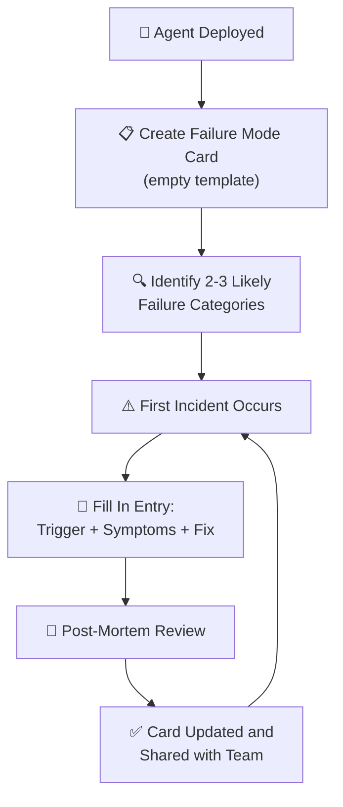

Three weeks after fixing a rate-limit crash on our document classifier agent, a different engineer hit the exact same failure. Same root cause, same fix. Two hours of debugging work done twice because nobody wrote it down.

That's the failure mode documentation problem. Agents break in specific, repeatable ways. But most teams treat each failure as a fresh puzzle instead of a known pattern.

## What a Failure Mode Document Actually Is

A failure mode document isn't an incident report or a post-mortem. It's a reference card per agent — a list of the ways a specific agent is known to break, what triggers each one, what you'll see in AgentCenter when it happens, and what fixes it.

It lives alongside the agent's runbook. You update it after post-mortems. You check it first when something goes wrong.

The goal: the next person who sees a failure can answer "is this a known issue?" in 30 seconds, not 2 hours.

## How to Build One

Start when you deploy the agent, not after the first crisis.

**Step 1: Create the failure mode card when you deploy.**

Don't wait for the first failure. Create an empty document with the agent name, the date it was deployed, and a table with four columns: Failure Type, Trigger, Symptoms in AgentCenter, Fix / Workaround. You'll fill in the rows as failures happen, but having the template ready means you actually use it.

**Step 2: Categorize failures before you see them.**

Every agent has predictable failure categories based on what it does. A document processing agent will likely hit: malformed input, rate limits, and context window exhaustion. An orchestration agent might see: dependency timeout, conflicting outputs from sub-agents, and task queue saturation.

List 2-3 likely categories upfront. Label the rows "TBD" — you'll fill in the specifics after real incidents.

**Step 3: After every incident, fill in one row.**

After your post-mortem, add one row to the card. It takes 5 minutes. Include:

- **Failure type**: A short label (e.g., "Rate limit crash on burst input")
- **Trigger**: What specifically causes it (e.g., "More than 40 tasks submitted within 60 seconds")
- **Symptoms in AgentCenter**: What you'd see on the task feed or monitoring view (e.g., "Tasks show 'error' status with 429 in the output log; agent goes idle for 2+ minutes")
- **Fix / Workaround**: Exactly what to do (e.g., "Throttle input at the queue level; restart agent after 3 minutes; failed tasks requeue automatically")

**Step 4: Link to the specific AgentCenter views where the failure shows up.**

Don't describe symptoms in the abstract. Write: "Go to the agent's task list, filter by status: error, look for the 429 code in task output." Specific locations mean a junior engineer can confirm a diagnosis in under a minute.

The [agent monitoring view](/features/agent-monitoring) shows real-time error rates. The task feed in the [AgentCenter dashboard](/features/agent-dashboard) shows which tasks failed and the raw output. Reference both.

**Step 5: Keep the card somewhere your team actually checks.**

Paste it into your team's wiki, pin it as a note in the agent's project in AgentCenter, or link it from the agent's runbook. The format doesn't matter. The location does.

## A Real Example

Our data enrichment agent has five documented failure modes. Three of the most common:

| Failure Type | Trigger | Symptoms in AgentCenter | Fix |
|---|---|---|---|
| Empty API response | External enrichment API returns 204 with no body | Task shows "completed" status but output field is null | Add null check in output validation; alert on null output |
| Context overflow | Input batch exceeds 6,000 tokens | Task errors with LLM timeout after 45s; agent status shows "blocked" | Split batch at 3,000 tokens; task template now includes a split step |
| Stale cache hit | Cached enrichment data older than 72 hours used for live requests | Output values don't match current API; no error shown | Add cache TTL check before returning; scheduled cache flush every 48h |

We added these over 3 months. Each entry came from a real incident. Checking this table when something breaks takes 30 seconds.

## Common Mistakes

**Documenting at the wrong altitude.** "Agent crashes sometimes" is not a failure mode. "Agent errors when input includes non-UTF-8 characters, visible as a 500 in the AgentCenter task output log" is.

**Waiting until you have a "complete" card.** Start with one row. A card with one entry is more useful than a card that doesn't exist yet.

**Not noting the observable symptoms specifically.** If someone has to dig through logs to even confirm they're looking at the right failure, the card isn't doing its job. Every entry should describe what you see without needing to open a terminal.

**Skipping failures that only happen occasionally.** The rarest failures are usually the most confusing. A failure that happens once every two months is exactly the kind that wastes the most time when it hits, because nobody remembers it. Document it.

## Bottom Line

Most agent failures repeat. The teams that debug them fast aren't smarter — they have better notes. A failure mode card per agent takes 20 minutes to set up and a few minutes to update after incidents. The first time it saves someone 2 hours of investigation, it's paid for itself many times over.

---

*The best time to set this up is before your agents start failing. [Try AgentCenter free for 7 days](/pricing) — cancel anytime.*
