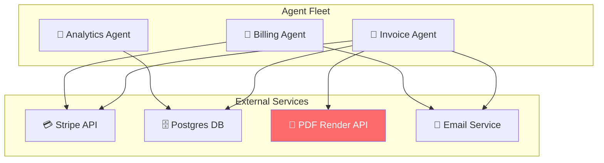

Your Stripe API key expired. Three agents failed silently. You spent two hours figuring out which ones.

Without a record of which agents call which external tools and APIs, you're debugging blind when anything in your stack has a problem. This guide walks through how to build and maintain that documentation — before an outage forces you to.

## Why Tool Dependency Documentation Matters

Every agent that does real work calls something external. A payment agent calls Stripe. A content agent calls your CMS. A research agent hits a vector database or a web scraper. Those aren't implementation details — they're operational dependencies.

When an external service has downtime, gets rate-limited, or changes its schema, agents that rely on it break. Sometimes loudly. Sometimes they just produce wrong output without any error.

Knowing which agents depend on which services means you can answer the question "which agents are affected?" in seconds instead of an hour.

## How to Document Agent Tool Dependencies

This process takes one afternoon for a small fleet. Schedule it before your next incident.

### Step 1: List Every External Call Per Agent

Go through each agent's code or configuration. Write down every external service it calls. For each one, note:

- Service name
- What the agent does with it (read, write, trigger webhook, query)
- Whether it's required or optional (does the whole task fail if this is unavailable, or does the agent skip that part and continue?)

Don't rely on memory. Check the actual implementation. You'll find services you forgot about.

### Step 2: Build an Agent Dependency Sheet

A simple table per agent is enough to start:

| Agent | Service | Call Type | Required? | Fallback |
|---|---|---|---|---|
| Invoice agent | Stripe API | Read | Yes | None — task fails |
| Invoice agent | Postgres | Read/Write | Yes | None — task fails |
| Invoice agent | PDF Render API | Write | Yes | None — task fails |
| Content agent | CMS API | Write | Yes | Draft queue |
| Content agent | Image service | Read | No | Skip, use placeholder |

That last column — fallback — is where most teams cut corners. It's also the most important one for incident response.

### Step 3: Build the Reverse Map

This is the one you actually need when something breaks. Flip the table to map each service to the agents that use it:

- **Stripe API** → invoice agent, billing agent, payment reconciliation agent
- **Postgres** → invoice agent, customer agent, analytics agent
- **PDF Render API** → invoice agent only

When Stripe is down at 2am, you open this map and know exactly which 3 agents to check. No code spelunking required.

The red node is the PDF Render API — if it goes down, only the invoice agent is affected. That's useful to know before you start checking everything.

### Step 4: Add Dependency Context to Your Agent Dashboard

Document this where your team can actually see it during an incident — not buried in a wiki no one opens at 2am.

In AgentCenter, you can attach notes and runbook links to each agent in the [agent monitoring](/features/agent-monitoring) view. When an agent shows an error in the activity feed, the dependency context is right there. Your team knows immediately whether to check Stripe's status page or look at something else.

### Step 5: Keep It Current

Dependency docs go stale fast. Two habits that help:

- Add a dependency check to your agent change process. Before any update ships, ask: did any external service calls change?
- Use AgentCenter's tool call monitoring to compare expected versus actual external calls after a deployment. If a new call appears that isn't documented, that's a gap to close.

## What Happens Without This

We ran 12 agents without dependency documentation for about five months. Then the PDF rendering API we'd been using quietly started failing on certain document sizes. Three agents produced partial outputs. One produced nothing and logged a generic timeout.

We spent 40 minutes cross-referencing code before someone thought to check the PDF API's status page. It was a 2-minute fix once we knew what to look at.

The dependency audit we ran afterward surfaced three other problems:

- Two agents calling the same rate-limited third-party service with no coordination between them. They were cutting each other's quota in half.
- One agent using a deprecated API that the provider was scheduled to shut down in six weeks.
- Several "optional" dependencies coded as required — meaning agents failed hard instead of degrading gracefully.

None of that showed up in normal monitoring because the agents were technically running. The problems were in their outputs.

## Common Mistakes

**Skipping the fallback column.** Knowing that an agent calls a service is only half the picture. What it does when that service is unavailable tells you how severe any outage actually is for that agent's tasks.

**Only documenting at the agent level.** Some agents handle multiple task types that call completely different services. An agent that manages both customer data and billing might call Postgres for one task type and Stripe for another. Map at the task type level, not just the agent level.

**Treating this as a one-time project.** Agents change. New tool calls get added. Old ones get removed or swapped. Build a review step into your change process so the map stays current.

**Not sharing it with the team.** If the dependency map lives in one person's notes, it doesn't exist for incident response. Put it where your team works — in AgentCenter task notes, in a shared doc linked from your [monitoring dashboard](/features/agent-monitoring), or in your agent runbooks.

## Bottom Line

When an external service has a problem, you don't want to be figuring out which agents use it. You want to already know. A dependency map — even a simple table — turns a 40-minute debugging session into a 2-minute check.

Start with your most critical agents. List every external call. Build the reverse map. Keep it where the team can find it during an incident. That's it.

---

*The best time to document dependencies is before an outage teaches you what they are. [Try AgentCenter free for 7 days](/pricing) — cancel anytime.*
