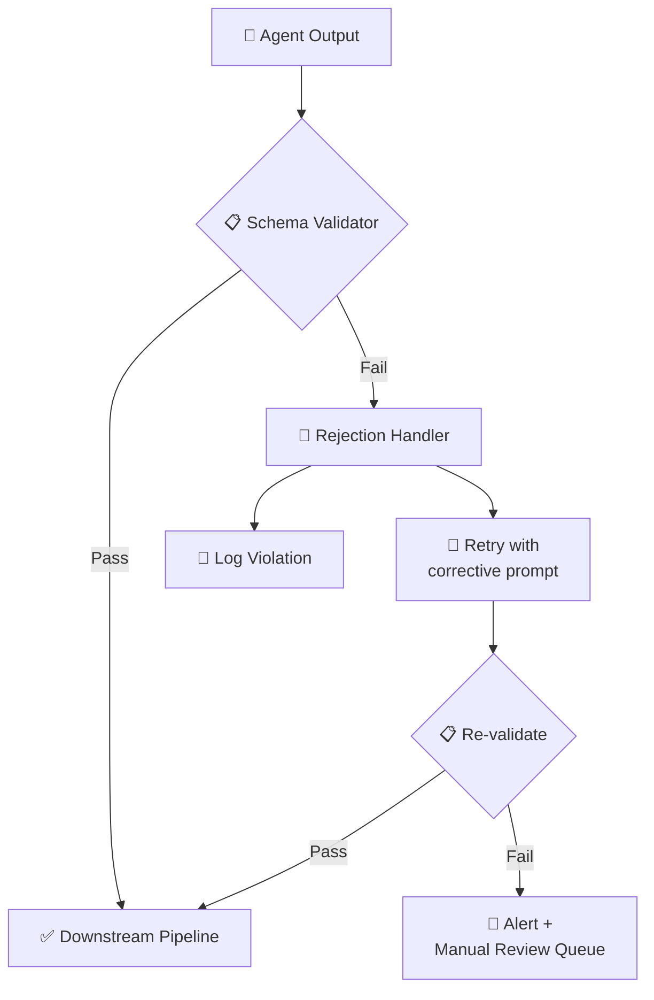

Three weeks into production, our data extraction agent started returning company names wrapped in markdown bold syntax. Not every time. Maybe 20% of the time. The downstream pipeline expected plain text, not `**Acme Corp**`. The string matching broke. Nobody noticed for four days.

That's an output schema violation. And it's more common than most teams expect.

## What Output Schema Enforcement Actually Means

When you define an output schema for an agent, you're specifying exactly what structure you expect back. Not "a JSON object." Specific fields, specific types, specific constraints. `company_name` is a string, not markdown. `confidence_score` is a float between 0 and 1, not a percentage string like `"87%"`.

Schema enforcement means your pipeline validates what the agent returned before doing anything with it.

Without it, you're trusting the model to return consistent output every single time. It won't.

## Why Agents Return the Wrong Format

Models are probabilistic. The same prompt returns slightly different output depending on temperature, context window state, and which model version is running. Common violations:

- **Markdown in text fields** — model adds bold, italics, or code blocks to plain-text fields
- **String vs number confusion** — `"42"` instead of `42`
- **Extra wrapper keys** — `{"result": {"company_name": ...}}` instead of `{"company_name": ...}`
- **Missing optional fields** — fields the model decided to skip
- **Casing drift** — `"status": "Complete"` instead of `"status": "complete"`

The model didn't fail. It returned something plausible. But plausible isn't parseable.

## How to Enforce Output Schemas in 5 Steps



### Step 1: Define the schema before you write the prompt

Start with the exact structure your downstream system needs. Every field, every type, every constraint. This is not documentation. It's a contract.

```json
{
  "company_name": "string",
  "domain": "string (URL, no trailing slash)",
  "employee_count": "integer or null",
  "confidence": "float 0.0–1.0"
}
```

Write the schema first, then write the prompt around it. If you write the prompt first, the schema ends up shaped by what the model tends to return rather than what your pipeline actually needs.

### Step 2: Use structured output modes where available

Most major LLM providers offer JSON mode or structured output constraints. Use them. They dramatically reduce format violations by restricting the model to valid JSON structure. If your agent uses OpenClaw with Claude or GPT-4, structured output is available — enable it.

JSON mode eliminates most type and structural violations. It won't eliminate logical errors (wrong value, wrong meaning), but it stops the parsing failures.

### Step 3: Add a validation layer between the agent and the downstream system

Don't pass raw agent output directly to the next step. Add a thin validation layer that checks the output against your schema before it goes anywhere.

In Python, `pydantic` or `jsonschema` handles this in a few lines. The validation step should return either a validated object or a structured error. Never silently pass malformed output through.

### Step 4: Write a corrective retry prompt for validation failures

When validation fails, don't immediately escalate. Try a corrective re-prompt first: return the original output to the model with explicit instructions on what was wrong and what format you need.

This handles the 80% of cases where the model just added markdown or returned a string where you expected a number. One targeted retry usually resolves it.

For AgentCenter users, this is where the [agent monitoring workflow](/features/agent-monitoring) pays off. Failed outputs can be flagged automatically and routed to a review queue rather than dropped silently or passed downstream broken.

### Step 5: Log every validation failure, not just the ones you retry

Every schema violation is a signal. Track which field fails most often, which agent, which prompt version. After two weeks you'll see patterns: temperature too high, a field description that's ambiguous, a prompt that works in staging but drifts under production load.

AgentCenter's [agent dashboard](/features/agent-dashboard) gives you a timestamped log of agent outputs and status changes. Pair that with your validation layer and you have a full audit trail to work from.

## Real Example: Lead Research Agent

A team ran a lead research agent that processed company names and returned structured data for CRM sync. Expected output:

```json
{
  "company": "string",
  "size": "SMB | Mid-Market | Enterprise",
  "website": "string (URL)",
  "primary_contact": "string or null"
}
```

Three violations were showing up in production:

1. `size` came back as `"small business"` instead of `"SMB"`
2. `website` included trailing slashes
3. `primary_contact` returned as `""` instead of `null`

They fixed it by enabling JSON mode, adding normalization logic for the `size` enum, stripping trailing slashes from URLs in the validation layer, and converting empty strings to null. Validation failures dropped by 94% in the first week. The prompt didn't change at all.

## Common Mistakes

**Making the schema too strict too early.** If you require 12 fields to all be present and non-null, you'll get constant failures until you've seen enough real outputs to know what's actually reliable. Start with the 3-4 fields your downstream system requires. Add constraints as you see what the model actually returns.

**Not logging failures in production.** Teams add validation, see it working in staging, and skip logging. In production, failures are silent unless you instrument them. You'll find out something was wrong when a stakeholder notices bad data.

**Retrying with the same prompt.** If the first attempt returns the wrong format, sending the exact same prompt again rarely helps. The retry must explicitly describe what failed and what format you need.

**Using validation as a substitute for a clear prompt.** If your agent returns inconsistent formats 40% of the time, that's a prompt problem. Validation catches failures — it doesn't fix a poorly specified prompt.

## Bottom Line

Output schema enforcement is a small layer that prevents a large class of silent production failures. Define your expected structure before writing the prompt, validate before passing output downstream, log every violation, and retry with corrective prompts before escalating.

The model will drift. Validation catches it before your pipeline does.

---

*The best time to set this up is before your agents start failing. [Try AgentCenter free for 7 days](/pricing) — cancel anytime.*
