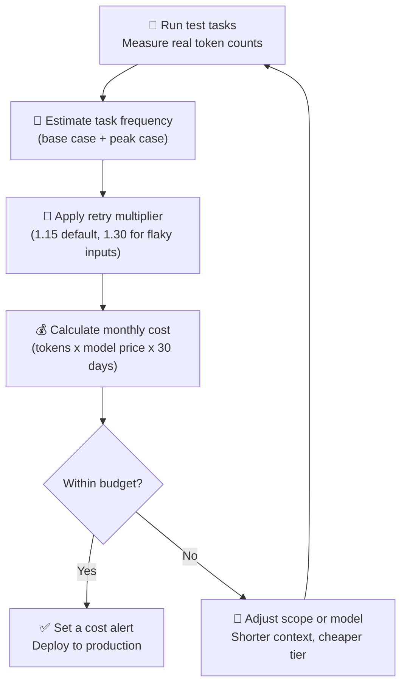

Most teams skip the cost estimate until the invoice arrives. A research agent that costs $3 in testing can cost $400/month in production. Same code. Same prompts. 30x the volume.

Estimating AI agent costs before you build isn't about being exact. It's about avoiding the 10x surprise that locks you into a workflow you can't afford.

## The Four Inputs That Determine Agent Cost

Every AI agent's monthly cost comes down to four things:

- **Tokens per task** — how many input and output tokens each run consumes
- **Task frequency** — how many times the agent runs per month
- **Retry rate** — how often tasks fail and restart (always more than you expect)
- **Model pricing** — cost per million tokens for your chosen model

Everything else feeds into one of these four. The math is simple. The challenge is measuring each input accurately before you have real data.

## How to Estimate AI Agent Costs: 4 Steps

### Step 1: Measure Tokens Per Task

Run your intended prompt with representative inputs 5-10 times. Check the token count for each run. Not the estimate from documentation — the actual count from your model provider's API response.

Two numbers to track: input tokens (your prompt, system instructions, any context you inject) and output tokens (what the model produces).

Long system prompts, injected documents, and tool call results all count as input tokens. If you're passing in document chunks, budget 500-2,000 tokens per chunk. If you're using tool calls, each tool response adds 200-500 tokens to the next call's context.

Take the average across your test runs. Outliers matter. One badly formatted input can triple the token count, and production inputs are messier than test inputs.

### Step 2: Set a Realistic Task Frequency

"Daily" is not a frequency. "80 tasks per day, 5 days a week" is.

Ask: is this agent triggered by events or scheduled on a timer? Triggered agents spike with demand. A support triage agent can jump from 50 tasks/day to 500/day overnight. Scheduled agents are predictable.

Build two estimates: your base case (current expected volume) and your peak case (2-3x base). The difference between them is your exposure to a bad month.

If you plan to expand the agent's scope over time, model that separately. Agents that start handling one task type tend to accumulate more.

### Step 3: Factor In Retries

Agents retry. An API call fails, a tool returns malformed JSON, a context window fills up — each failure costs a full run's worth of tokens.

If you have no historical data, start with a 1.15 multiplier (15% extra load). For agents calling external APIs or processing variable-quality input, use 1.30.

Your monthly token estimate looks like this:

`Monthly tokens = (input tokens + output tokens) x retry multiplier x daily tasks x 30`

### Step 4: Apply Model Pricing

Divide your monthly token estimate by 1,000,000 and multiply by your model's per-million-token price. Do this separately for input and output tokens — they're priced differently.

A concrete example: an agent with 4,000 input tokens and 600 output tokens per task, running 50 times per day with a 1.20 retry rate:

- Monthly input tokens: 4,000 x 1.20 x 50 x 30 = 7,200,000
- Monthly output tokens: 600 x 1.20 x 50 x 30 = 1,080,000

At $3/M input and $15/M output: $21.60 + $16.20 = **~$38/month**

## A Real Example Using AgentCenter

Say you're building a daily competitor tracking agent. It pulls 3 product pages, summarizes each, and writes a brief.

Rough estimate: 6,000 input tokens per run (3 pages at around 1,500 tokens each, plus your prompt and prior summaries), 700 output tokens. Running once per day. Retry multiplier: 1.25, since web scraping fails more than you'd expect.

Monthly: (6,000 + 700) x 1.25 x 30 = 251,250 total tokens. At typical GPT-4o pricing, that's around $15-20/month.

Before you deploy, set a per-agent monthly budget inside AgentCenter's [agent monitoring dashboard](/features/agent-monitoring). When the agent starts running longer than expected — larger pages, more retries, context window growth — you'll get an alert before the cost doubles. Week one in production is when estimates and reality diverge most.

This is the pattern: estimate, set a ceiling, track actuals against estimate in the first two weeks. The estimate gets you in the right ballpark. The [monitoring](/features/agent-monitoring) keeps you there.

## Common Mistakes

**Estimating from documentation, not your actual prompts.** Model docs show token counts for simple inputs. Your system prompt, injected context, and tool definitions add thousands of tokens to every call. Always measure with your real prompts.

**Forgetting that multi-step pipelines multiply costs.** If your pipeline has 3 agents passing output to each other, calculate each stage separately. The output of stage 1 becomes the input of stage 2. Token costs compound across the chain.

**Using one estimate instead of two.** Model both base and peak volume. The gap between them is your worst-case exposure. You need to know if a traffic spike can turn your $30/month agent into a $300/month problem.

**Not tracking retry rates from day one.** High retry rates are usually a signal of flaky inputs or brittle tool calls. If your actual retry rate comes in at 1.50 and you planned for 1.15, that's a 30% cost overrun on a single variable.

## Bottom Line

You won't get the number exactly right before you build. But 30 minutes of measurement — real token counts from real test runs, honest frequency estimates, a retry buffer — puts you within 2x. That's enough to know whether your plan is viable before you've committed to anything.

Once you go live, check your cost actuals weekly in the first month. That's when estimates and real usage diverge, and catching it early costs nothing.

---

*The best time to set this up is before your agents start failing. [Try AgentCenter free for 7 days](/pricing) — cancel anytime.*
