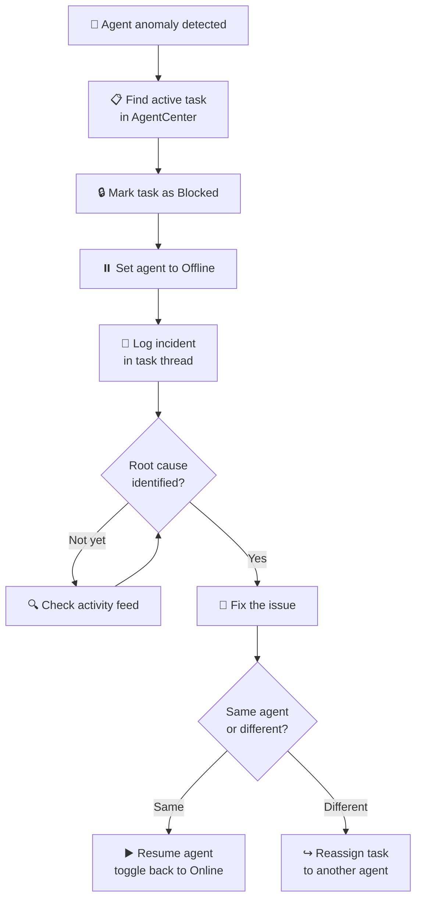

It's 2am. An agent that should take 40 minutes to run has been working for 6 hours. It's consumed 12x its normal token budget and written duplicate records to your database. You don't know why yet.

You need it stopped.

That's not a monitoring problem. That's a response problem. If you don't have a clear way to freeze the agent in place, you'll either kill it and lose all task state, or watch it keep burning through resources while you figure out what went wrong.

Here's how to freeze an AI agent cleanly and recover without throwing away the work it already did.

## What "Freezing" an Agent Actually Means

Freezing an agent means putting it in a controlled pause state. It stops accepting new tasks and halts whatever it's currently running. The goals:

- Stop the damage (runaway costs, bad outputs, duplicate writes)
- Preserve enough state to understand what happened
- Keep your pipeline intact so other agents aren't disrupted

This is different from killing an agent. Killing drops everything. Freezing is a deliberate pause you can resume from.

## How to Freeze an AI Agent: Step by Step

Here's the process for stopping a misbehaving agent using AgentCenter.

**Step 1: Find the agent and its active task**

Open your [agent monitoring dashboard](/features/agent-monitoring) and locate the agent with the anomalous status. It'll usually show as "Working" for longer than expected, or you'll see a spike in error count or token cost on the activity feed.

Before doing anything else, note the task ID. You'll need it to track what happened and to resume correctly.

**Step 2: Mark the active task as Blocked**

In AgentCenter's Kanban board, drag the task from "In Progress" to "Blocked," or change its status from the task detail view. This signals to the agent that a human needs to review the task before it continues.

Depending on your OpenClaw agent configuration, this either pauses the agent mid-task or lets it finish its current action and then stop. Either way, no new work starts.

**Step 3: Set the agent to Offline**

In the agent roster, toggle the agent to Offline. AgentCenter stops routing any new tasks to it. Other agents in your pipeline continue working normally.

If you're running [multi-agent workflows](/features/multi-agent-workflows), tasks queued for the frozen agent hold in place rather than being silently dropped. You won't lose them.

**Step 4: Log the incident in the task thread**

Open the blocked task and add a comment explaining what you observed, when you froze it, and what you're investigating. Use @mentions to loop in a teammate if you need backup.

This is not a courtesy step. The comment thread is your incident log. If you hand this off to someone else an hour from now, they need to know why the agent is offline and what the last known state was.

**Step 5: Investigate using the activity feed**

Go to the agent's activity feed and look at the last few entries before you froze it. You're looking for:

- The last successful output
- The last tool call that ran
- Any error events or retries

In most cases, one of three things caused the problem: the agent hit a rate limit and started looping retries without backoff, an external tool call hung and never returned, or the task description was broad enough that the agent kept expanding scope.

**Step 6: Resume or reassign**

Once you know what went wrong, you have two options.

**Resume the same agent.** Fix the root cause (update the retry config, fix the external API, tighten the task description), set the task back to "In Progress," and toggle the agent to Online. It picks up from the blocked state.

**Reassign to a different agent.** If the agent has a config problem that needs more time to fix, reassign the task in AgentCenter to another online agent of the same type. The task and its state transfer over.

## A Real Example

A team running 8 research agents noticed one had been "Working" for 4 hours on a task that normally takes 25 minutes. The agent was hitting a third-party data API that had started rate-limiting requests. The agent's retry logic had no backoff, so it was retrying every 2 seconds in a tight loop.

They opened AgentCenter, found the agent, and moved its task to Blocked. The agent finished its current retry cycle and stopped. They added a comment explaining the rate-limit issue, then spent 12 minutes updating the retry configuration to use exponential backoff.

Once fixed, they toggled the agent back to Online. The task restarted and finished in 22 minutes.

If they'd killed the agent process directly, they would have lost the partial results it had already gathered. Freezing preserved everything.

## Mistakes to Avoid

**Freezing without logging.** You pause the agent and switch to investigating. Two hours later, no one remembers why it's offline. Always leave a comment in the task thread before you close the tab.

**Killing instead of freezing.** If you terminate the agent process outside of AgentCenter, you drop the task state. Use AgentCenter's status controls to pause cleanly.

**Freezing the wrong agent.** In a multi-agent setup, one agent producing bad output is often being fed bad data by an upstream agent. Check the task history to find where the bad input came from before you blame the agent you can see.

**Ignoring the task queue.** When you freeze an agent, check if other tasks are waiting for it. If any are time-sensitive, reassign them before you start investigating.

## Bottom Line

Freezing an agent is the production equivalent of pulling a car over before checking under the hood. You don't diagnose the problem while still moving. You stop, look, then decide what to do.

AgentCenter gives you the controls to do this without losing work: block the task, take the agent offline, log what happened, and resume or reassign when you're ready. No guesswork, no lost state, no cascading failures into the rest of your pipeline.

---

*The best time to practice freezing an agent is before you need to. [Try AgentCenter free for 7 days](/pricing) — cancel anytime.*
