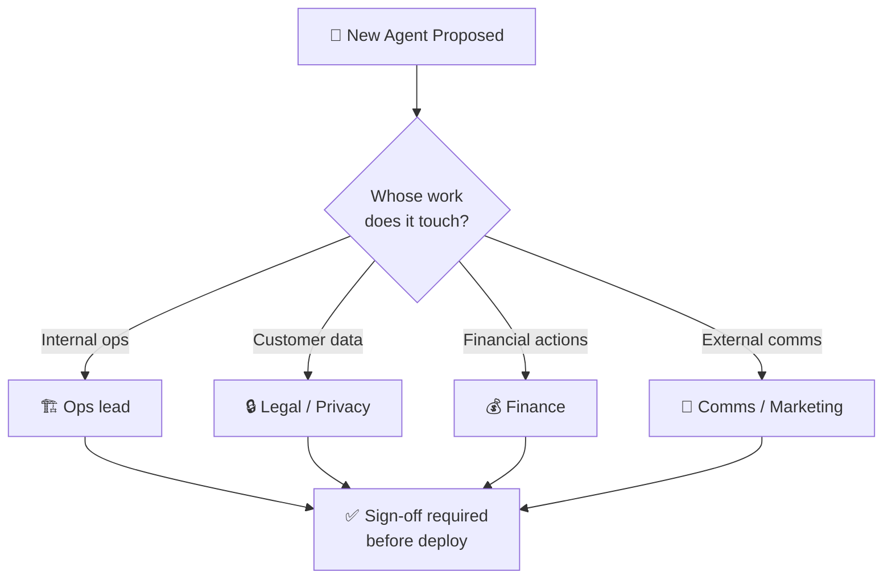

We deployed an invoice extraction agent without telling the finance team. Three days later they were manually re-entering data the agent had already filed, because nobody knew the agent was running. The agent worked fine. The coordination did not.

Getting stakeholder sign-off before deploying an AI agent isn't a bureaucratic hurdle. It's how you avoid a week of cleanup that nobody budgeted for.

## What Stakeholder Sign-Off Actually Means

For AI agents, sign-off isn't just an email saying "looks good." It means the right people have seen the agent's scope, understood what it touches, agreed on success criteria, and accepted the risks.

That's different from a code review. Code reviewers check that the implementation is correct. Stakeholders check that the implementation is solving the right problem for the right people.

You need both.

## Who Needs to Sign Off

Not everyone needs to approve every agent. The question is: who will this agent's work affect?

A writing assistant agent that drafts internal docs needs your content lead. An agent that touches customer data needs your privacy or legal contact. An agent that triggers billing actions needs finance.

A simple rule: if the agent's output can change someone's work, their data, or their metrics, that person needs to know before it goes live.

## How to Get Stakeholder Sign-Off

### 1. Write a one-page brief

Before scheduling a single meeting, write down what the agent does, what it doesn't do, what systems it reads and writes to, and what failure looks like. One page. Plain language.

If you can't write that page in under an hour, the agent isn't scoped clearly enough to deploy.

### 2. Identify your stakeholders

Go through the brief and ask: who runs each system this agent touches? Who approves work in that domain? Those are your stakeholders.

Keep the list short. Four people who actually care beats twelve who will ignore the email.

### 3. Set a success threshold

Before you share anything, decide what "working well" looks like. Concrete numbers help: 95% of outputs accepted without revision, cost under $0.12 per task, average run time under 3 minutes.

Put the thresholds in the brief. Stakeholders should be approving specific criteria, not vibes.

### 4. Share the brief and give a deadline

Send the brief via your existing channel — Slack, email, whatever. Ask for written approval or specific objections by a date.

Set the deadline 3 business days out. Longer and it drifts. Shorter and you're setting people up to rubber-stamp without reading.

### 5. Hold a 30-minute sync for blockers

If a stakeholder has questions or concerns, get on a call. Don't try to resolve substantive blockers asynchronously — it takes longer.

For most agents, the sync won't be needed. The brief answers the questions.

### 6. Document the approval

Write down who approved what and when. A Slack message counts. A comment in your task tracker counts. A formal document is unnecessary unless your compliance process requires it.

The point is that it's findable later when someone asks "who knew about this before it launched?"

## Using AgentCenter to Support Sign-Off

AgentCenter's [task orchestration board](/features/task-orchestration) makes this concrete. Before your agent is deployed, create a task like "Stakeholder sign-off — Invoice Extraction Agent" and assign it to your lead. The task description holds the brief; the comments track the back-and-forth; the status shows where approval stands.

When the sign-off task is marked complete, that's your green light to move the agent to production.

You can also run the agent in staging first. Capture real output against real data in read-only mode and include 3 to 5 sample results in your brief. Stakeholders approve things faster when they can see actual outputs, not hypotheticals. The [agent monitoring dashboard](/features/agent-monitoring) shows exactly what the agent produced, costs per run, and how long it took — useful data to include when asking for sign-off.

## Common Mistakes

**Sending the brief too late.** If you send it 24 hours before you want to deploy, you're not asking for approval. You're asking for a rubber stamp. Build 3 to 5 days into your deploy plan from the start.

**Getting approval from the wrong person.** Your manager approving an agent that touches finance data isn't a finance sign-off. Get approval from the person who owns the domain, not just someone senior enough to feel like it counts.

**Treating silence as approval.** If someone doesn't respond by the deadline, that's not a yes. Follow up. If they're genuinely unavailable, escalate or delay.

**Not updating stakeholders after deployment.** Sign-off isn't the end of the relationship. After the agent runs for two weeks, send a quick update: here's how it's performing against the criteria you approved. This builds trust and makes future sign-offs faster.

## Bottom Line

Stakeholder sign-off before deploying an AI agent takes a few days. Cleaning up a surprise deployment takes longer. A one-page brief, the right people, a real deadline, and documented approval is all you need to get it right the first time.

---

*The best time to set this up is before your agents start failing. [Try AgentCenter free for 7 days](/pricing) — cancel anytime.*
