Rate limits are one of the least glamorous problems in AI agent operations and one of the most common causes of cascading failures. You hit a rate limit. The agent retries. The retry also hits the limit. Now you have a retry storm, your other agents are starved for API capacity, and you're debugging an incident that feels like a production fire but is actually just a queue management problem.

Here's how to design your agent system to handle rate limits before they cause trouble.

## Why Rate Limits Are Worse for Agents Than for APIs

When a standard web service hits a rate limit, the response fails, you show the user an error, they retry. Clear, bounded, recoverable.

When an agent hits a rate limit mid-task, the situation is murkier. The agent might be 70% through a complex task. It retries the rate-limited call. That retry competes with other agents for the same API budget. If you have 10 agents all retrying simultaneously, your entire rate limit budget goes to retries, and no actual work gets done.

The agent's retry logic and your LLM provider's rate limits interact in ways that aren't obvious until you're seeing them in production at 2am.

```mermaid
graph TD
    subgraph "Rate Limit Cascade"
        A["🤖 10 Agents<br/>Running"] --> B["⚡ Rate Limit<br/>Hit"]
        B --> C["🔁 All 10 Agents<br/>Retry at Same Time"]
        C --> D["💥 Retry Storm<br/>Exhausts Quota"]
        D --> E["🔴 No Agent Gets<br/>Work Done"]
        E --> F["⏱️ Full Reset<br/>Needed"]
    end
    subgraph "Managed Rate Limit Handling"
        G["🤖 10 Agents<br/>Running"] --> H["⚡ Rate Limit<br/>Detected"]
        H --> I["⏸️ Agent Marked<br/>Blocked"]
        I --> J["⏱️ Backoff Queue<br/>Managed Centrally"]
        J --> K["✅ Agents Resume<br/>Sequentially"]
    end
```

## Step 1: Understand Your Rate Limit Structure

Different providers structure rate limits differently. Know yours.

- **Requests per minute (RPM):** How many API calls per minute
- **Tokens per minute (TPM):** How many tokens of input+output per minute
- **Tokens per day (TPD):** Daily caps on some tiers

Some providers have both RPM and TPM limits, and you can hit either one independently. An agent making frequent short calls can hit RPM. An agent processing large documents hits TPM. They have different solutions.

Check your provider's documentation and your current tier. Then check how close you're running to those limits on a busy day.

## Step 2: Implement Exponential Backoff at the Agent Level

Every agent should implement backoff when it hits a rate limit. Not fixed-interval retries — exponential backoff with jitter.

The pattern:

- First retry: wait 1 second
- Second retry: wait 2 seconds
- Third retry: wait 4 seconds
- Add random jitter (+/- 500ms) to each wait to prevent synchronized retries

The jitter is important. If all 10 agents back off for exactly 2 seconds and then all retry at the same moment, you get a synchronized retry storm. Jitter spreads the retries out.

## Step 3: Centralize Rate Limit Awareness

Individual agent backoff is necessary but not sufficient. If 10 agents each handle their own rate limits independently, they have no coordination. One agent's retry doesn't know that 9 other agents are also retrying.

Centralized rate limit awareness means: when one agent hits a limit, the system slows down all agents, not just the one that got the error. A shared token bucket or rate limiter that all agents check before making calls.

AgentCenter's [task orchestration](/features/task-orchestration) helps here. When an agent is blocked (including rate-limited), the task status changes and new tasks don't start on that agent until it's clear. This prevents the "10 agents all retrying simultaneously" pattern.

## Step 4: Design for Graceful Degradation

When you hit a rate limit, what should happen?

**Fail fast on user-facing operations.** If a user is waiting for a response, return an error or a "please wait" message. Don't retry indefinitely.

**Queue and continue for background operations.** If the agent is doing background processing, queue the task and resume when rate limits clear. This is the case for most batch agent workloads.

**Prioritize critical agents.** If you have both critical and non-critical agents, route API capacity to critical ones first when limits are tight. Non-critical agents wait. Critical ones keep running.

## Step 5: Monitor Rate Limit Frequency

Rate limits should be rare in normal operation. If you're hitting them regularly, it's a signal that your agent design or workload needs adjustment.

Track:

- How often each agent hits rate limits per day
- Which task types trigger rate limits most frequently
- Whether rate limit frequency is increasing (workload growth)

An agent that hits rate limits 20 times per day is either processing inputs that are too large, making too many calls per task, or running at a volume that exceeds your current plan.

## Common Mistakes

**Retry without backoff.** Immediate retries on rate limits make the problem worse. Always back off.

**No max retry limit.** Retrying forever is a runaway process. Set a max retry count (typically 3-5). After that, fail the task and flag it for review.

**Ignoring per-model limits.** If you're using multiple models across your agents, each model may have different limits. Claude and GPT-4 have separate quotas. Don't assume shared budget.

**No visibility into rate limit events.** If you can't see how often your agents are hitting limits, you can't know when the problem is getting worse. Log rate limit events explicitly.

## Bottom Line

Rate limit handling is a coordination problem, not a retry problem. Individual agent backoff is the first step. Centralized awareness, priority routing, and queue management are what make it reliable at scale. Build these patterns in before you have 15 agents fighting over the same API budget.

_The best time to set this up is before your agents start failing. [Try AgentCenter free for 7 days](/pricing) — cancel anytime._
