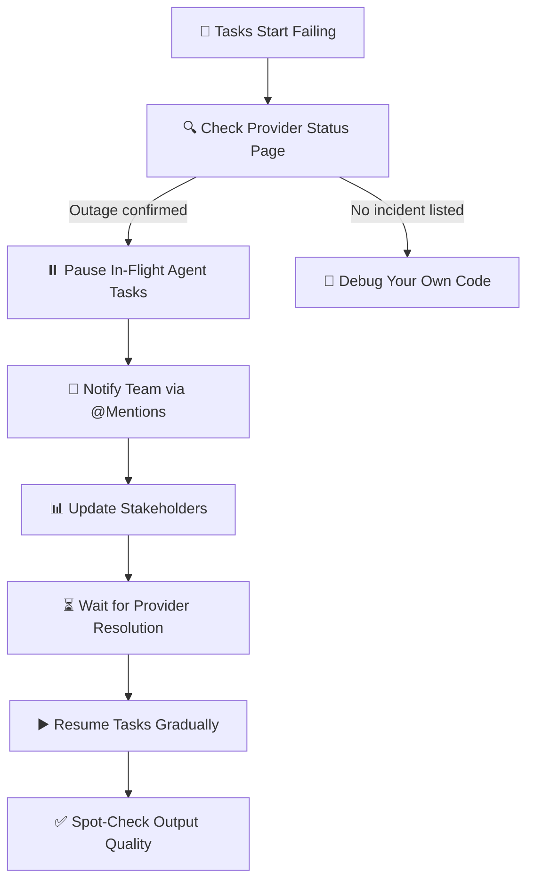

Your agents are running 12 tasks. Then your LLM provider goes down.

Requests start failing. Agents hit retry limits. Tasks that were halfway through sit frozen. Your team has no idea what to do next because nobody planned for this.

Most teams improvise their way through it, then spend two days cleaning up the mess. This post walks through a structured process so the next outage doesn't cost you half a sprint.

## What a Provider Outage Looks Like

A provider outage is different from a rate limit and different from a bug in your code.

Rate limits are predictable and self-correcting: wait a few seconds, try again, it works. Code bugs show up in your error logs with stack traces you wrote. Provider outages look like sudden 503s or 529s across all your agents, at the same time, with no changes on your side.

The first sign is usually a cluster of failed tasks with HTTP errors pointing to the same endpoint. Check the provider's public status page before assuming the problem is yours. OpenAI, Anthropic, and Google all publish live incident pages. If they're showing an active incident, you have your answer.

## The Response Process

### Step 1: Confirm it's the provider, not you

Go to the provider's status page first. If there's an active incident, stop debugging your own code immediately. If there's no incident, check whether errors are hitting one agent or all of them. Uniform 503s across your fleet at the same timestamp is almost always upstream. A single misbehaving agent is usually yours to fix.

Don't spend 20 minutes in your codebase before you've ruled out the obvious.

### Step 2: Pause in-flight agent tasks

Once you confirm a provider outage, stop agents from retrying. Most agent retry logic will keep hammering the provider on a backoff schedule, which burns budget and produces nothing useful.

In AgentCenter, go to your [agent monitoring](/features/agent-monitoring) view, filter for active tasks, and freeze them. Note which tasks were mid-run and at what step — you'll need this when you resume. Tasks that already completed are safe; only the in-progress ones need attention.

Pausing explicitly is better than letting retry limits handle it. Retry exhaustion can leave tasks in an ambiguous state where the agent thinks it's done but the output is incomplete.

### Step 3: Notify your team

Use @mentions in the affected project's task threads to tell the team what's happening and what state things are in. One message in the task thread is better than five separate Slack DMs because it stays attached to the work.

Something brief works: "@team — LLM provider is down (checked status page). Paused all in-flight tasks. Will resume and re-validate once resolved."

This way, anyone who picks up the work later has context directly in the task thread, not buried in a message channel.

### Step 4: Update stakeholders

If the affected agents were working on anything time-sensitive, a brief note to stakeholders is better than silence. They're not watching the provider status page. They just know the deliverable isn't ready.

Post a one-line status update in AgentCenter's activity feed. It timestamps automatically and is visible to everyone on the project without requiring them to dig through chat threads.

### Step 5: Resume gradually and validate

When the provider resolves the incident, don't restart everything at once. Bring back one or two tasks first. Confirm they complete cleanly. Then resume the rest.

Providers sometimes have a window of degraded performance right after an incident resolves, where the API responds but output quality is lower than usual. If your first resumed tasks produce outputs that look off, wait another 10 minutes before continuing.

After full resumption, spot-check a sample of outputs manually before treating them as production-ready. This is true even for tasks that were early in their run — partial context from before the outage can affect final output quality in subtle ways.

## How This Plays Out in Practice

A team running a competitive research pipeline in AgentCenter had 9 agents active when an Anthropic incident hit at 14:30 UTC. Four agents had already submitted their deliverables. Five were mid-run.

They paused the five mid-run tasks, posted a note in each task thread, and sent a brief status message to the project's stakeholder channel. When Anthropic resolved the incident at 15:50, they resumed two tasks first, reviewed their outputs, then brought the remaining three back online.

Total unplanned time spent: about 12 minutes. The key was that the pause-and-resume workflow already existed in their [task orchestration](/features/task-orchestration) setup. They weren't figuring it out under pressure.

## Mistakes That Make Outages Worse

**Skipping the status page.** The most common mistake is jumping straight into debugging your own code. Spend 30 seconds checking the provider's status page before you do anything else.

**Letting retry logic run unchecked.** Automatic retries are useful for transient errors. During a full provider outage, they just drain your token budget with nothing to show for it. Pause explicitly.

**Resuming everything at once.** Post-incident provider performance can be shaky for 15-30 minutes after resolution. Starting with a few tasks and checking quality before full resumption catches lingering instability before it affects your whole queue.

**Not validating outputs after resume.** Agents that were mid-task during an outage sometimes produce lower-quality output on resumption. "The task completed" is not the same as "the output is good." Sample before shipping anything downstream.

## Bottom Line

Provider outages are not emergencies if you have a process. Confirm, pause, notify, wait, resume gradually, validate. Most teams can complete the whole response in under 20 minutes.

The teams that lose a day to a provider outage are the ones figuring out each step in real time. Set up the pause workflow before you need it.

---

*The best time to set this up is before your agents start failing. [Try AgentCenter free for 7 days](/pricing) — cancel anytime.*
