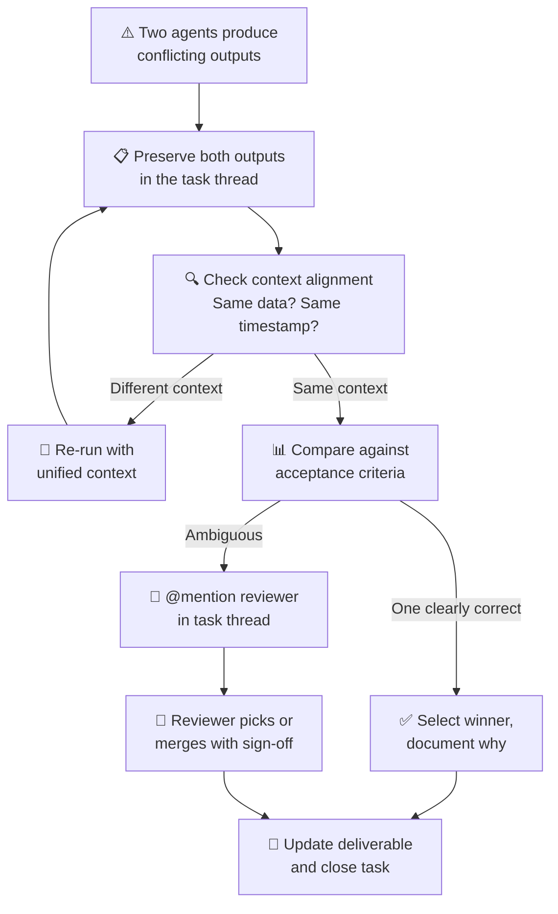

Your research agent says the competitor dropped their price last week. Your analysis agent says pricing is unchanged. They both ran on the same task. You have to make a decision in 20 minutes.

That's conflicting agent output. It happens more than teams expect, and most don't have a process for it until they've already shipped the wrong answer once.

## Why Agents Disagree

Agents conflict for specific, diagnosable reasons. Knowing which one hit you cuts the resolution time in half.

**Data timing.** If two agents pull data at different moments, they may see different states of the same resource. One reads an API at 9:01am. The other at 9:07am. If a record changed in that window, they'll produce different outputs — and both will be technically correct.

**Different tool access.** A research agent with live API access may see newer data than an analysis agent running against a local cache. Neither is "wrong." They're working from different sources.

**Prompt drift.** If you've updated one agent's instructions without updating the other, their interpretation of the task diverges. Two agents on the same project can have different ideas of what "complete" means.

**Non-determinism.** LLMs don't produce identical outputs for identical inputs every time. Run the same prompt twice on the same data and you'll occasionally get different conclusions, especially on edge cases.

## How to Resolve Conflicting Agent Outputs

Here's a repeatable process for catching and fixing conflicts before they reach downstream systems.

### Step 1: Preserve both outputs

Don't overwrite the first output when the second comes in. You need both to diagnose the conflict. In AgentCenter, each agent submission appears as a separate deliverable in the task thread. They stay there until you explicitly resolve the task. That history is your evidence.

If your current setup overwrites outputs or stores them in a shared doc with no version history, fix that first. Debugging a conflict you can't see takes far longer than one where both outputs are visible side by side.

### Step 2: Check context alignment

Most conflicts trace back to different inputs, not bad reasoning. Check three things:

- **Timestamps:** When did each agent read its data? Were they looking at the same state of the source?
- **Tool calls:** Did both agents hit the same API endpoints with the same parameters?
- **Prompt versions:** Has either agent's system prompt changed recently without updating the other?

If the agents had different inputs, the conflict is a pipeline problem, not a quality problem. Fix the context management — make sure both agents read from the same source at the same time — then re-run before escalating to human review.

### Step 3: Compare against acceptance criteria

Before involving a human, check both outputs against the task's success criteria. If you defined expected output format, required fields, or factual constraints, you may be able to rule out one output automatically.

In AgentCenter, the deliverable review panel shows each submission next to the original task brief. Reviewers can compare both outputs and mark one accepted or flag it for revision.

If this is the moment you realize you haven't written acceptance criteria, that's useful information. [Writing clear acceptance criteria for agent tasks](/blogs/how-to-write-acceptance-criteria-for-ai-agent-tasks) before they run prevents most ambiguous conflicts from reaching review in the first place.

### Step 4: Bring in a reviewer via @mentions

When the simple checks don't resolve it — same context, no clear criteria violation — you need a human call. In AgentCenter, @mention a reviewer directly in the task thread. They see both deliverables in context: the task brief, both agent outputs, and any automated check results.

Give the reviewer a specific question. "Agent A says $49/month. Agent B says $39/month. Which should we use, and why?" is faster to answer than "These agents disagreed — please resolve." The narrower the question, the quicker you get a decision.

### Step 5: Document the resolution

After you pick a winner — or merge the two — log the reason in the task thread. One line is enough: "Used Agent A's output. Agent B was pulling from a cached dataset 4 days old — missed a competitor price change."

When the same pattern shows up next month, your team finds the resolution in the task history in two minutes instead of rerunning the entire diagnosis.

## A Real Example

A pricing research agent and a competitive analysis agent both ran on a product pricing task. The research agent recommended $49/month. The analysis agent recommended $39/month.

Both outputs appeared as separate deliverables in AgentCenter. A context check revealed the issue: the research agent had pulled competitor data from a live API. The analysis agent was working from a cached dataset that was 4 days old — before a competitor dropped their price.

We updated the analysis agent's data source and re-ran. Both outputs converged at $41/month. Resolution took 20 minutes. That speed only happens when the outputs and the context trail are in the same place.

The [agent monitoring dashboard](/features/agent-monitoring) in AgentCenter keeps both outputs and the activity log in a single view — which made the timing discrepancy easy to spot instead of something to hunt down across multiple tools.

## Common Mistakes

**Picking the newer output by default.** "The second agent ran later, so it's more current" isn't always true. The first agent might have used a fresher data source. Check timestamps, not submission order.

**Auto-merging without review.** When both agents are partially correct, the temptation is to combine outputs automatically. That usually creates something internally inconsistent. Get a human sign-off before merging anything that affects a downstream system.

**Re-running both agents and hoping they agree.** If the conflict came from non-determinism or a prompt gap, running them again may produce two new conflicts. Fix the root cause first.

**Not documenting the resolution.** If you resolve a conflict without noting why, you'll debug the same pattern from scratch in three months.

## Bottom Line

Conflicting agent outputs are a coordination problem, not a model problem. The fix is a short, repeatable process: preserve both outputs, check context alignment, compare against acceptance criteria, bring in a reviewer when needed, and document the decision. A shared task thread with full deliverable history makes each of those steps fast instead of a forensic exercise.

---

*The best time to set this up is before two agents disagree on something that's already shipped. [Try AgentCenter free for 7 days](/pricing) — cancel anytime.*
