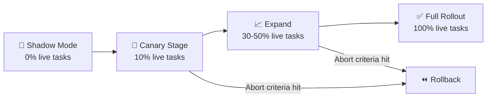

Your staging tests passed. The agent looked good. You pushed to production and routed 100% of tasks through it. Two hours later, output quality had quietly degraded — but you had hundreds of completed tasks with bad results before anyone noticed.

That's what happens without a gradual rollout.

## What a Gradual Rollout Means for AI Agents

With software, a gradual rollout typically means sending a small percentage of traffic to the new version. With AI agents, the same principle applies — but the failure modes are different.

Code failures are usually obvious. An agent failure is often silent: the task completes, the output looks plausible, but it's wrong in subtle ways. That's exactly why you need a stage-by-stage approach rather than a binary ship/don't-ship decision.

A gradual rollout for an AI agent means:

- Running the new version on a controlled subset of real tasks
- Monitoring output quality, cost, and error rate against a known baseline
- Expanding coverage only when your exit criteria are met
- Having a clear abort plan at each stage

This is not the same as a staging environment. Staging gives you synthetic or replayed traffic. A gradual rollout uses real production tasks, which surface edge cases that staging misses.

## How to Implement Gradual Rollouts for AI Agents

Here's a practical approach that works whether you're shipping a new agent or updating an existing prompt.

### Step 1: Define Your Exit Criteria Before You Start

Before routing a single task, write down what "good" looks like. This is the step most teams skip — and why they end up debating mid-flight whether to continue.

Your exit criteria should cover:
- **Error rate:** what percentage of tasks can fail before you stop?
- **Output quality:** how are you measuring it? Human review? Schema validation?
- **Cost per task:** is the new version within acceptable token spend?
- **Time to complete:** is it finishing within acceptable limits?

Set your abort threshold too. If error rate exceeds X% in stage 2, you roll back immediately. Write this down before you start.

### Step 2: Run in Shadow Mode First

Before any live tasks hit the new agent, run it alongside your current agent. Both process the same input — only the existing agent's output is used. You're watching what the new one would have done, with zero production risk.

Run shadow mode across at least 50 to 100 tasks before moving forward.

In [AgentCenter's agent monitoring view](/features/agent-monitoring), you can create a separate agent entry for the shadow version, route tasks to it manually, and compare output side by side. No live traffic touches it yet.

### Step 3: Canary Stage — 10% of Live Tasks

Route 10% of incoming tasks to the new agent. Keep the remaining 90% on the existing version.

At this stage, you're looking for anything that fails your exit criteria. Watch the [AgentCenter dashboard](/features/agent-dashboard) for:

- Task error rates on both versions
- Cost per task comparison
- Tasks stuck in a running state
- Deliverable quality flags from human reviewers

Run this for at least 48 hours, or until you have enough volume to draw conclusions — whichever comes later.

### Step 4: Expand in Stages

If the canary stage passes your exit criteria, expand to 30%, then 50%, then 100%. Each stage should have its own wait period and monitoring review before you move forward.

Don't rush. The goal is to surface problems that only appear at volume. An edge case that hits 1% of tasks won't show up reliably across 50 canary tasks, but it will show up at 300.

### Step 5: Set a Hard Abort Trigger

Before you start, set a rule: "If error rate exceeds X%, we roll back immediately." Don't make this a judgment call during the rollout.

In AgentCenter, the activity feed and per-agent error tracking give you real-time data during each stage. If something spikes, you see it before you're guessing.

### Step 6: Full Rollout or Abort

Once you've passed all stages without hitting abort criteria, switch 100% of tasks to the new agent. Archive the old version — don't delete it. You want it ready for quick rollback if something surfaces later.

If you hit an abort trigger at any stage, [rolling back is straightforward](/blogs/how-to-roll-back-an-ai-agent-safely): restore the previous version and route all traffic back to it.

## A Real Example

Your team runs a contract summarization agent. You want to update the prompt to handle multi-jurisdiction contracts better.

1. You create a shadow version in AgentCenter and run 30 test contracts through both agents manually
2. Outputs look comparable — you move to 10% live traffic
3. After 48 hours: error rate is 0.5% vs 0.3% baseline, within range. Token cost is down 8%. Quality flags are normal.
4. You expand to 50%, watch for 24 more hours, then ship to 100%

The old prompt version stays archived in your agent settings. If a problem surfaces next week, you can revert in minutes.

## Common Mistakes

**Skipping straight to 50%.** The 10% canary stage exists because most problems are rare. You need enough real volume to see them.

**Not defining exit criteria first.** If you decide what "bad" looks like during a rollout, you'll rationalize staying the course when you should stop.

**Treating no errors as success.** An agent can complete tasks while producing wrong output. Error rate and output quality are separate metrics. Track both.

**Waiting too long to abort.** Set the rule in advance, then follow it. Gut feel during a rollout is not reliable.

**Deleting the old version.** Archive it. You will want it for rollback. Don't assume the new version is permanent just because you shipped it.

## Bottom Line

Gradual rollouts for AI agents work on the same principle as canary deployments in software, but the failure mode is different. Code breaks loudly. Agent quality degrades quietly until someone looks closely. Stage-by-stage rollouts with defined exit criteria let you catch problems when they're small — not after your entire backlog has run through a broken agent.

---

*The best time to set up a rollout process is before you need to roll something back. [Try AgentCenter free for 7 days](/pricing) — cancel anytime.*
