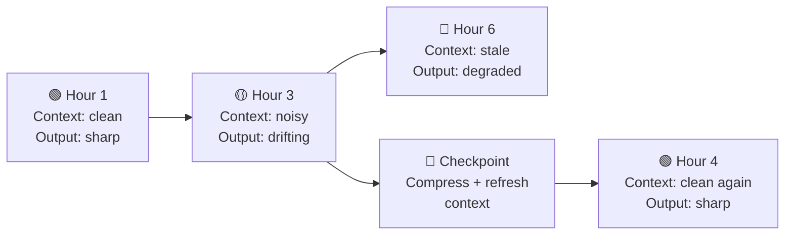
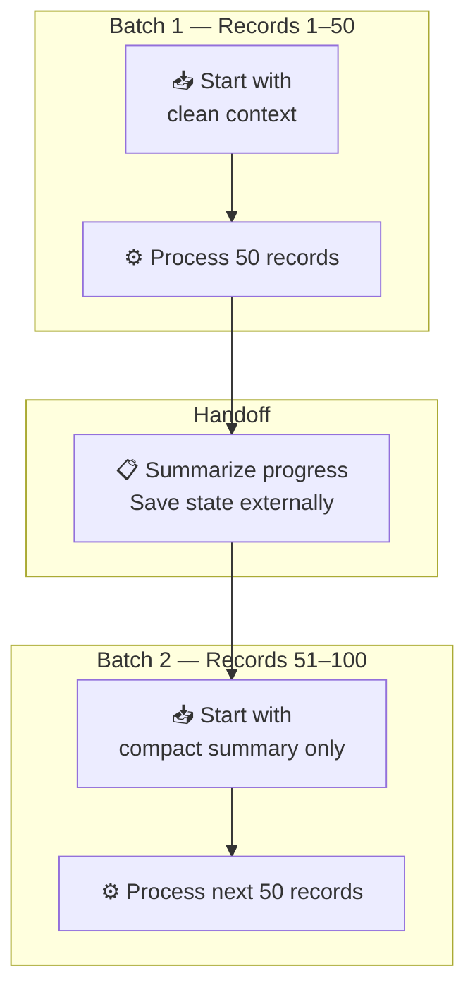

An agent that works well in hour one often produces garbage by hour six. Not because the model changed. Because the context window did.

Long-running agents accumulate noise: intermediate results that are no longer relevant, instructions they've already acted on, data that was accurate an hour ago but isn't anymore. The model doesn't know what to ignore, so it treats everything equally — and quality drops.

This is different from context window exhaustion, where you hit the token limit and the model errors. Context staleness is subtler. The window still has room. The agent still runs. But the outputs quietly get worse.

## Why Agent Context Goes Stale

Most agents are designed around a single task lifecycle: start, run, return output. For short tasks, that's fine. For tasks that take hours — a research agent working through 200 documents, a monitoring agent checking a pipeline every few minutes, a data agent processing a large backlog — the accumulated history in the context becomes a liability.

Three things go stale:

1. **Intermediate state** — earlier steps leave working notes in the context. By step 40, the model is carrying notes from steps 1 through 39, most of which are irrelevant to step 40.
2. **External data references** — if your agent was given a list of pending tasks at the start, that list is outdated by hour three.
3. **Instructions** — repeated instructions accumulate weight as the conversation grows, but they also compete with earlier responses that contradict current intent.

## How to Detect Context Staleness

Before you fix it, you need to know it's happening. Signs of context staleness in production:

- Output quality noticeably drops after a certain number of tasks or a certain elapsed time
- The agent starts revisiting work it already completed
- The agent references data from early in the run, ignoring newer inputs
- Token usage per task increases over time for the same task type

[AgentCenter's agent monitoring](/features/agent-monitoring) makes this visible. If average task completion time is climbing over a long run, or if cost-per-task is spiking while output quality is flat, that's a staleness signal worth investigating.

## How to Keep Context Fresh

There are four practical approaches. Which one you use depends on how your agent is structured.

### 1. Checkpoint and restart on a schedule

For agents that process a queue of similar items, the most reliable fix is periodic restarts. After N tasks or T minutes, the agent summarizes its current state, saves it externally, and starts a fresh conversation with only the summary plus the next batch of work.

In AgentCenter, set this up as a recurring task chain: the primary task runs for a fixed window, then a "summarize and handoff" task fires, and the next task picks up the summary as its starting context. No infinite context windows. No gradual drift.

### 2. Trim the context before each sub-task

For agents mid-workflow that can't restart cleanly, trim before each new item. The agent explicitly drops older intermediate notes from its working context, keeping only the task definition, its current working state, and the immediate next step.

This requires designing the agent to maintain a structured working state object it updates explicitly, rather than relying on the accumulated conversation history.

### 3. Inject a fresh briefing at fixed intervals

Every N tasks, re-inject the current state of your external data: the current task list, the current counts, whatever was true at the start but may have changed. Don't rely on the agent to remember it from hour one.

In AgentCenter's task view, you can see exactly what context a task was given and when. If you're seeing drift, check whether the agent's briefing data is still accurate at the point it drifts.

### 4. Use task-level context, not session-level context

The simplest long-term fix: structure your agents so each task is a fresh call with only the context that task needs. No accumulated session history. No memory of the last 40 tasks. Just: here is this task, here is what you need to know to complete it, return the output.

This works well for queue-based workloads and is the architecture AgentCenter's [task orchestration](/features/task-orchestration) is built around.

## A Real Example

A data enrichment agent processing 500 company records in sequence. It worked well for the first 80 records, then started producing noticeably shorter, lower-quality outputs. Token usage was similar but output quality had dropped.

The problem: the agent was carrying all 80 previous company notes in its context. By record 80, it was running summary compression internally, and the compression was discarding useful detail.

Fix: after every 50 records, trigger a checkpoint task. The checkpoint summarizes progress, resets the working context, and passes only the compact summary to the next batch. Quality stays consistent from record 1 to 500.

In AgentCenter, this runs as a three-task pipeline: `enrich-batch-1`, `summarize-progress`, `enrich-batch-2`. Each enrichment task has a bounded, clean context.

## Common Mistakes

**Ignoring it until you see obvious errors.** Context staleness causes subtle quality degradation long before it causes visible failures. By the time the agent is clearly producing bad output, you've already wasted tokens on mediocre work.

**Conflating context limits with context staleness.** Hitting the token limit throws an error. Staleness doesn't. You can be deep into a 128K context window and still have a stale, noisy context degrading outputs.

**Assuming a newer model will fix it.** A more capable model handles context better — but it still degrades if you don't manage what's in the context. The architecture matters more than the model version.

**Relying on the agent to manage its own memory.** Some agents summarize their own history as they go. This works for short sessions. For long runs, it accumulates compression errors on top of compression errors. External checkpointing is more reliable.

## Bottom Line

Long-running AI agents degrade when their context fills with irrelevant history. The fix isn't a smarter model — it's better context hygiene: periodic checkpoints, external state storage, task-bounded context windows. Start monitoring task quality and token usage over the course of long runs. If you see drift, you're looking at a context problem.

---

*The best time to set this up is before your agents start failing. [Try AgentCenter free for 7 days](/pricing) — cancel anytime.*
