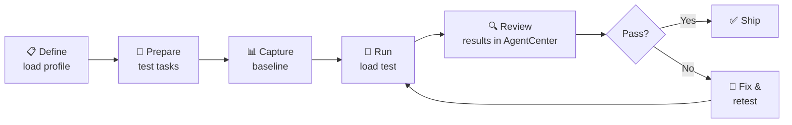

We shipped an invoice extraction agent that worked perfectly at 2 concurrent tasks. Three weeks later, finance pushed 80 invoices at once. The agent choked, LLM API calls started queuing, and costs spiked 11x in under four minutes. We had never load tested it.

That's the problem. Most teams test AI agents for correctness — does the output look right on these five examples? Almost nobody tests for load: what happens when 30 tasks hit the agent simultaneously, when the context window fills up under pressure, when the LLM provider starts rate limiting.

## What Load Testing AI Agents Actually Means

Load testing software usually means measuring throughput and latency under concurrent requests. For AI agents it's a bit different because agents aren't just fast or slow — they make decisions, consume tokens, and call external services.

A proper load test for an AI agent checks four things:

- **Latency under concurrency** — does response time stay acceptable when 10, 20, or 50 tasks run in parallel?
- **Token cost at scale** — does per-task token consumption hold steady, or does it creep up as context grows?
- **Rate limit behavior** — does the agent queue gracefully when the LLM API rate limits, or does it crash?
- **Output quality under pressure** — does the agent produce correct outputs at volume, or does quality degrade?

That last one is the part that pure performance tools miss entirely.

## Step-by-Step: How to Load Test an AI Agent

### 1. Define your load profile

Start with what production actually looks like. If your agent handles customer support tickets, check your peak hour volume. If it processes documents, check your largest batch size.

Pick three load levels:
- **Baseline**: your typical concurrent task count (say, 5)
- **Peak**: your highest realistic burst (say, 25)
- **Stress**: 2x your expected peak (say, 50)

You're not trying to crash the agent. You're finding where it starts degrading.

### 2. Prepare representative test tasks

Use real inputs, not toy examples. The agent that works fine on "short, clean" test prompts often breaks on the messy real-world input you didn't think to test.

Pull a sample of 50–100 actual tasks from your backlog or logs. Mix easy, medium, and hard cases. If you don't have real data yet, synthesize inputs that match the distribution you expect.

Avoid using the same task repeated 100 times — you want to catch issues caused by varied context, not just measure raw throughput on one pattern.

### 3. Capture a baseline before the load test

Before you run anything at scale, run 10 tasks sequentially and record:

- Average task duration
- Average token usage per task
- Output quality (manually check all 10)

This is your control. If load testing reveals a 3x latency increase at 25 concurrent tasks, the baseline is how you know what "normal" looks like.

### 4. Run the load test in stages

Don't jump straight to stress level. Ramp up:

1. Run 5 concurrent tasks. Measure latency, token cost, outputs.
2. Run 15 concurrent tasks. Compare against baseline.
3. Run your peak level. Look for where things start slipping.
4. Run stress level only if peak passed cleanly.

Between each stage, wait for all tasks to finish. Review results before moving up.

### 5. Monitor the right signals in AgentCenter

This is where [agent monitoring](/features/agent-monitoring) pays off during load testing. You want to watch:

- **Task queue depth** — is it growing faster than it's draining?
- **Error rate** — are any tasks failing or retrying under load?
- **Per-task cost** — does token spend per task hold steady or start climbing?
- **Task duration** — are later tasks in the queue taking longer than early ones?

A task queue that keeps growing is a sign the agent can't keep up. Per-task cost creeping up usually means context is accumulating somewhere it shouldn't.

### 6. Check output quality, not just throughput

Run a sample of outputs from your peak-load test through the same quality check you used on the baseline. You're looking for:

- Are outputs shorter or less specific than baseline?
- Are there new error patterns that didn't appear before?
- Are any tasks returning empty or malformed outputs?

Token pressure and LLM rate limiting can both quietly degrade output quality without causing hard failures.

## Real Example: Testing a Document Processing Agent

Say you have a contract review agent that extracts key dates and clauses from legal documents. Your baseline test (10 sequential tasks) shows:

- Average duration: 12 seconds per task
- Average token cost: $0.04 per task
- Quality: all 10 outputs correct

You run 20 concurrent tasks. Duration spikes to 45 seconds average. Cost holds at $0.04. Quality drops — 4 of 20 outputs are missing the "termination clause" field.

The latency spike tells you the LLM provider is queuing your requests. The missing field tells you the agent is hitting a context handling issue under concurrency. You've found two separate problems before any real contract gets processed.

Fix the rate limit handling first (add backoff and retry logic), then isolate why context handling breaks at scale. Retest before shipping.

## Common Mistakes

**Testing with too few tasks.** Running 3 concurrent tasks and calling it done. Most problems appear at 10+ concurrent tasks, not 3.

**Ignoring cost drift.** A 20% increase in per-task token usage seems small until you have 200 agents running all day. Measure it.

**Skipping quality checks.** Throughput and latency look fine. Outputs quietly start skipping fields or truncating summaries. You only find out when a user complains.

**Testing against the production LLM account.** Run load tests against a separate dev account with rate limits configured to match production. You don't want a test to exhaust your production quota.

**Only testing the happy path.** Add a few malformed inputs, edge cases, and unusually long documents to the load test mix. These are the tasks that trigger unexpected behavior under pressure.

## Bottom Line

Load testing an AI agent is not the same as stress testing a web server. You're not just measuring requests per second — you're checking whether output quality holds up, whether costs stay predictable, and whether the agent degrades gracefully when the LLM API slows down.

Do it before you ship, not after users start reporting weird outputs at 9am on a Monday.

---

*The best time to set this up is before your agents start failing. [Try AgentCenter free for 7 days](/pricing) — cancel anytime.*
