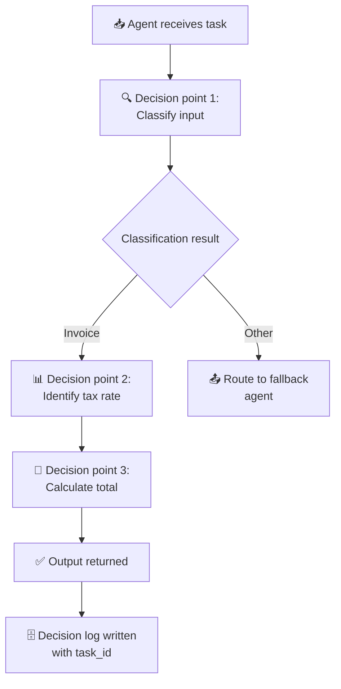

Most agents fail silently. You see the final output, but you don't see the 14 intermediate decisions that led to it. When something breaks, you're looking at the result with no trail of what happened in between.

Knowing how to log AI agent decisions, not just outputs, is what separates teams that debug in minutes from teams that guess for hours.

Output logging tells you what an agent returned. Decision logging tells you why.

## What Decision Logging Actually Is

A decision log captures the intermediate steps your agent took to produce its output. Not just "agent ran, returned result X" but:

- What input did the agent receive?
- Which condition or rule did it evaluate?
- What did it decide to do next?
- What data did it use to make that choice?
- What was the output at each stage?

Think of it as the agent's reasoning trace made persistent. If your agent is parsing invoices, the decision log might show: "Identified document as invoice format. Tax column found at position 3. Applied rate: 19%. Calculated total: $4,200."

Now when someone reports a wrong total, you can see exactly where it went off.

This matters for two reasons.

**Debugging.** You can replay the agent's steps and see where the wrong choice happened. Was it a bad prompt? A missing condition? A tool call that returned unexpected data?

**Compliance.** In regulated industries like finance, healthcare, or legal, you may need to show that your agent followed a specific process before arriving at an output. A decision log is your audit trail.

## How to Log AI Agent Decisions in Production

Here's a practical approach that works for most production agents.

### 1. Map your agent's decision points

Start by listing where your agent makes a choice that affects the output. Common examples:

- Which tool to call next
- Which prompt branch to follow (refund request or general inquiry?)
- Whether to escalate to a human or continue autonomously
- How to interpret ambiguous input

You don't need to log everything. Log at the boundaries where a wrong choice produces a wrong output.

### 2. Add a structured log entry at each decision boundary

Each log entry should capture enough to reconstruct what happened:

```json
{
  "task_id": "t_abc123",
  "agent_id": "invoice-parser",
  "timestamp": "2026-05-21T06:14:00Z",
  "decision": "apply_vat_rate",
  "input": {"document_type": "invoice", "country": "DE"},
  "value_chosen": "19%",
  "reason": "country=DE, standard VAT"
}
```

`task_id` and `agent_id` are the two fields you must not skip. They let you filter logs when debugging one specific run out of thousands.

### 3. Correlate logs with your task manager

If you're using [AgentCenter's agent monitoring](/features/agent-monitoring), each task already has a unique ID. Thread your decision logs through that ID. When a task shows a failed status, you click into it and see the complete decision trail alongside the output rather than just the final result.

### 4. Pick a log destination that supports queries

Decision logs are only useful if you can query them:

- A structured log service (Datadog, Logfire, or similar)
- A database table with `task_id` as the primary index
- Your agent platform's built-in event logging

Avoid writing decision logs to flat files. You'll never find what you need when you're under pressure at 2am.

### 5. Set a retention policy before you launch

How long to keep decision logs depends on your context:

- General debugging: 30 days is usually enough
- Compliance use cases: check your regulatory requirements — it could be 1 to 7 years
- High-volume agents: use object storage with indexing to avoid runaway costs



## A Real Example with AgentCenter

Say you have a contract review agent that flags clauses for a legal team. The agent reads each clause and decides whether it needs human review.

Without decision logging, a reviewer sees: "Clause 14 flagged for review." That's all they get.

With decision logging: "Clause 14 flagged. Reason: contains indemnification language. Keyword match: 'shall indemnify'. Confidence: 0.91. Rule applied: standard-review-trigger."

In [AgentCenter's task orchestration view](/features/task-orchestration), your legal team sees that decision trail attached directly to the task. They know why the agent flagged it, not just that it did. Reviews get faster. Disputes about the agent's behavior get shorter.

For compliance, you now have a record that shows your agent applied rule X to document Y and produced decision Z. That's an audit trail you can hand to an auditor without having to reconstruct it from memory.

## Common Mistakes

**Logging only at the start and end.** The start log shows "task received," the end log shows "output returned." Nothing in between. When something goes wrong, you have two data points and a gap that could be anything.

**Unstructured log strings.** Writing "agent decided to escalate because ambiguous" as a plain string means you can't filter or query it at scale. Use structured fields with consistent keys so you can actually search across runs.

**Logging without task IDs.** Logs without a task identifier are nearly useless in production. You get thousands of lines with no way to pull the ones belonging to a specific failing run.

**Logging too much.** Some agents have hundreds of micro-steps. Don't log every internal computation. Log the choices that change the output path if they go wrong. Pick boundaries, not every operation.

## Bottom Line

You can't debug a failure you can't trace. You can't prove compliance for a decision you didn't record.

Decision logging adds a few structured writes to your agent code, but it changes what's possible when something goes wrong. You go from guessing to knowing exactly which step made the wrong call.

Set it up before you need it. By the time a compliance team asks for the audit trail, you don't want to be building it from scratch.

---

*The best time to set this up is before your agents start failing. [Try AgentCenter free for 7 days](/pricing) — cancel anytime.*
