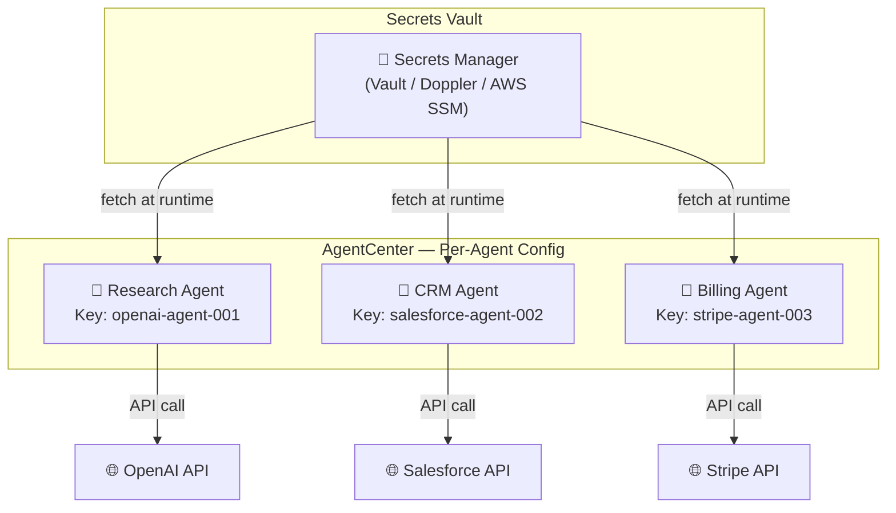

You have 12 agents running. Each one hits at least one external API. Your research agent calls OpenAI and a search provider. Your CRM agent reads from Salesforce. Your billing agent talks to Stripe.

Somewhere in that setup, the API keys are sitting in a `.env` file in your repo, or hardcoded into the agent's script. This is the setup that gets teams burned.

Managing agent credentials isn't complicated — but most teams skip it until they're already dealing with a leaked key or a broken agent in production.

## What Agent Credential Management Actually Is

Every AI agent that talks to an external service needs a credential — an API key, a token, a secret. Managing those credentials means controlling three things:

- Where secrets are stored (not in code)
- Who — or what — can access them at runtime
- When they get rotated and revoked

If you don't have a clear answer to all three, your secret management isn't actually managed.

## Step 1: Audit What Your Agents Are Using

Start by mapping every external call each agent makes. For each one, ask: what credential does it use, and where is that credential currently stored?

You'll probably find a mix: some in `.env` files, some hardcoded in agent scripts, some in shared config files nobody owns.

Write it down. A simple table works:

| Agent | Service | Credential Type | Current Location |
|-------|---------|-----------------|------------------|
| Research agent | OpenAI | API key | .env file |
| CRM agent | Salesforce | OAuth token | hardcoded |
| Billing agent | Stripe | Secret key | shared config |

That table is your starting point. You can't fix what you haven't mapped.

## Step 2: Stop Storing Secrets in Code

Hardcoded credentials are the top cause of secret leaks. They get committed to version control, shared in screenshots, and forgotten in backup files.

Move every secret out of code immediately. The minimum safe option is environment variables set at runtime — not stored in a `.env` file committed to the repo.

For anything sensitive, use a secrets manager:

- **AWS Secrets Manager** or **Parameter Store** if you're on AWS
- **HashiCorp Vault** for self-managed infra
- **Doppler** or **Infisical** for teams that want a simple SaaS option

The principle is the same: secrets live in a vault, agents request them at runtime, and no secret ever touches your code.

## Step 3: Give Each Agent Its Own Credential Set

One API key shared across 12 agents is a single point of failure. If it leaks, every agent is compromised. If you rotate it, every agent breaks at once.

Each agent should have its own credentials where the service allows it. Most APIs let you create multiple API keys per account. Use this.

In AgentCenter, you configure each agent's environment separately. You can pass different API keys per agent without touching the agent code. When you onboard a new agent, create a fresh key scoped to the minimum permissions that agent needs.

If one agent's key is compromised, you revoke just that one. The rest of your fleet keeps running.

## How Credential Flow Should Look

Each agent pulls its own secret at runtime. No secrets in code. No shared keys.

## Step 4: Rotate Credentials on a Schedule

Secrets that never rotate are credentials waiting to be leaked.

Set a schedule to rotate every credential every 90 days at minimum. For anything that touches customer data or payments, do it every 30 days.

When you rotate:

1. Create the new key in the API provider
2. Update it in your secrets manager
3. Verify the agent picks up the new value correctly
4. Revoke the old key after confirming

In AgentCenter, you can use a [recurring task](/features/task-orchestration) assigned to an ops agent to surface rotation reminders as trackable tasks — not calendar reminders you'll skip.

## Step 5: Monitor for Credential Misuse

Even with good storage and rotation, you need to know if a credential gets misused. Most secrets managers and API providers give you access logs.

Watch for:

- Unusual request volumes from a specific key
- Requests from unexpected IP ranges
- Any call to a scope the key shouldn't have

In AgentCenter's [agent monitoring](/features/agent-monitoring), you can track per-agent API call volumes over time. A spike from one agent without a matching task is worth investigating immediately.

## Real Example

We had a team running 6 agents, all using the same API key for web research. One agent got stuck in a retry loop and burned through the entire monthly quota in 36 hours.

Because every agent shared the key, there was no way to tell which one was looping. We couldn't throttle just that agent without killing the rest.

After moving to per-agent credentials and enabling monitoring, we caught a similar issue two weeks later in under 5 minutes. One agent's call count spiked to 4x normal. We paused it, fixed the retry logic, and the other five agents ran without interruption.

## Common Mistakes

**Storing secrets in `.env` files committed to the repo.** The most common one. Even private repos get leaked. Use a secrets manager.

**Using a single credential for all agents.** Makes rotation painful and debugging impossible. Scope credentials to individual agents.

**Never rotating.** A key created two years ago and never changed has probably been exposed to more people than you remember.

**Not auditing which agents can access which secrets.** If every agent has access to every credential, the blast radius of a compromise is your entire fleet.

**Skipping the audit step.** Teams that move fast often don't know what credentials they're using until something breaks. The table from Step 1 is worth 20 minutes of your time.

## Bottom Line

Agent credential management comes down to four habits: audit what you have, stop storing secrets in code, give each agent its own key, and rotate on a schedule. Teams that build these habits early avoid the fire drill that comes from a leaked key in production.

The hardest part isn't the tooling — it's doing the audit in Step 1. Once you know what you're working with, the rest follows quickly.

---

*The best time to set this up is before your agents start failing. [Try AgentCenter free for 7 days](/pricing) — cancel anytime.*
