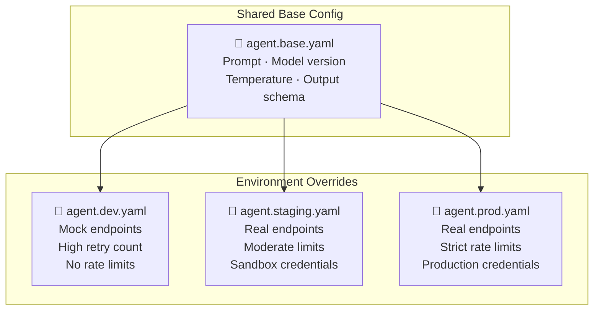

Your agent works perfectly in dev. You test it, the outputs look right, the behavior matches what you designed. You promote it to staging. Still fine. You push it to production and it starts doing something different.

Not crashing. Not erroring. Just different. Slightly wrong in ways you can't immediately pin down.

This is one of the most common problems in AI agent operations, and it's almost never the model's fault. It's the config.

## What Agent Configuration Actually Covers

Most people think about agent config and picture the system prompt. That's one part. A complete agent configuration includes:

- **The prompt** (system prompt, any user-facing templates)
- **The model** (which LLM, which exact version)
- **Model parameters** (temperature, top_p, max tokens)
- **Tool access** (which tools the agent can call, which endpoints it hits)
- **Rate limits and concurrency** (calls per minute, parallel task count)
- **Timeout and retry settings** (how long before abandoning a call, how many retries)
- **Output constraints** (required schema, max output length)

Any one of these can behave differently across environments if you don't manage them explicitly. And because agents don't throw exceptions when config drifts, the problem can run quietly for weeks.

## Step 1: Separate Stable Config from Environment-Specific Config

Not every config value should change across environments. The principle: behavior-defining config should stay identical everywhere; infrastructure config (endpoints, credentials, limits) should be parameterized per environment.

| Config Element | Should It Vary by Environment? |
|---|---|
| System prompt | No |
| Model version | No — pin the same version everywhere |
| Temperature | No |
| Tool endpoints | Yes — dev points to mock or sandbox services |
| Rate limits | Yes — looser in dev, stricter in prod |
| Retry settings | Yes — fewer retries in dev for faster feedback |
| Output schema | No |

The moment your system prompt differs between dev and prod, you're testing a different agent than the one you're running. That makes debugging a guessing game.

## Step 2: Store Configs Outside Agent Code

The most common mistake is hardcoding config values directly into agent files. When someone needs to tweak a production setting, they edit the code, open a PR, wait for review, and redeploy. That creates unnecessary change risk. Or worse, someone edits the running config directly on the server and the change disappears the next deploy.

A cleaner structure:

1. Create a base config file with the values that stay constant: `agent.base.yaml`
2. Create per-environment files that inherit from base and override only what differs: `agent.dev.yaml`, `agent.staging.yaml`, `agent.prod.yaml`
3. Load the right config at startup using an environment variable: `AGENT_ENV=prod`

This is the same pattern you already use for database connections and API keys. Apply it to agent configs.

## Step 3: Pin the Model Version Exactly

Never let your agent reference a model with an unversioned alias like `gpt-4` or `claude`. Providers update their models. What `claude-sonnet` responds to today can change after a silent provider update, and you'll never know why the agent started behaving differently.

Pin the exact version string in your base config and treat it like a dependency version. If you want to test a newer model, create an explicit branch or test environment. Don't just change the base config and push to dev hoping it behaves the same.

When you do upgrade the model, bump the config version, note the reason, and run your staging environment through a full task cycle before promoting.

## Step 4: Track Which Config Version Ran Each Task

Even with clean configs, you'll hit a case where a task ran with the old config before you deployed an update. If you're investigating a bad output, you need to know which config was active when that task ran, not just what the config looks like today.

In [AgentCenter's agent monitoring dashboard](/features/agent-monitoring), you can attach a config version tag to each task at the time it's created. When an output looks wrong, you can pull up the task and see exactly what configuration was in play, without guessing.

This matters especially when you're rolling out config changes incrementally, running the new config on a small percentage of tasks before full deployment. Without task-level config tracking, you can't tell which tasks ran on the new config and which ran on the old one.

## Step 5: Promote Config Changes the Way You Promote Code

Config changes should go through the same review process as code changes: pull request, review, staging deploy, then production.

This sounds obvious but most teams skip it. Instead, someone edits the temperature value on the prod agent because outputs felt too random. Three weeks later nobody remembers. The agent behaves differently. You spend hours investigating.

Practical rules:

- Config lives in version control alongside the code
- Changes go through PR review — at least one other person looks at them
- Staging runs the new config for at least one full cycle before prod promotion
- Each config version gets a timestamp so you can correlate task outputs to config state

In [AgentCenter's task orchestration view](/features/task-orchestration), you can attach the active config version to each task log entry automatically. That creates an auditable trail without any manual bookkeeping.

## Common Mistakes

**Letting temperature drift between environments.** A common pattern is setting temperature to 0 in dev ("for predictability") and a higher value in prod. You're now testing a deterministic agent and running a non-deterministic one. Those are meaningfully different. Set the same temperature everywhere.

**Using live external APIs in staging.** If your staging agent calls real external services, staging isn't a safe test environment. Mock the external dependencies, or use read-only API credentials with tight scope.

**Not versioning prompt changes.** When you update the system prompt, that's a config change. Write a changelog entry, bump the config version, and run through staging. A prompt change that looks minor ("just clarifying the output format") can break a downstream parser that expected the previous format exactly.

**Making "quick" config fixes directly in prod.** The fix for an agent generating overly long outputs (dropping max tokens by 200) can break downstream systems that expected a minimum response length. Quick config fixes deserve the same review as any other change.

## Bottom Line

Environment-specific agent behavior almost always traces back to config drift. The fix isn't complicated: decide what should stay constant everywhere, decide what should vary, put it all in version control, and promote config changes the same way you promote code.

Agents don't change behavior on their own. When prod behaves differently than staging, something in the config changed. The only way to debug it quickly is to have a clear record of what the config was and when.

---

*The best time to set this up is before your agents start failing. [Try AgentCenter free for 7 days](/pricing) — cancel anytime.*
