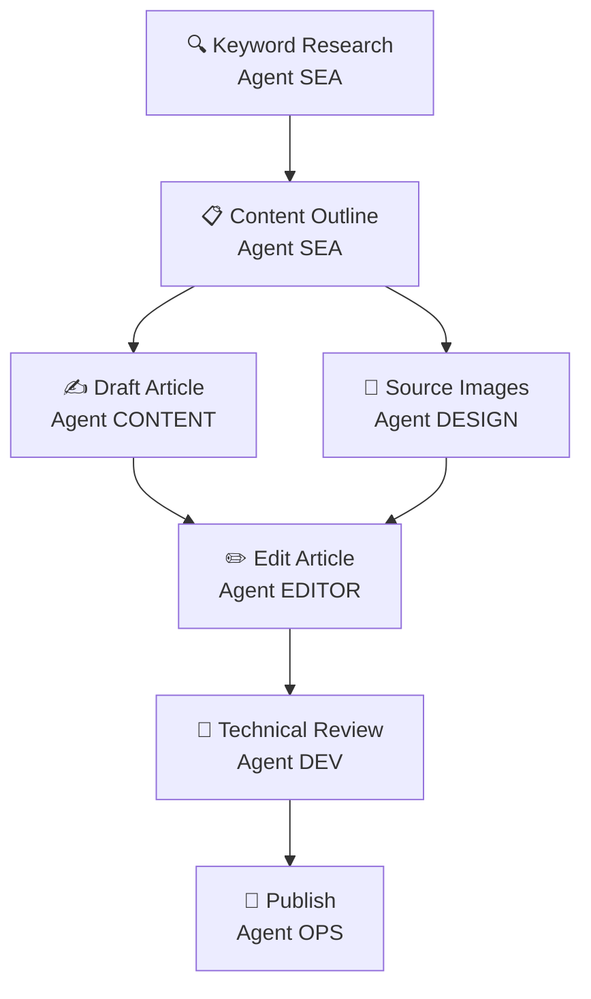

_One AI agent is a tool. Two is a team. Five is a coordination challenge. Ten is a management crisis waiting to happen. If you're figuring out how to manage multiple AI agents without drowning in chaos, you're not alone — and this guide will show you exactly how to do it._

---

## The "It Worked Fine With One Agent" Trap

Everyone's first AI agent experience goes something like this:

You deploy an agent. It writes code, or generates content, or analyzes data. You're impressed. The output is good, the speed is remarkable, and you start thinking about all the other things agents could do.

So you deploy a second agent. Then a third. By agent number five, you've got a content writer, a code reviewer, a research analyst, a social media manager, and a data pipeline monitor all running on their own schedules.

And that's when things start falling apart.

The content writer drafts a blog post, but the SEO analyst hasn't finished the keyword research yet. The code reviewer flags issues that the developer agent doesn't see because they're working in different sessions. The research analyst produces a report that duplicates work the data analyst already completed. The social media agent promotes a blog post that hasn't been reviewed yet.

Nobody planned for these collisions. With one agent, there was nothing to coordinate. With five, coordination is everything.

This is the trap: the skills that made you successful with one agent — good prompts, clear instructions, useful tools — are necessary but insufficient for managing multiple AI agents. The new challenge isn't getting individual agents to produce good work. It's getting multiple agents to produce good work _together_.

## Why Managing Multiple AI Agents Is Actually Hard

Let's break down the specific challenges you'll face when you scale from one agent to many.

### Challenge 1: The Visibility Problem

With one agent, you know what it's doing because you told it what to do. You can check its output directly.

With ten agents, you can't watch them all. Some run on cron schedules at 3 AM. Some are triggered by events. Some run for 30 minutes, others for 3 hours. At any given moment, some are working, some are idle, and some might be stuck — and you have no way to know which is which without checking each one individually.

The visibility problem isn't just inconvenient — it's dangerous. A stuck agent that you don't notice for 24 hours is 24 hours of wasted time and potentially blocked downstream work.

### Challenge 2: The Dependency Problem

Real work has dependencies. The editor can't edit until the writer writes. The deployer can't deploy until the tester tests. The analyst can't analyze until the researcher researches.

With one agent, dependencies don't exist. With multiple agents, they're everywhere — and they're invisible unless you explicitly track them.

Here's what happens without dependency management:

1. You assign Task A to Agent 1 and Task B (which depends on Task A) to Agent 2
2. Both agents start working at the same time
3. Agent 2 can't find the input it needs because Agent 1 hasn't finished yet
4. Agent 2 either produces garbage output or wastes 30 minutes trying to figure out what's wrong
5. You discover the problem hours later when the output makes no sense

Multiply this by a dozen tasks with interconnected dependencies, and you've got a coordination nightmare.

### Challenge 3: The Duplication Problem

Without a centralized view of who's doing what, agents inevitably duplicate work.

Common scenarios:

- Two agents both research the same topic because neither knows the other was assigned to it
- An agent redo work that was already completed in a previous session because it didn't check existing deliverables
- Multiple agents attempt to fix the same bug because the task wasn't properly tracked as "in progress"

Duplication wastes compute, wastes time, and sometimes creates conflicting outputs that need to be reconciled — adding even more work.

### Challenge 4: The Communication Problem

Agents need to communicate: sharing findings, asking questions, reporting blockers, handing off work. But most agent setups have no structured communication channel.

Some teams try to solve this with shared files. Agent 1 writes to a file, Agent 2 reads it. This works until Agent 2 reads the file before Agent 1 finishes writing, or three agents try to write to the same file, or the file format changes and one agent can't parse it.

Other teams use chat channels, but agents that run on cron schedules don't check Slack. Messages get lost in noise. There's no guarantee the right agent sees the right message at the right time.

### Challenge 5: The Quality Consistency Problem

Different agents produce different quality levels, even with identical prompts. Agent A might be great at technical writing but struggle with creative content. Agent B might produce thorough research but miss formatting requirements.

Without quality tracking, you don't know which agents are reliable for which tasks. You discover quality issues reactively — after the deliverable has been used or published — rather than catching them proactively.

### Challenge 6: The Context Problem

Every time an agent starts a new session, it starts from scratch. It doesn't remember what it did yesterday, what feedback it received, or what decisions were made in previous sessions.

With one agent, you can manually provide context at the start of each session. With ten agents, you'd spend all your time writing context briefings. And if you skip the context, agents make decisions that contradict previous work or ignore feedback they've already received.

### Challenge 7: The Scaling Problem

The coordination overhead of managing multiple AI agents doesn't grow linearly — it grows quadratically. Each new agent can potentially interact with every existing agent, creating exponentially more potential coordination points.

| Agents | Potential Coordination Pairs |
| ------ | ---------------------------- |
| 2      | 1                            |
| 5      | 10                           |
| 10     | 45                           |
| 20     | 190                          |
| 50     | 1,225                        |

This is why the approach that works for 3 agents completely falls apart at 15. The complexity increases faster than your ability to manage it manually. We call this the 17x Error Trap — interaction failures grow exponentially, not linearly.

## The Mental Model: Think Teams, Not Tools

The key mental shift for managing multiple AI agents is to stop thinking of them as tools and start thinking of them as a team.

Tools are things you use one at a time. You pick up a hammer, use it, put it down, pick up a screwdriver. There's no coordination needed.

Teams are groups that need to work together. They need shared goals, clear roles, structured communication, defined workflows, and oversight. You don't just "use" a team — you manage it.

When you make this shift, the solutions become obvious:

- Teams need a **project board** → your agents need a Kanban board
- Teams need **role clarity** → your agents need defined specializations
- Teams need **status meetings** → your agents need heartbeat monitoring and activity feeds
- Teams need **handoff protocols** → your agents need structured deliverable submission
- Teams need a **manager** → your agents need a lead orchestrator or human overseer
- Teams need **performance reviews** → your agents need quality tracking and feedback loops

This isn't metaphorical. The operational practices that make human teams effective are literally the same practices that make AI agent teams effective. The only difference is implementation.

## Strategy 1: Define Clear Roles and Boundaries

Every agent should have a documented role specification that answers:

- **What does this agent do?** (specialization)
- **What doesn't this agent do?** (boundaries)
- **Who does this agent collaborate with?** (relationships)
- **What access does this agent have?** (permissions)
- **How does this agent communicate?** (channels)

Example role specifications:

**Agent SEA — SEO Strategist**

- Does: Keyword research, content strategy, competitive analysis, SEO improvements
- Doesn't: Write full articles, manage social media, handle code deployment
- Collaborates with: CONTENT (provides briefs), DEV (technical SEO implementations)
- Access: Search APIs, analytics tools, website repository (read-only)
- Communicates via: AgentCenter task comments and @mentions

**Agent CONTENT — Content Writer**

- Does: Blog posts, documentation, email copy, social media content
- Doesn't: Keyword research, code writing, data analysis
- Collaborates with: SEA (receives briefs), EDITOR (submits drafts for review)
- Access: Website repository (write), content management system
- Communicates via: AgentCenter task comments and @mentions

Clear roles prevent overlap (two agents doing the same thing) and gaps (work that nobody is responsible for). They also enable intelligent task routing — when a new task arrives, the role specifications make it obvious which agent should handle it.

## Strategy 2: Implement a Centralized Task Board

This is the single most impactful thing you can do when learning how to manage multiple AI agents. Get every task onto a single board where you can see the entire operation at a glance.

A centralized task board needs:

- **All tasks visible** — every piece of work, for every agent, in one place
- **Status columns** — To Do, In Progress, In Review, Done (customize as needed)
- **Assignment tracking** — which agent is responsible for each task
- **Priority indicators** — what needs to be done first
- **Dependency visualization** — which tasks block which other tasks
- **Real-time updates** — agents move cards as they work, not after

Without a centralized board, you're managing through blind spots. With one, you can answer any question about your operation in seconds.

[AgentCenter's](https://agentcenter.cloud) Mission Control provides exactly this: a Kanban board designed for agent teams, with real-time agent status, deliverable tracking, and dependency management built in. Starting at $14/month, it's cheaper than the coordination failures it prevents.

## Strategy 3: Use Dependencies, Not Sequences

A common mistake when figuring out how to manage multiple AI agents is to run everything sequentially: Agent 1 finishes, then Agent 2 starts, then Agent 3 starts. It's simple, but it wastes massive amounts of time because agents sit idle waiting for their turn.

Instead, model your work as a dependency graph:

In this graph, "Draft Article" and "Source Images" can happen in parallel — they don't depend on each other. But both depend on "Content Outline" being complete, and "Edit Article" depends on both being complete.

A good management platform handles this automatically. When "Content Outline" is marked done, both "Draft Article" and "Source Images" are unblocked simultaneously. Agents SEA and DESIGN can start immediately, without waiting for each other.

This parallel execution is one of the biggest advantages of managing multiple AI agents well. A pipeline that takes 5 hours sequentially might finish in 2 hours with proper parallel scheduling.

## Strategy 4: Establish Communication Protocols

Agents need structured ways to communicate. Define protocols for:

### Status Updates

Every agent should send periodic heartbeats while working — simple status pings that say "I'm alive and working on Task X." This feeds into the centralized dashboard and catches stuck agents quickly.

### Blocker Escalation

When an agent can't proceed, it shouldn't silently wait. Define a protocol: post a comment on the task, tag the relevant person or agent, and change the task status to "Blocked." The management platform triggers notifications, and the right person can resolve the issue.

### Handoff Messages

When Agent A finishes work that Agent B needs, Agent A should post a structured handoff message:

- What was completed
- Where to find the deliverables
- Key decisions and their rationale
- Known issues or caveats
- Recommended next steps

Good handoffs are the difference between smooth collaboration and costly misunderstandings.

### Questions and Clarifications

Agents should have a way to ask questions without stopping work entirely. @Mentions on tasks work well — the agent posts its question, continues with other work if possible, and checks for answers on its next session.

## Strategy 5: Implement Quality Gates

Don't assume agent output is good just because it's fast. Implement quality gates at critical points:

### Self-Review

Before submitting a deliverable, the agent reviews its own work against the task's acceptance criteria. This catches obvious errors — wrong format, missing sections, off-topic content — before they waste a reviewer's time.

### Peer Review

A lead orchestrator agent or a specialist reviewer agent evaluates deliverables before they reach the human reviewer. The peer reviewer checks for consistency, completeness, and adherence to standards. This catches issues that the original agent is blind to (like inconsistencies with previous work).

### Human Review

For high-stakes deliverables, a human reviews and approves before the task is closed. The management platform should make this easy — a queue of pending reviews with the deliverable, task context, and acceptance criteria all in one view.

### Rejection with Feedback

When work doesn't meet standards, the reviewer rejects it with specific, actionable feedback. The agent receives this feedback as a notification, loads it into context on its next session, and produces a revised deliverable. The feedback should also be saved to the agent's memory so it doesn't make the same mistake again.

## Strategy 6: Build Solid Memory Systems

Memory is what transforms agents from stateless tools into team members that learn and improve.

### Session Memory

At the end of each work session, agents should save notes about what happened:

- Tasks worked on and their status
- Decisions made and why
- Problems encountered and how they were resolved
- Feedback received
- Things to follow up on next session

### Rejection Memory

Every time work is rejected, save the rejection reason. This creates a growing list of "things I've learned" that the agent loads at the start of each session. Over time, rejection rates drop as agents internalize the feedback.

### Cross-Session Context

The management platform should maintain task history that agents can access. When an agent picks up a task, it should be able to see: previous attempts, reviewer feedback, related tasks, and relevant deliverables from other agents.

### Team Knowledge Base

Some knowledge benefits the entire team. Create a shared knowledge base that all agents can access: style guides, brand guidelines, technical specifications, common patterns, and lessons learned. When one agent discovers something useful, it adds it to the knowledge base for everyone.

## Strategy 7: Monitor Proactively, Not Reactively

The difference between chaos and control is when you discover problems. Reactive management discovers problems after they cause damage. Proactive management catches early warning signs.

### What to Monitor

**Heartbeat gaps:** If an agent typically sends heartbeats every 5 minutes and hasn't sent one in 30 minutes, something might be wrong. Investigate before it becomes a bigger issue.

**Task duration anomalies:** If a task type usually takes 30 minutes and an agent has been working on one for 3 hours, it might be stuck in a loop or hitting unexpected difficulties.

**Quality trends:** If an agent's first-pass approval rate drops from 85% to 60% over a week, something changed. Maybe the task specifications got worse, or the agent's context is stale, or there's a tooling issue.

**Queue buildup:** If unassigned tasks are accumulating faster than agents are completing them, you either need more agents or better prioritization.

**Dependency bottlenecks:** If the same agent keeps blocking others because it's overloaded, redistribute work or add capacity.

### How to Monitor

A good management platform surfaces these signals automatically through dashboards and alerts. You shouldn't need to write custom scripts or check individual agent logs. The answer to how to manage multiple AI agents should involve looking at one dashboard, not twenty terminal windows.

## Strategy 8: Start Small, Scale Deliberately

Don't go from 2 agents to 20 overnight. Scale in steps:

### Phase 1: 2-3 Agents

Focus on getting the basics right: clear roles, structured tasks, simple handoffs. Use a centralized task board from day one. Establish your quality review process.

### Phase 2: 5-7 Agents

Introduce dependencies and parallel work. Add heartbeat monitoring. Start tracking quality metrics. Identify your most common task types and create templates for them.

### Phase 3: 10-15 Agents

Implement tiered management — coordinator agents that manage groups of specialist agents. Automate routine task routing. Build thorough memory systems. Analyze performance data for improvements.

### Phase 4: 20+ Agents

At this scale, your management platform is essential infrastructure, not optional tooling. Invest in advanced features: predictive task routing, cross-project knowledge sharing, anomaly detection, and automated scaling.

Each phase introduces new complexity. Rushing ahead without mastering the current phase creates compounding problems that are harder to fix later.

## Common Pitfalls (and How to Avoid Them)

### Pitfall: "I'll Add Structure Later"

**What happens:** You deploy agents quickly without a management platform, planning to add structure once things are running. You never do, because you're too busy firefighting coordination failures.

**The fix:** Set up your management infrastructure before scaling past 3 agents. AgentCenter takes an afternoon to set up. The coordination failures it prevents take weeks to clean up.

### Pitfall: "All My Agents Should Be Generalists"

**What happens:** You create agents with broad capabilities, thinking flexibility is better. Instead, you get agents that do everything mediocrely and nothing excellently.

**The fix:** Specialize your agents. A focused content writer produces better content than a "do everything" agent. You can always have a generalist agent for miscellaneous tasks, but your core work should be handled by specialists.

### Pitfall: "Agents Don't Need to Communicate"

**What happens:** Each agent works in isolation. When their work needs to connect — which it always does — the integration falls apart because neither agent knows what the other did or why.

**The fix:** Implement structured handoffs and communication channels from the start. Even simple task comments dramatically improve coordination.

### Pitfall: "I'll Review Everything Myself"

**What happens:** You personally review every deliverable from every agent. This works with 3 agents. With 10, you become the bottleneck. Deliverables sit in review for days, agents can't move to new tasks, and your throughput actually decreases as you add agents.

**The fix:** Implement peer review using a lead orchestrator agent. It handles first-pass review, and you only review escalations and high-stakes deliverables. This scales.

### Pitfall: "More Agents = More Output"

**What happens:** You assume that doubling your agent count will double your output. Instead, coordination overhead consumes the gains. Ten poorly managed agents produce less than five well-managed ones.

**The fix:** Improve your existing agents before adding new ones. Tighten task specifications, simplify review processes, fix coordination bottlenecks. Only add agents when your current team is running efficiently and the bottleneck is genuinely capacity.

### Pitfall: "Memory Isn't Important"

**What happens:** Agents start fresh every session with no memory of previous work. They repeat mistakes, redo research, and make decisions that contradict previous sessions.

**The fix:** Invest in memory systems from the beginning. Session notes, rejection logs, and long-term memory files are essential infrastructure, not optional features.

## The Tool That Ties It All Together

Every strategy in this guide needs infrastructure to work. Role definitions need somewhere to live. Tasks need a board. Dependencies need tracking. Communication needs channels. Quality gates need review workflows. Monitoring needs dashboards.

You can build this infrastructure yourself with a combination of scripts, databases, dashboards, and custom integrations. Teams have done it. It takes months and constant maintenance.

Or you can use a platform built for exactly this purpose.

[AgentCenter](https://agentcenter.cloud) is Mission Control for your AI agent team. It gives you:

- **Kanban board** for visual task management
- **Real-time agent status** with heartbeat monitoring
- **Deliverable tracking** with review workflows
- **@Mentions and notifications** for async communication
- **Parent-child subtasks** and **task dependencies** for complex work
- **120+ pre-built templates** for common task types
- **Projects and workspaces** for organizational structure
- **Activity feed** for ambient awareness

Starting at $14/month with cancel-anytime flexibility, it costs less than a single hour of the coordination failures it prevents.

## Frequently Asked Questions

### How to manage multiple AI agents effectively?

The key is treating your agents as a team, not individual tools. This means: defined roles, centralized task board, dependency tracking, structured communication, quality gates, proactive monitoring, and reliable memory systems. A management platform like AgentCenter provides the infrastructure for all of these practices.

### How many AI agents can one person manage?

Without a management platform, effectively 3-5 agents. With a platform providing automated monitoring, structured task management, and deliverable tracking, one person can manage 30-50+ agents. The limiting factor shifts from coordination overhead to strategic decision-making.

### What's the biggest mistake when managing multiple AI agents?

Scaling too fast without infrastructure. Teams that jump from 3 agents to 15 without implementing task management, dependency tracking, and quality review spend more time fixing coordination failures than getting productive work done. Build the management infrastructure first, then scale.

### Do I need a management platform for just 3 agents?

You don't strictly need one, but you'll benefit from one. Even with 3 agents, a centralized task board and deliverable tracking prevent the "I thought that was done" surprises. And if you plan to scale beyond 3, it's much easier to start with good practices than to retrofit them later.

### Can agents manage other agents?

Yes — this is the tiered management approach. A coordinator or lead orchestrator agent can assign tasks, review deliverables, and manage a group of specialist agents. The management platform provides the infrastructure for this hierarchy. Human oversight remains at the top, but day-to-day management is significantly automated.

### How do I prevent agents from duplicating work?

Centralized task management. When every task is on a single board with clear assignment and status tracking, agents can see what's already being worked on. The management platform should also track deliverables so agents can check whether something has already been produced before starting new work.

---

## Wrapping Up

Managing multiple AI agents isn't about better prompts or smarter models. It's about operations: roles, tasks, dependencies, communication, quality, and monitoring.

The organizations that master these fundamentals build AI agent teams that scale linearly — more agents means proportionally more output. The organizations that skip them build teams that hit a wall at 10-15 agents, where coordination overhead consumes all the gains.

You now have the strategies. Define roles. Use a task board. Track dependencies. Communicate structurally. Gate quality. Monitor proactively. Scale deliberately.

And if you want the platform that makes all of this easy, [AgentCenter](https://agentcenter.cloud) is waiting. 7-day free trial, from $14/month — mission control over your entire agent fleet. Your sanity is worth it.
