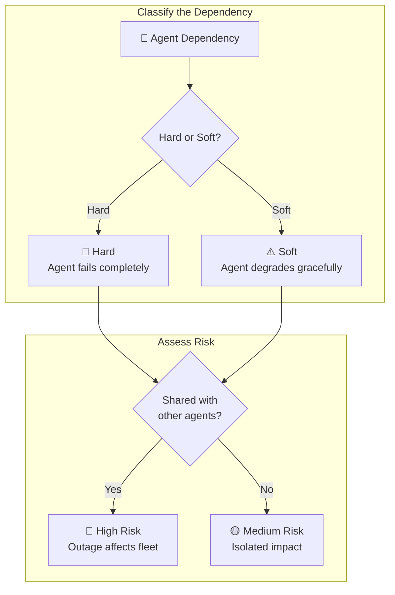

Your agents look fine. Green status, low error rates, tasks completing on schedule. Then someone rotates an API key on a Thursday afternoon and six agents fail at once. Nobody knew those six all called the same credential endpoint. Nobody had written it down.

That's the dependency problem. Not the model, not the prompts. The undocumented web of shared resources your agents draw from without anyone noticing.

A dependency map makes that web visible before it becomes a 2am incident.

## What a Dependency Map Actually Is

A dependency map is a record of every external resource an agent needs to run: APIs, databases, other agents, credentials, queues, file storage, webhooks, third-party services.

Two types of dependencies matter most:

**Hard dependencies** — the agent cannot run at all without them. A data pipeline agent that reads from a warehouse fails completely if the warehouse is down.

**Soft dependencies** — the agent degrades but still runs. A report-generation agent that pulls optional enrichment data from a secondary API can skip that step and still produce a useful output.

Knowing which is which changes how you alert, how you build fallbacks, and how you prioritize fixes.

## Step 1: List Every Agent You're Running

Start with your inventory. Get all agents in one place before you do anything else. In AgentCenter, your [agent dashboard](/features/agent-dashboard) shows every agent with current status — that's your starting list.

For each agent, write down:
- What it does (one sentence)
- Who owns it
- How often it runs

Don't skip this. You can't map dependencies for agents you haven't listed.

## Step 2: Audit What Each Agent Calls

For each agent, trace every external call it makes. Check for:

- API endpoints it hits, and which credentials it uses
- Databases or data stores it reads from or writes to
- Other agents it triggers or waits on
- Storage buckets or file systems it uses
- Queues or message brokers it produces to or consumes from
- Third-party services (email, Slack, CRMs, analytics tools)

The fastest approach: read the agent's code or configuration directly. If you can't do that, run it in a staging environment with network logging on and capture every outbound call.

Expect surprises. One team I know ran an audit and found their summary agent called 11 external endpoints. They thought it called 3.

## Step 3: Categorize Hard vs. Soft

For each dependency you find, answer two questions:

1. If this is unavailable, does the agent crash completely or just degrade?
2. Is this dependency shared with any other agent?

Mark each one as hard or soft. Then flag the shared ones — those are your highest-risk items.

## Step 4: Find the Shared Ones

Shared hard dependencies cause fleet-wide outages. A simple table captures this fast:

| Dependency | Type | Agents that use it |
|---|---|---|
| OpenAI API key | Hard | Agent A, Agent C, Agent G |
| Postgres production DB | Hard | Agent B, Agent D |
| Slack webhook | Soft | Agent A, Agent B, Agent E |
| S3 report bucket | Soft | Agent C, Agent F |

Any row with 3 or more agents in the last column is a risk concentration point. If OpenAI has an outage, every agent in that first row stops working. If your Postgres DB has a connection issue, agents B and D go down together.

That's worth knowing before it happens — not during.

## Step 5: Document It Where Your Team Can Find It

A dependency map nobody reads is just noise. Keep it somewhere your team actually opens:

- A single page in your internal wiki
- A Markdown file in your agent repository
- A comment block at the top of each agent's configuration file

Format matters less than location. If your team manages work in AgentCenter, pin a dependency summary note to each agent's task card. That keeps the context close to the work, not buried in a doc someone has to go looking for.

Update it when you add a new agent, change an integration, or rotate credentials. A recurring 4-week reminder to verify accuracy is enough for most teams.

## Step 6: Wire Dependencies Into Your Monitoring

A map without monitoring is documentation with no feedback loop. The real payoff comes when alerts reflect what you now know about dependencies.

In AgentCenter's [agent monitoring](/features/agent-monitoring) view, you can watch real-time status across your entire fleet. When a shared dependency shows stress — latency rising, errors spiking — you want to know which agents are at risk before they start failing.

Three alert rules worth setting up after you map:

- Alert when any agent with a hard dependency has 3 or more consecutive failures
- Alert when error rates spike across 2 or more agents that share a resource (that's almost always a shared dependency problem, not an individual agent problem)
- Route hard and soft dependency alerts differently — one needs an immediate response, the other can wait for business hours

## Common Mistakes

**Mapping once and never updating.** Agents change. A quarterly review is the floor; a trigger on every new agent or integration is better.

**Mapping only what you already know.** The dangerous dependencies are the ones nobody thought to mention. Do the network logging pass in Step 2 rather than just asking the engineer who built the agent.

**Treating all dependencies the same.** A soft dependency failure at 2am doesn't need a page. A hard shared dependency failure does. Alerts that don't distinguish between the two will burn out whoever is on call.

**Skipping agents built by other teams.** If another team's agent shares your credentials or database, they belong in your map too. Outages don't follow org chart boundaries.

## Bottom Line

A dependency map is not a complex artifact. It's a list: what each agent calls, whether it's hard or soft, and whether anything else uses the same resource. That list, kept current, changes how fast you respond to incidents, how confidently you design alerts, and how much time you waste debugging the wrong agent when something breaks.

Most teams build one after their first fleet-wide outage. Build it before that.

---

*The best time to set this up is before your agents start failing. [Try AgentCenter free for 7 days](/pricing) — cancel anytime.*
