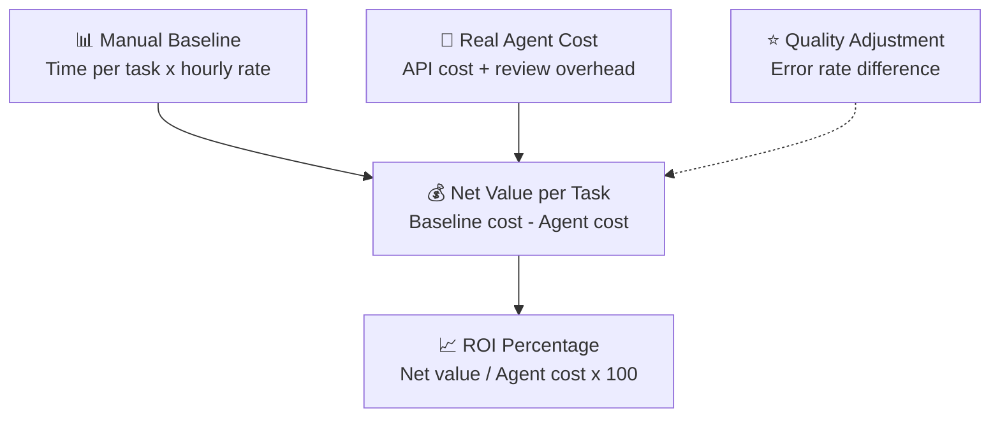

You've deployed agents. You're paying for API calls, compute, and team time to manage them. But can you actually prove they're worth it?

Most teams can't. They have a gut feeling that agents are saving work, but no number to show finance or leadership. That's a problem — especially when you're scaling from 3 agents to 15.

Here's how to measure AI agent ROI without a spreadsheet nightmare.

## What ROI Actually Means for AI Agents

ROI for AI agents isn't complicated in principle. It's:

**(Value delivered - Cost to run) / Cost to run**

The hard part is defining "value delivered." For most agent use cases, value breaks down into three types:

- **Time saved**: The agent does in 4 minutes what a human did in 45
- **Throughput gained**: The agent runs 24/7, handling volume a human couldn't match
- **Errors reduced**: The agent doesn't forget, fatigue, or skip steps

Pick the type that fits your use case first. A content research agent mostly delivers throughput. A QA agent mostly delivers error reduction. You need different measurements for each type — trying to measure all three at once usually ends with measuring none well.

## Step 1: Calculate Actual Agent Cost Per Task

This is the number most teams don't know. Start here.

Agent cost has two parts:

1. **LLM token cost** — what you pay your AI provider per task (Anthropic, OpenAI, Gemini, etc.)
2. **Infrastructure and management cost** — compute, hosting, and the time your team spends running the thing

In [AgentCenter's monitoring dashboard](/features/agent-monitoring), you can see per-agent cost data broken down by time period. Look at tasks completed and total spend, then divide. That's your cost per task.

If you don't have this instrumented yet, a rough estimate works: sum your monthly AI API bill plus any hosting costs, then divide by total tasks completed that month.

Example: $120/month in API costs, 800 tasks completed. Cost per task = $0.15.

## Step 2: Baseline the Manual Equivalent

Before you can claim ROI, you need to know what the agent replaced.

Interview the person who used to do this work (or still does for part of the volume). Ask:

- How long does this task take manually?
- How often do errors happen in manual runs?
- What's the hourly rate for this work?

Example: A data extraction task took a contractor 20 minutes each time at $35/hour. That's $11.67 per task manually versus $0.15 by agent.

Write this number down. It's your comparison point. Without it, you're just looking at costs with nothing to compare against.

## Step 3: Account for Human Review Time

Here's where most ROI calculations break down. They ignore the time humans spend reviewing, correcting, or re-running agent outputs.

If your agent completes 100 tasks but 30% need human review (10 minutes each), that's 5 extra person-hours per 100 tasks. At $35/hour, that's $175 in hidden cost — which turns a $15 agent run into a $190 run after review overhead.

Track your real rejection rate. In [AgentCenter's approval workflows](/features/agent-dashboard), you can see exactly how many tasks get flagged for review — that's your real review rate, not a guess.

Adjust your agent cost per task upward:

**Real cost = API cost + (review rate x review time x hourly rate)**

## Step 4: Measure Throughput and Output Quality

Now the value side.

**Throughput**: How many tasks does the agent complete per week? Compare to what a human could do in the same time. An agent completing 500 tasks/week where a human could do 80 is a 6x throughput multiplier. That matters even when per-task savings are small.

**Quality**: This is harder to track. Pick one proxy metric:
- Output acceptance rate (what share of agent outputs go straight to production without edits)
- Downstream error rate (fewer support tickets, fewer bug reports, faster cycle times after agent deployment)
- Direct comparison to historical human error rate

Pick one and track it consistently. Don't swap metrics mid-measurement or you'll never have a comparable baseline.

## Step 5: Run the Numbers

With all these inputs, the calculation is just arithmetic.

Working through the example:
- Manual cost per task: $11.67
- Agent cost per task after review overhead: $0.50
- Net value per task: $11.17
- ROI: $11.17 / $0.50 x 100 = 2,234%

That's a real number from a data extraction workflow. The ROI is high because the manual baseline was expensive and slow. For tasks where human work was already cheap or fast, the math looks different — and sometimes the honest answer is "this agent isn't worth it yet."

## Real Example: Seeing It in Practice

One team ran 8 agents across content research and data work. They had no visibility into whether any of them were net positive. After setting up AgentCenter, they could see:

- Per-agent cost by week, not just blended monthly totals
- Task completion rate and rejection rate per agent
- Which agents were expensive relative to their output volume

Two of the 8 agents were costing more than equivalent manual work once review time was factored in. They removed one, adjusted the other's prompt instructions, and cut overall spend by 22% with no drop in throughput.

That's what tracking ROI actually gives you — not a number to show a slide deck, but decisions about which agents to keep and which to rework.

## Common Mistakes

**Measuring too early.** Agents often need 2-4 weeks to stabilize. Error rates drop as you tune prompts. ROI measured in week 1 is usually worse than week 6 — and some teams kill useful agents because they checked the numbers too soon.

**Ignoring review time.** If humans are checking every output, you don't have automation — you have an AI drafting service. Factor in review cost or you'll report ROI that doesn't hold up to scrutiny.

**Using a theoretical baseline.** Don't compare to "how long this should take" — compare to how long it actually took. The theoretical version is usually faster than reality.

**Measuring only cost, not capacity.** Sometimes the real ROI isn't cheaper work — it's more work done with the same team. That's a capacity argument, and it's often more compelling to leadership than a pure cost reduction story.

## Bottom Line

Three numbers: what the agent actually costs per task (including review overhead), what the manual baseline costs, and what output quality looks like.

If you don't have these numbers today, you're guessing. Pick your highest-cost agent, get 2 weeks of real data, and run the arithmetic. You'll either confirm it's worth running or find out early that it isn't — either way, you'll know.

---

*The best time to set this up is before your agents start failing. [Try AgentCenter free for 7 days](/pricing) — cancel anytime.*
