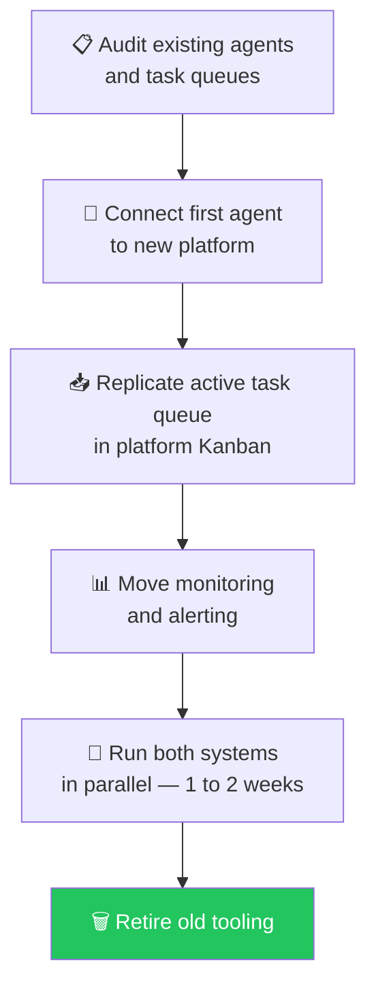

At some point, the homegrown setup stops working.

You started with a cron job, a shared spreadsheet, and a Slack channel where someone posts "agent done" when a task finishes. That was fine for two agents. Then you added four more, then eight, and now you're spending 30 minutes every week untangling which agent ran what, when, and whether the output was any good.

That's when teams start looking for a dedicated platform. But the migration is the part nobody talks about. Here's how to do it without breaking what's already running.

## What DIY Agent Management Actually Looks Like

Most DIY setups have some version of these pieces:

- A task queue living in a spreadsheet or Notion doc
- Manual triggers — someone runs a script or clicks a button
- Logs piped to a file or Slack
- Costs tracked (sometimes) in a separate billing dashboard
- Output review done via email thread or shared folder

This works. Until it doesn't. The failure mode isn't dramatic — it's gradual. Agents run without anyone checking outputs. Costs creep up. Someone leaves and half the knowledge of how the setup works walks out with them.

A dedicated platform replaces all of that with a single control layer: task management, monitoring, review, and cost tracking in one place.

## Before You Migrate: Audit What You Have

Don't move chaos from one system to another. Before connecting anything to a new platform, document what's actually running.

Work through these questions for every agent:

- What does this agent do? Who owns it?
- How does it receive tasks today?
- What does a completed task look like — where does output go?
- What breaks most often?

If you can't answer these for every agent, you have a visibility problem that a new platform won't fix on its own. Write it down first. Even a rough list is fine.

## The Migration Process

The right order matters. Teams that migrate everything at once tend to break things. Teams that migrate one agent at a time don't.

### Step 1: Connect One Agent First

Pick the agent you understand best — usually the simplest one — and connect it to the new platform first.

In AgentCenter, this means adding the agent to a project and pointing it at a task queue. The agent picks up tasks from the platform instead of your old trigger. Run it for a few days. Make sure outputs show up in the deliverables view. Make sure the heartbeat is showing active.

Only move to the next agent after the first one feels solid.

### Step 2: Replicate Your Task Queue

Your spreadsheet or Notion doc has tasks in some form. Recreate that structure in the platform's [Kanban board](/features/task-orchestration).

Don't dump everything in at once. Start with the active backlog — tasks that need to happen this week. Historical tasks can stay in the old system. The goal is to stop creating new rows in the old spreadsheet, not to archive everything you've ever done.

Each task gets a card with the agent assigned, status, priority, and linked deliverable. That replaces the manual status column you were maintaining by hand.

### Step 3: Move Monitoring and Alerting

This is where most migrations stall. Teams keep checking old logs even after the agent is running on the new platform because the new [monitoring dashboard](/features/agent-monitoring) doesn't feel familiar yet.

Set up your alerts in the new platform before you stop watching the old logs. In AgentCenter, you can track task completion time and get notified when an agent goes idle unexpectedly. Get those alerts working on the new platform first, then stop watching the old setup.

Practical tip: run both in parallel for two weeks. If you see something in the old logs that the new platform missed, that's a signal you need to tune your monitoring configuration.

### Step 4: Migrate Cost Tracking

If you're pulling LLM costs from a billing dashboard and reconciling manually, a dedicated platform gives you per-task attribution instead of monthly aggregates.

Connect your OpenClaw-compatible agents so cost gets attributed per task, per agent, per project. You'll immediately see which agents are expensive. That's information your old setup probably didn't give you at that level of detail.

### Step 5: Run Both Systems in Parallel

Don't flip a switch and cut over overnight. Keep your old system read-only — no new tasks — while the new platform becomes primary. This gives you a window where:

- New tasks go into the new system
- Agents run from the new system
- Old logs are still available for historical context
- You can compare behavior between the two setups

After two weeks, if nothing is broken, retire the old tooling.

## Common Mistakes

**Migrating everything at once.** It feels cleaner but it's risky. One agent migrated well is worth more than eight migrated badly.

**Not cleaning up the task backlog first.** If your old spreadsheet has 200 tasks and 180 of them are stale, don't import them. Prune first, then migrate. A clean task queue in the new platform is one of the best side effects of doing this migration right.

**Expecting the platform to fix broken agent logic.** A control plane gives you visibility. It doesn't fix an agent that consistently produces bad output. If an agent was unreliable before, you'll just see the unreliability more clearly — which is useful, but not a fix.

**Skipping the parallel run period.** Two weeks of running both systems feels wasteful. It isn't. The parallel period catches the things you forgot to migrate and builds your team's confidence in the new setup before you depend on it fully.

## What Changes After Migration

The clearest change isn't the tooling — it's the time you stop spending on coordination overhead. No more checking five places to understand what's running. No more manual status updates. No more "did agent X finish that task?" messages in Slack.

You end up with a dashboard that shows every agent, every task, and every output in one place. That's what makes it possible to go from 8 agents to 20 without things falling apart.

## Bottom Line

Migrating from DIY agent management is less complicated than it looks. Audit before you move, connect one agent at a time, run both systems long enough to trust the new one, then shut off the old one.

The old setup got you here. The new one gets you to whatever comes next.

---

*The best time to set this up is before your agents start failing. [Try AgentCenter free for 7 days](/pricing) — cancel anytime.*
