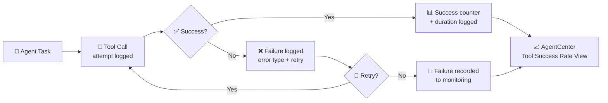

Most agents don't fail because the model made a bad decision. They fail because a tool call returned a 429, an API timed out, or a database query came back empty when it shouldn't have. By the time a task is marked failed, the problem started three tool calls earlier.

If you're only watching task completion rates, you're watching the wrong thing.

## What Tool Call Success Rate Actually Means

Every production AI agent calls external tools — search APIs, databases, code interpreters, webhook endpoints, third-party services. Each call either succeeds or fails. Tool call success rate is just:

**successful calls / total calls × 100**, per tool, per agent, per time window.

A single agent with 94% task completion can have one tool running at 60% success — and that tool is costing you tokens on retries, corrupting outputs downstream, and hiding a real infrastructure problem. Task-level metrics don't show you this. Tool-level metrics do.

## Step 1: Catalog Every Tool Your Agents Use

Before you can monitor anything, you need a list. Go through each agent and write down:

- Every external API it calls
- Every database or datastore it reads from or writes to
- Every internal service it hits (auth, search, config)
- Every code execution or file system operation it triggers

Most teams have 3–6 distinct tools per agent. A pipeline with 5 agents can easily have 20+ distinct tool endpoints — each a potential failure point.

## Step 2: Enable Tool Call Logging at the Runtime Layer

Your agent runtime (OpenClaw or whatever you're using) needs to log each tool call with at minimum:

- Tool name
- Timestamp
- Success or failure
- Error type on failure (timeout, rate limit, 4xx, 5xx, empty response)
- Duration

Don't log just the final result. Log every attempt, including retries. A tool call that succeeded on the third try is not a success — it's a hidden problem that cost you two extra API calls and probably 800ms.

## Step 3: Calculate Success Rates by Tool, Not Just by Task

Once you have logs, group them. For each tool in your fleet, calculate:

- Success rate over the last 24 hours
- Success rate broken down by hour (to catch degradation patterns)
- Average duration for successful calls vs. failed calls
- Retry rate per tool

You want this per-tool, per-agent view. "Your agents collectively called the enrichment API 4,200 times yesterday, and 312 of those failed" is useful. "Agent B had a 91% success rate on enrichment API calls while Agent A had 99%" is the signal that tells you something specific is wrong with how Agent B is calling that API.

## Step 4: Set Thresholds That Match the Tool's Risk Level

Not all tool failures are equal. Losing 5% of image generation calls is annoying. Losing 5% of payment record lookups is a production incident.

Set alert thresholds based on:

- **Business criticality**: Data writes, payment flows, and customer-facing outputs warrant tighter thresholds (99%+)
- **Retry tolerance**: Tools that agents already retry aggressively can tolerate lower raw success rates — but watch your retry volume instead
- **Expected baseline**: Some external APIs run at 97% SLA by design — don't alert at 98%

A good starting point: flag any tool below 95% success rate, and immediately alert on anything below 90%.

## Step 5: Watch for Degradation, Not Just Failure

A tool running at 99% success that drops to 94% over three hours is a different problem from a tool sitting at 85% all day. Both are issues, but the degradation pattern tells you the cause is different — likely a third-party provider degradation, a quota limit being approached, or a recent deployment on their side.

In [AgentCenter's agent monitoring view](/features/agent-monitoring), each task's activity feed shows the tool calls made during execution — including which ones failed and how many times the agent retried before giving up or succeeding. This gives you per-task visibility without needing to build a separate logging pipeline.

For fleet-wide tool call trends, you can cross-reference the activity feeds across tasks assigned to specific agents or projects to spot which tool is causing repeat failures.

## Common Mistakes

**Only tracking task-level success.** A task that failed tells you something went wrong. Per-tool success rates tell you what went wrong and where. You need both.

**Treating retries as success.** If your agent retried 4 times and finally got a response, your tool call "succeeded" — but you paid for 4 API calls, 3 seconds of latency, and potentially 3,000 tokens in the retry context. Track retries as a separate metric.

**Setting uniform thresholds across all tools.** A 95% success rate on a low-stakes enrichment API is fine. A 95% success rate on the tool that writes confirmed orders to your database is a disaster. Calibrate thresholds to what the tool actually does.

**Ignoring slow successes.** A tool call that takes 8 seconds but technically succeeds is a problem. Include P95 and P99 latency alongside success rate — a slow tool is often a degrading tool.

## Bottom Line

Task completion rate is a lagging indicator. By the time it drops, the damage is already done. Tool call success rates are a leading indicator — they show you which tools are getting flaky before they start dragging your agents down.

Start by logging every tool call with success/failure and error type. Group by tool. Set thresholds that match business risk. And watch for degradation trends, not just absolute failures.

That's the setup. It's not complicated. It just has to exist before your agents need it.

---

*The best time to set this up is before your agents start failing. [Try AgentCenter free for 7 days](/pricing) — cancel anytime.*
